# Руководство администратора: развёртывание и эксплуатация сервера лицензирования на Ubuntu 24.04

| Параметр | Значение |
|---|---|
| История бэклога | E17-02 |
| Версия сервера | 0.6.3 (выпуск 1.0.0 — после readiness gate) |
| Для кого | Администраторы АЛМИ (центральный сервер), администраторы заказчиков (локальный сервер) |
| Связанные документы | Руководство оператора — `docs/user-guide.md`; установка в закрытом контуре — `docs/operations/airgap-install.md`; резервное копирование — `docs/operations/backup.md`; прототипы продуктов — `prototypes/README.md` |

Руководство описывает то, что есть в коде этой версии: комплекты `deploy/central` и `deploy/local`, их скрипты, переменные и проверки. Выводы команд на снимках — настоящие: они получены установкой этих комплектов на чистый хост. Расхождения со спецификациями собраны в разделе 16.

## Содержание

1. Что разворачивается
2. Требования к хосту
3. Подготовка Ubuntu 24.04
4. Центральный сервер: установка по шагам
5. Пробный сервер для проверок и обучения
6. Резервное копирование и восстановление
7. Локальный сервер заказчика
8. Обновление и откат
9. Проверка продуктами после установки
10. Ключи: церемония, пакет доверия, перевыпуск
11. Ежедневная эксплуатация
12. Мониторинг и журналы
13. Безопасность хоста
14. Типовые неисправности
15. Справочник файлов, переменных и команд
16. Расхождения со спецификациями

---

## 1. Что разворачивается

| Сервер | Где | Комплект | Откуда образы | Ключ подписи аренд |
|---|---|---|---|---|
| Центральный | Контур АЛМИ, `license.alter-os.ru` | `deploy/central` в копии репозитория | Собираются на хосте из репозитория | Ключ выпуска, сертифицированный корневым ключом на церемонии |
| Локальный | Сеть заказчика, в том числе без интернета | Архив `almi-license-local-<версия>.tar.gz` (`make bundle-airgap`) | Из архива (`docker load`) | Ключ сервера: его создаёт мастер первого запуска, сертификат выдаёт центральный сервер |

Оба комплекта — один образ сервера в разных режимах (`DEPLOYMENT_MODE=central` или `local`) и одинаковый набор сервисов Docker Compose:

| Сервис | Образ | Назначение |
|---|---|---|
| `db` | `postgres:17` | База данных; том `db` |
| `migrate` | `almi-license` | Миграции от имени владельца таблиц `almi`, затем права роли приложения `almi_app`; завершается |
| `api` | `almi-license` | Product API, Admin API, Sync API, адаптеры совместимости. Gunicorn и Uvicorn на `:8000` внутри сети compose |
| `worker` | `almi-license` | Очередь задач: автоосвобождение, пересчёт состояний, отчёты и обмен с центральным сервером |
| `console` | `almi-license-console` | Статика консоли (Nginx) |
| `gateway` | `nginx:1.27` | TLS на `HTTPS_PORT` (443). Маршруты `/api/`, `/apps/`, `/.well-known/`, `/health`, `/ready` ведут к API, остальное — к консоли. На центральном сервере `/api/activate/` отвечает 404: регистрацию АльтерОС этапа 1 обслуживают локальные серверы (решение E11-03, `legacy-activate.locations`) |
| `backup` | `postgres:17` | Профиль `ops`: запускается только из `./backup.sh` и `./restore.sh` |

Наружу открыт только `gateway`. База, API и `/metrics` доступны лишь внутри сети compose.

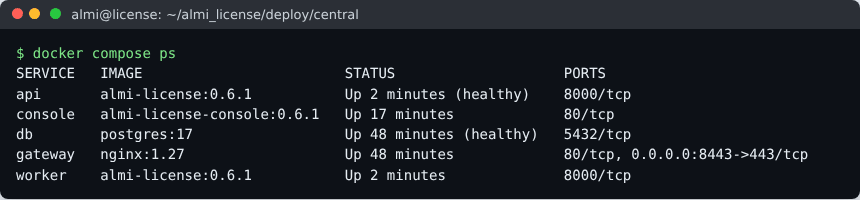

Кто и как обращается к серверу:

| Клиент | Адрес | Протокол |
|---|---|---|
| АльтерОфис Desktop и другие продукты с модулем DL | `/api/v1/…`, `/.well-known/almi-license` | Product API v1: подписанные запросы, аренды |
| АльтерОфис Web (Nextcloud, приложение `support`) | `/apps/zammad_organisation_management/api/query/subscription/{ключ}` | Адаптер подписки |
| АльтерОС (`registration.sh`) | `/api/activate/` | Адаптер ЛК |
| Локальные серверы заказчиков | `/api/sync/v1/…` | Регистрация, пакеты, отчёты |
| Операторы | `/` (консоль), `/api/admin/…` | Браузер |
| Пользователи без сети | `/offline` | Портал офлайн-активации |

## 2. Требования к хосту

| Ресурс | Центральный | Локальный |
|---|---|---|
| ОС | Ubuntu Server 24.04 LTS, x86-64 | Ubuntu Server 24.04 LTS (или другой Linux с Docker 24+) |
| Процессор и память | 4 vCPU, 8 ГБ | 2 vCPU, 4 ГБ |
| Диск | 100 ГБ SSD | 40 ГБ |
| Сеть | Входящий 443. Исходящий к Docker Hub, PyPI, npm — на время сборки образов | Входящий 443 из сети заказчика. Исходящий к центральному серверу — только для обмена по сети |
| Имя и TLS | DNS-имя и сертификат от публичного или корпоративного CA | Имя в сети заказчика и сертификат CA заказчика |
| Время | `systemd-timesyncd` или chrony; допуск ±5 минут | То же |

Нагрузочная цель этапа 1 — 100 проверок и 20 активаций в секунду при p95 до 500 мс (`make load`).

## 3. Подготовка Ubuntu 24.04

### 3.1. Пакеты и время

```sh
sudo apt update && sudo apt -y full-upgrade
sudo apt -y install ca-certificates curl git openssl gnupg ufw
timedatectl set-ntp true && timedatectl status   # "System clock synchronized: yes"
```

### 3.2. Docker Engine и плагин compose

В Ubuntu 24.04 пакет `docker.io` не содержит плагина compose, поэтому ставьте Docker из репозитория Docker:

```sh
sudo install -m 0755 -d /etc/apt/keyrings
curl -fsSL https://download.docker.com/linux/ubuntu/gpg | sudo gpg --dearmor -o /etc/apt/keyrings/docker.gpg
echo "deb [arch=$(dpkg --print-architecture) signed-by=/etc/apt/keyrings/docker.gpg] https://download.docker.com/linux/ubuntu noble stable" \
  | sudo tee /etc/apt/sources.list.d/docker.list > /dev/null
sudo apt update && sudo apt -y install docker-ce docker-ce-cli containerd.io docker-buildx-plugin docker-compose-plugin
docker version --format '{{.Server.Version}}'    # 24 или новее
docker compose version
```

Журналы контейнеров хранятся на хосте 14 дней (раздел 11 документа 7). Ограничьте их размер в `/etc/docker/daemon.json` и выполните `sudo systemctl restart docker`:

```json
{ "log-driver": "json-file", "log-opts": { "max-size": "50m", "max-file": "10" } }
```

**Корпоративный прокси.** Если выход в интернет только через прокси, Docker нужно настроить дважды:
- для загрузки образов — systemd override `/etc/systemd/system/docker.service.d/proxy.conf` с `Environment=HTTPS_PROXY=…`;
- для сборки — `~/.docker/config.json` пользователя `almi`, раздел `"proxies": {"default": {"httpsProxy": "…", "noProxy": "localhost,127.0.0.1"}}`. Docker сам передаёт эти значения в `docker build`.

Если прокси подменяет сертификаты, в образ сборки нужен корень прокси. Проще собрать образы на машине с прямым доступом и перенести их через `docker save` / `docker load`, а установку выполнить с `ALMI_SKIP_BUILD=1` (раздел 4.6).

### 3.3. Учётная запись и межсетевой экран

```sh
sudo useradd -m -s /bin/bash -G docker almi   # администратор сервера; членство в группе docker равносильно root
sudo ufw allow OpenSSH && sudo ufw allow 443/tcp && sudo ufw enable
```

Docker публикует порты в обход правил ufw. Поэтому в compose наружу открыт только `gateway`.

## 4. Центральный сервер: установка по шагам

### 4.1. Код

```sh
sudo mkdir -p /opt/almi && sudo chown almi: /opt/almi
sudo -iu almi
git clone https://github.com/ayurasov/almi_license.git /opt/almi/almi_license
cd /opt/almi/almi_license && git checkout v1.0.0     # тег выпуска
cd deploy/central
```

### 4.2. Настройки `.env`

Скопируйте `.env.example` в `.env` (иначе это сделает `install.sh`) и задайте значения:

| Переменная | Значение |
|---|---|
| `ALMI_VERSION` | Тег образов, например `1.0.0`; виден в `/.well-known/almi-license` |
| `SERVER_NAME` | Публичное имя. Из него получаются `LEASE_ISSUER = https://SERVER_NAME`, `ALLOWED_HOSTS` и доверенные источники CSRF |
| `HTTPS_PORT` | 443. Другой порт допустим, консоль работает и на нём |
| `TRUST_ROOTS` | Открытые корневые ключи АЛМИ `kid:pub` через запятую — из `root.pub.json` церемонии |
| `TRUST_BUNDLE_FILE` | `/etc/almi/trust/trust.json`; сам файл кладётся в `./trust/` |
| `WEB_CONCURRENCY`, `DATABASE_POOL_MAX_SIZE` | Процессы API и соединения каждого (2 и 10). Произведение плюс обработчик должно быть меньше `max_connections` = 100 |
| `LOG_LEVEL` | `INFO` |

Остальные параметры — значения по умолчанию из `server/almi_license/settings/base.py`:
- лимиты частоты `RATE_LIMIT_*`, раздел 4.7 документа 2;
- `OFFLINE_CAPTCHA_AFTER` — капча портала.

Их можно переопределить в `docker-compose.override.yml`, в разделе `environment` нужного сервиса.

### 4.3. Первый запуск `install.sh` — ключ выпуска

```sh
./install.sh
```

Скрипт:
- проверяет Docker;
- создаёт секреты в `secrets/` (каталог 0700): пароли ролей `almi` и `almi_app`, ключ Django, пароль резервных копий;
- собирает образы;
- создаёт **ключ выпуска** `keys/issuer.key` и его открытую часть `keys/issuer.pub`.

Закрытая часть создаётся на этом хосте генератором ОС и его не покидает. Без сертификата ключа скрипт останавливается:

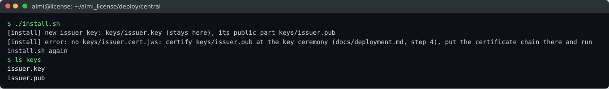

### 4.4. Сертификат ключа выпуска (церемония)

Церемония проводится на офлайн-рабочем месте с продуктивным корнем, под двойным контролем (E17-04, `tools/almi-keytool/README.md`). На неё приносят только `keys/issuer.pub`:

```sh
uv run almi-keytool issue-cert --root ./root/root.key.json --subject-pub issuer.pub \
    --role issuer --kid c-2026-01 --valid-days 365 --out issuers/c-2026-01.jws
uv run almi-keytool export-trust --root ./root/root.key.json --issuers ./issuers --out trust.json
```

На сервер переносятся только открытые файлы:

| С церемонии | На сервер |
|---|---|
| `issuers/c-2026-01.jws` | `keys/issuer.cert.jws` |
| `trust.json` | `trust/trust.json` |
| `kid` и `pub` из `root.pub.json` | `TRUST_ROOTS=root-2026:<pub>` в `.env` |

Корневой ключ и его пароль на сервер не попадают никогда.

### 4.5. TLS

Положите сертификат с промежуточными и ключ в `tls/server.crt` и `tls/server.key`. Если их нет, `install.sh` создаст самоподписанный сертификат на 825 дней — только для проб: модуль DL проверяет сертификат по системному хранилищу и проверку не отключает.

Let's Encrypt, если сервер доступен из интернета:

```sh
sudo apt -y install certbot
K=/opt/almi/almi_license/deploy/central
sudo certbot certonly --standalone -d "$SERVER_NAME" \
  --pre-hook  "docker compose -f $K/docker-compose.yml stop gateway" \
  --post-hook "cp /etc/letsencrypt/live/$SERVER_NAME/fullchain.pem $K/tls/server.crt && cp /etc/letsencrypt/live/$SERVER_NAME/privkey.pem $K/tls/server.key && chmod 644 $K/tls/* && docker compose -f $K/docker-compose.yml start gateway"
```

Продление выполняет таймер `certbot.timer` с теми же хуками.

### 4.6. Второй запуск — установка и первый администратор

```sh
ADMIN_USER=admin ./install.sh
```

Пароль администратора вводится без отображения, длина — не меньше 12 символов. Скрипт:
1. Выполняет миграции.
2. Запускает `api`, `worker`, `console` и `gateway`; готовности ждёт до 10 минут.
3. Загружает каталог продуктов.
4. Создаёт администратора.
5. Выполняет `check.sh`.

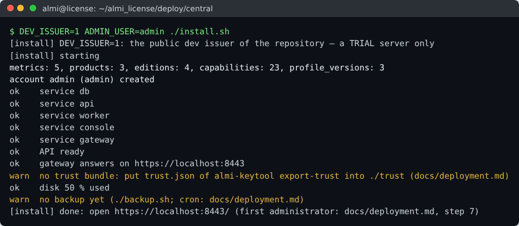

Если образы собраны на другой машине и загружены `docker load`, сборка не нужна:

```sh
docker load -i almi-license-1.0.0.tar && docker load -i almi-license-console-1.0.0.tar
ALMI_SKIP_BUILD=1 ADMIN_USER=admin ./install.sh
```

### 4.7. Проверка

```sh
./check.sh
curl -fsS https://$SERVER_NAME/.well-known/almi-license    # версия, протокол, адреса
curl -fsS https://$SERVER_NAME/ready
```

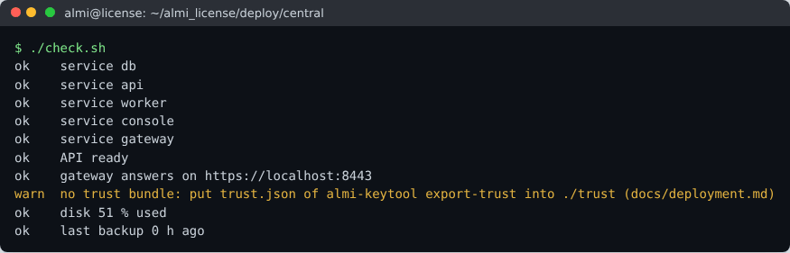

`check.sh` проверяет:
- службы и готовность API;
- ответ шлюза;
- пакет доверия;
- заполнение диска (предупреждение с 80 %, ошибка с 90 %);
- возраст последней копии.

Код возврата 1 — нужно вмешательство, причина названа в выводе. Предупреждения о пакете доверия и копиях снимаются шагами 4.4 и 6.

### 4.8. Вход в консоль и данные

Откройте `https://SERVER_NAME/` и войдите администратором. Консоль называется «АЛицензия»; после входа открывается «Обзор» (руководство оператора, раздел 3.1).


Дальше:
- создайте учётные записи операторов на экране «Пользователи» (`docs/user-guide.md`, раздел 14) или командой `docker compose run --rm api manage create_account --username <имя> --role operator|admin|customer_viewer`;
- загрузите лицензии из выгрузки ЛК на экране «Импорт» (руководство оператора, раздел 7);
- проверьте на экране «Профили», что все профили в режиме `monitor` — так требует выпуск 1.0.

## 5. Пробный сервер для проверок и обучения

Для ручных проверок, обучения операторов и отладки продуктов разверните пробный сервер на отдельной ВМ с публичными dev-ключами репозитория:

```sh
cd deploy/central && cp .env.example .env    # SERVER_NAME — имя ВМ
DEV_ISSUER=1 ADMIN_USER=admin ./install.sh
(umask 077; docker compose run --rm -T api manage seed_minimal --trial --out - > seed-keys.json)
```

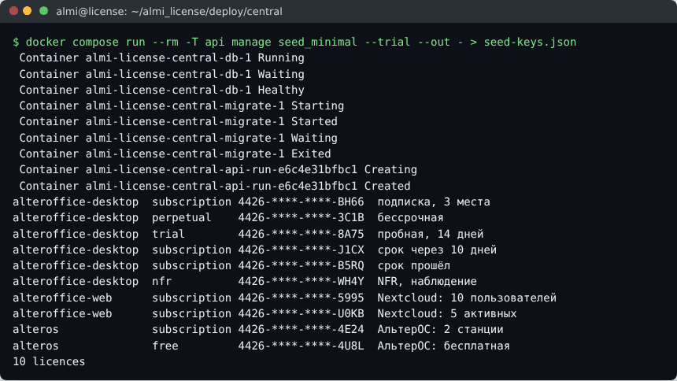

Набор seed-minimal (документ 7, раздел 4) — 3 тестовых заказчика и 10 лицензий всех продуктов и типов: подписка, бессрочная, пробная, срок через 10 дней, срок прошёл, NFR в наблюдении, Nextcloud с лимитами, АльтерОС. Полные ключи — только в `seed-keys.json`, храните его как секрет стенда.

Пробный сервер подписывает аренды dev-ключом. Их принимают только сборки модуля с `LM_TRUST_ROOTS=dev`: прототипы `prototypes/` и `lm-demo`. Продуктивные сборки такую аренду отвергнут. Для продуктива пробный сервер не годится: закрытый dev-ключ опубликован.

## 6. Резервное копирование и восстановление

`./backup.sh` создаёт копию в `backups/`:
- `pg_dump -Fc`, зашифрованный gpg (AES-256);
- сумма SHA-256 рядом;
- метка `last-success` — её видят `check.sh` и метрика `almi_backup_age_seconds`.

Копии хранятся 30 дней (`BACKUP_KEEP_DAYS`).

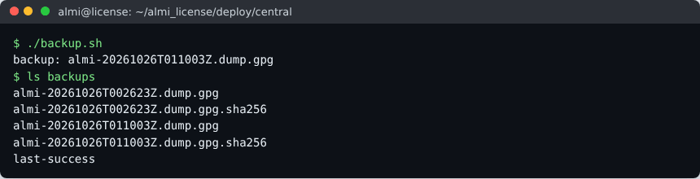

Расписание — в crontab пользователя `almi` (`crontab -e`):

```cron
17 2 * * * /opt/almi/almi_license/deploy/central/backup.sh >> /opt/almi/backup.log 2>&1
47 2 * * * rsync -a /opt/almi/almi_license/deploy/central/backups/ backup-host:/srv/almi-license/
```

Обязательно:
- копируйте `backups/` за пределы хоста;
- храните `secrets/backup_passphrase` отдельно от копий: без него копию не восстановить;
- раз в квартал проводите учение восстановления (`docs/operations/backup.md`, `make backup-drill`). Цель — восстановление не дольше 4 часов.

Вне копий базы сохраните:
- `keys/issuer.key` — в сейфе, как секрет. При утрате ключ выпуска перевыпускается на церемонии (раздел 10.3);
- `.env` и `tls/`;
- у локального сервера — ключ сервера: `backup.sh` копирует его отдельно и зашифрованно.

**Восстановление:**

```sh
./restore.sh backups/almi-20261026T002623Z.dump.gpg
```

Скрипт выполняет по порядку:
1. Останавливает API, обработчик и шлюз.
2. Проверяет сумму SHA-256.
3. Восстанавливает базу.
4. Снова выдаёт права `almi_app`.
5. Проверяет цепочку журнала аудита (`verify_audit`).
6. Запускает сервисы и выполняет `check.sh`.

## 7. Локальный сервер заказчика

Подробная инструкция для заказчика лежит в комплекте и в `docs/operations/airgap-install.md`. Порядок:

1. **Сборка комплекта в АЛМИ.** Команда `VERSION=1.0.0 TRUST_ROOTS=root-2026:<pub> tools/build_airgap_bundle.sh out/` создаёт архив с образами, compose, скриптами и `SHA256SUMS`. С `SBOM_DIR=dist/sbom` (после `make sbom VERSION=1.0.0`) комплект получает каталог `sbom/`: состав образов и лицензии (`docs/sbom.md`).
2. **Docker на хосте заказчика** — раздел 3. Без интернета пакеты `.deb` Docker из `download.docker.com/linux/ubuntu/dists/noble/pool/stable/amd64/` переносятся вместе с комплектом и ставятся командой `sudo apt install ./*.deb`.
3. **Установка.** Распакуйте комплект в `/opt/almi`, задайте `SERVER_NAME` и `HTTPS_PORT` в `.env`, положите сертификат CA заказчика в `tls/` и выполните `./install.sh`.
4. **Администратор.** `docker compose run --rm api manage create_account --username admin --role admin`.
5. **Регистрация.** Оператор АЛМИ создаёт локальный сервер и выдаёт код регистрации (руководство оператора, раздел 10). Администратор заказчика вводит код в мастере первого запуска и выбирает обмен по сети или файлами.

   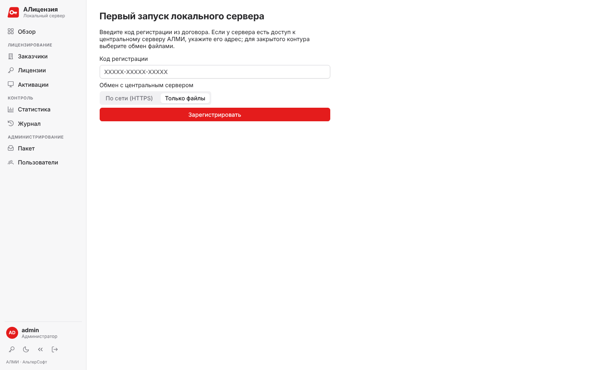

6. **Пакет прав.** При обмене файлами запрос `.alk-req` уходит оператору, а полученный пакет `.alk` загружается на экране «Пакет».

   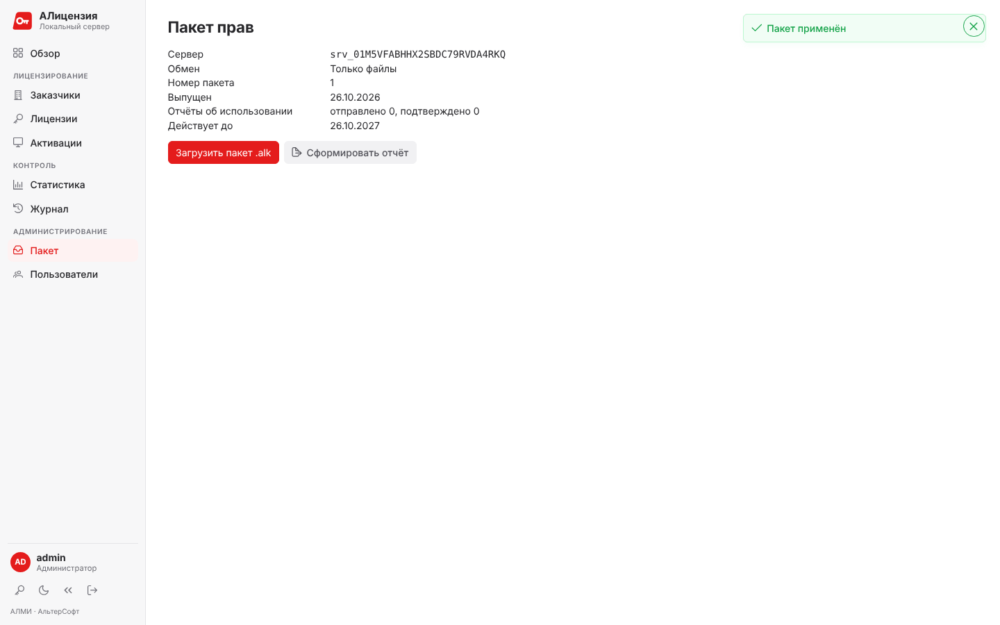

7. **Проверка.** `./check.sh` проверяет службы, доступность каталога ключа сервера для записи, регистрацию, срок пакета, отчёты, диск и копии.

   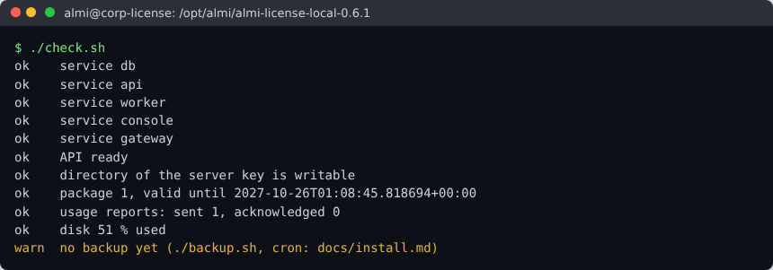

Продукты заказчика указывают адрес локального сервера. Централизованно это свойство MSI `LICENSE_SERVER_URL` или переменная `ALMI_LICENSE_SERVER_URL`. Уже активированные продукты переводятся командой «Перевести на другой сервер» из консоли центрального сервера.

## 8. Обновление и откат

**Центральный сервер:**

```sh
cd /opt/almi/almi_license && git fetch --tags && git checkout v1.0.1
cd deploy/central && NEW_VERSION=1.0.1 ./upgrade.sh
```

`upgrade.sh`:
1. Снимает копию и сохраняет `.env` и имя копии в `previous/`.
2. Собирает образы новой версии.
3. Меняет `ALMI_VERSION`.
4. Применяет миграции. Если миграция не прошла, сам выполняет `rollback.sh`.
5. Запускает сервисы, загружает каталог, выполняет `check.sh`.

`./rollback.sh` возвращает предыдущую версию:
- образы и прежний `.env`;
- базу из копии, снятой перед обновлением. Схема очищается до восстановления, чтобы таблицы новых миграций не мешали.

Изменения, сделанные после обновления, при откате теряются. Решение об откате принимает технический лидер, например если в первые 2 часа доля 5xx Product API выше 1 %. Продукты с модулем в режиме `monitor` продолжают работать и при недоступном сервере.

**Локальный сервер:** `./upgrade.sh /путь/к/новому/комплекту` и `./rollback.sh` (`docs/operations/airgap-install.md`).

## 9. Проверка продуктами после установки

Пробный сервер проверяется прототипами продуктов (`prototypes/README.md`). Это те же вызовы, что у настоящих продуктов:

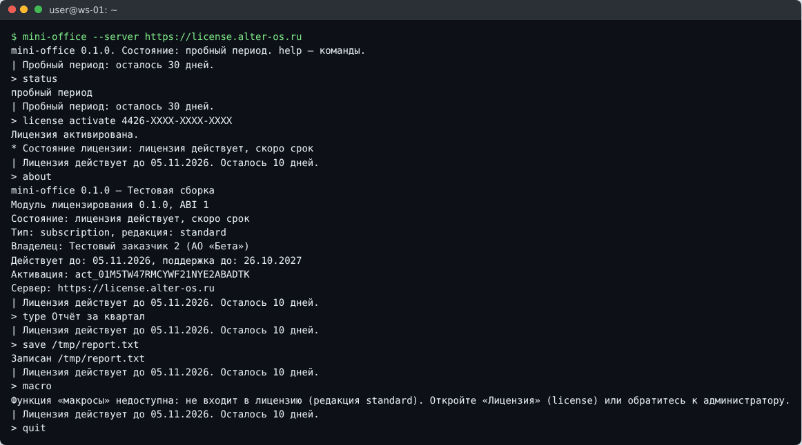

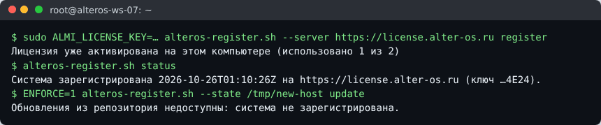

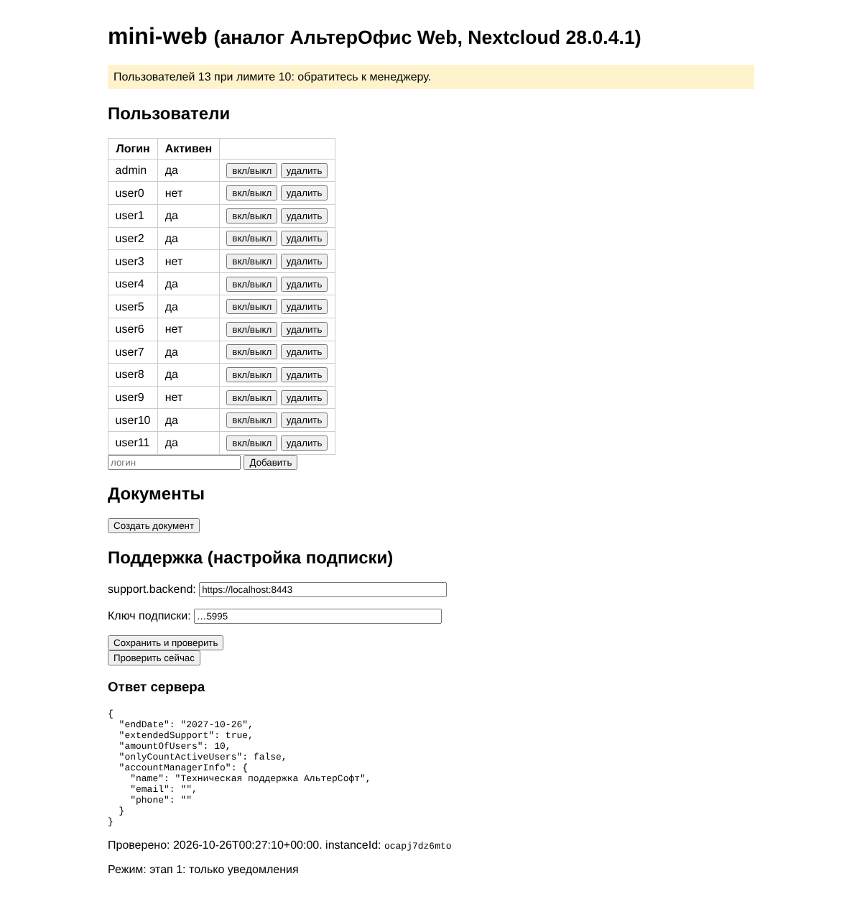

Полная проверка соответствия продукта по 20 пунктам раздела 18 документа 2 — `tools/conformance/README.md` и `make e2e-stand`.

Продуктивный сервер проверяется служебной лицензией и выпускной сборкой продукта (шаг 8 порядка выпуска, документ 7).

## 10. Ключи: церемония, пакет доверия, перевыпуск

### 10.1. Цепочка доверия

Цепочка состоит из трёх звеньев:
- **корневой ключ АЛМИ** хранится офлайн у двух ответственных;
- он подписывает **сертификат ключа выпуска** центрального сервера;
- ключ выпуска подписывает аренды и сертификаты локальных серверов.

Продукты знают только открытые корневые ключи — они встроены в сборку (`LM_TRUST_ROOTS=prod`). Пакет доверия `trust.json` (`GET /api/v1/trust`) сообщает продуктам отозванные ключи: продукт запрашивает его по команде «Обновить доверенные ключи».

### 10.2. Плановые сроки

| Ключ | Срок | Как продлевается |
|---|---|---|
| Ключ выпуска | Ежегодно (документ 1, раздел 9) | Раздел 10.3 |
| Сертификат локального сервера | Срок пакета | Новым пакетом с центрального сервера |
| TLS | По сроку сертификата | Замените `tls/*` и выполните `docker compose restart gateway` |

### 10.3. Перевыпуск ключа выпуска

1. Сохраните старые `keys/issuer.*` в `keys/old/`.
2. Удалите `keys/issuer.key` и `keys/issuer.cert.jws` и выполните `./install.sh`: он создаст новый ключ.
3. Сертифицируйте `keys/issuer.pub` на церемонии и выполните `export-trust` с обоими издателями.
4. Положите сертификат и новый `trust/trust.json` и выполните `docker compose up -d`.

Аренды, подписанные старым ключом, остаются действительными до своего срока, пока сертификат старого ключа не отозван.

### 10.4. Отзыв ключа (компрометация)

```sh
uv run almi-keytool revoke-cert --root ./root/root.key.json --kid c-2026-01
uv run almi-keytool export-trust --root ./root/root.key.json --issuers ./issuers --out trust.json
```

Новый `trust.json` положите в `trust/` на сервере. Затем отправьте продуктам команду «Обновить доверенные ключи» — из карточки каждой лицензии или по заказчикам. Продукты перестанут принимать аренды отозванного ключа.

## 11. Ежедневная эксплуатация

| Задача | Команда (из `deploy/central`) |
|---|---|
| Состояние | `./check.sh` |
| Сервисы | `docker compose ps` |
| Журналы API и обработчика | `docker compose logs -f --since 1h api worker` |
| Перезапуск после правки `.env` | `docker compose up -d` |
| Остановить и запустить сервер | `docker compose stop` / `docker compose start` |
| Новый администратор | `docker compose run --rm api manage create_account --username <имя> --role admin` |
| Проверить цепочку журнала аудита | `docker compose run --rm api manage verify_audit` |
| Загрузить каталог заново (после обновления каталога) | `docker compose run --rm api manage loadcatalog` — добавляет недостающие продукты, редакции и версии профилей; изменения, сделанные в консоли, не трогает |
| Консоль базы (только чтение, для разбора) | `docker compose exec db psql -U almi -d almi_license` |
| Место на диске | `df -h /var/lib/docker`, `docker system df` |
| Удалить старые образы после обновления | `docker image prune` |

Не меняйте таблицы базы вручную: изменения прав выполняются только через консоль, иначе журнал аудита и учёт мест разойдутся.

## 12. Мониторинг и журналы

- **Внешняя проверка** раз в минуту: `https://SERVER_NAME/ready` даёт 200, если база доступна. Ключ подписи проверяется при старте: с негодным ключом `api` не запускается.
- **Метрики** `/metrics` доступны только внутри сети compose. Для Prometheus на том же хосте опубликуйте API на loopback в `docker-compose.override.yml` и собирайте с `127.0.0.1:8000/metrics`:

  ```yaml
  services:
    api:
      ports: ["127.0.0.1:8000:8000"]
  ```

  | Метрика | Значение |
  |---|---|
  | `almi_http_requests_total`, `almi_http_errors_total`, `almi_http_request_duration_seconds` | Запросы, ошибки, длительность по маршрутам |
  | `almi_task_queue_due`, `almi_task_failed` | Очередь задач обработчика |
  | `almi_backup_age_seconds` | Возраст последней копии |
  | `almi_product_requests_without_idempotency_key_total` | Продукты без `Idempotency-Key` (старые клиенты) |
  | `almi_product_requests_without_protocol_total` | Продукты без заголовка `ALMI-Protocol` (модули до 1.0) |

- **Оповещения** (раздел 11 документа 7):
  - недоступность;
  - доля 5xx больше 1 %;
  - `almi_backup_age_seconds > 93600`;
  - `almi_task_failed > 0`.

  Без Prometheus подойдёт задание cron: `*/5 * * * * cd /opt/almi/almi_license/deploy/central && ./check.sh > /dev/null || <отправка письма>`.
- **Журналы** — JSON в stdout контейнеров, хранятся 14 дней по настройке раздела 3.2. Ключи лицензий, аренды, подписи, nonce и пароли в журналы не пишутся (AGENTS.md, правило 9). Ключ в адресе запроса (параметр `lic` у `/api/activate/`, путь `/subscription/<ключ>` у адаптера Nextcloud) шлюз и API записывают как `***`.
- **Адрес клиента.** Лимиты запросов и капча считаются по IP. Шлюз — граница сервера: он передаёт API адрес соединения и не пересылает `X-Forwarded-For` клиента. Если перед шлюзом стоит балансировщик, все запросы придут с его адреса; тогда лимиты на IP нужно поднять (`RATE_LIMIT_*_IP`) или подключиться к шлюзу напрямую.

## 13. Безопасность хоста

- SSH только по ключам (`PasswordAuthentication no`); доступ к хосту — по списку раздела 12 документа 7.
- Автоматические обновления безопасности: `sudo apt -y install unattended-upgrades`.
- `secrets/`, `keys/`, `tls/`, `trust/` и `backups/` не покидают хост, кроме копий из раздела 6, и исключены из git (`.gitignore`).
- Роль приложения `almi_app` не может изменить или очистить журнал аудита (вопрос 38). Миграции и копии работают от имени `almi`.
- Сервисы работают от непривилегированного пользователя `app` (UID 10001).
- Перед выпуском — протокол `docs/security/review-stage1.md`.

## 14. Типовые неисправности

| Признак | Причина | Что делать |
|---|---|---|
| `install.sh`: `no keys/issuer.cert.jws` | Ключ выпуска не сертифицирован | Шаг 4.4 |
| `install.sh`: `failed to solve … uv sync` при сборке | Нет доступа к PyPI из сборки (прокси, файрвол) | Раздел 3.2: прокси для Docker или `ALMI_SKIP_BUILD=1` с готовыми образами |
| `api` не становится healthy, в журнале `SIGNING_KEY_FILE` / `SIGNING_CERT_FILE` | Сертификат выписан не на этот ключ или повреждён | Сверьте `keys/issuer.pub` с `pub` в сертификате: `almi-keytool verify` |
| 400 Bad Request на всех адресах | `SERVER_NAME` не совпадает с именем в адресной строке | Исправьте `.env` и выполните `docker compose up -d` |
| Консоль: вход не выполняется, в журнале API `Forbidden (Origin checking failed)` | Консоль открыта по другому имени, чем `SERVER_NAME`. До версии 0.6.1 — ещё и на порту, отличном от 443 | Открывайте `https://SERVER_NAME[:HTTPS_PORT]/` |
| Локальный сервер: мастер первого запуска — «Ошибка сервера», в журнале `PermissionError` | До версии 0.6.1 каталог ключа сервера в томе `server-key` принадлежал root; `check.sh` пишет «the API cannot write /var/lib/almi» | Обновитесь до 0.6.1. На уже созданном томе: `docker compose run --rm -u root --entrypoint chown api app:app /var/lib/almi` |
| Продукт: `LM_ERR_NETWORK`, хотя сервер открывается в браузере | Самоподписанный или неполный сертификат: модуль не обходит ошибки TLS | Полная цепочка в `tls/server.crt` |
| Продукт: `LM_ERR_INVALID_SIGNATURE` | Модуль собран с другим корнем (`dev` против продуктивного) | Сборка продукта и `TRUST_ROOTS` сервера должны быть от одного корня |
| Сервер отвечает `401 clock_skew` | Часы хоста расходятся с клиентом больше 5 минут (модуль поправляет подпись один раз) | `timedatectl` на хосте |
| Продукт: `LM_ERR_UPGRADE_REQUIRED` (426) | Модуль отправил версию протокола, которую сервер не знает | Обновите модуль или сервер, чтобы версии протокола совпадали |
| `check.sh`: `no trust bundle` | Нет `trust/trust.json` | Шаг 4.4, `export-trust` |
| `too many connections` в журнале `db` | `WEB_CONCURRENCY × DATABASE_POOL_MAX_SIZE` больше 100 | Уменьшите пул или число процессов |
| `restore.sh`: сумма не совпадает | Копия повреждена | Возьмите предыдущую копию |
| Диск заполнен | Копии, журналы, старые образы | `docker image prune`, вынос копий, лимиты журналов (раздел 3.2) |

## 15. Справочник файлов, переменных и команд

**Файлы `deploy/central`:**

| Файл | Назначение |
|---|---|
| `docker-compose.yml` | Сервисы раздела 1; `api` и `worker` — роль `almi_app`, `migrate` — `almi` |
| `.env.example` | Настройки раздела 4.2 |
| `install.sh` | Секреты, образы (или `ALMI_SKIP_BUILD=1`), ключ выпуска, TLS, запуск, каталог, первый администратор (`ADMIN_USER`), пробный режим (`DEV_ISSUER=1`) |
| `check.sh` | Состояние; код 0 или 1 |
| `backup.sh`, `restore.sh` | Копии: `deploy/ops/*.sh` в контейнере `postgres:17` |
| `upgrade.sh`, `rollback.sh` | Обновление (`NEW_VERSION=`) и откат |
| `secrets/`, `keys/`, `tls/`, `trust/`, `backups/`, `previous/` | Создаются на хосте, в git не попадают |

**Команды `manage` (`docker compose run --rm api manage …`):**

| Команда | Назначение |
|---|---|
| `create_account --username … --role …` | Учётная запись консоли; пароль из `CONSOLE_PASSWORD` или с клавиатуры |
| `loadcatalog` | Каталог продуктов, редакций, функций, профилей |
| `verify_audit` | Проверка цепочки журнала аудита |
| `seed_minimal --trial --out …` | Тестовый набор (только пробный сервер) |
| `local_status --check` | Состояние локального сервера |
| `sync_package` | Запросить пакет у центрального сервера (локальный сервер, обмен по сети) |

## 16. Расхождения со спецификациями

1. **Откат** (документ 7, раздел 10: «`rollback.sh <версия>` и `migrate <приложение> <номер>`»). В коде откат возвращается к версии до последнего обновления и восстанавливает базу из копии, снятой перед ним. Обратные миграции не применяются: так проще и одинаково для local и central, но изменения после обновления теряются.
2. **CI и стенды** (документ 7, раздел 6). Задачи `deploy-staging` и `deploy-prod` в CI отсутствуют, стенды `test-*` и `staging` не созданы (вопрос 28). Установку, вход в консоль, копию, обновление и откат проверяет задача CI `central-install`.
3. **Комплект локального сервера** (документ 7, раздел 9). В нём нет `docs/` в PDF и подписи `SHA256SUMS.sig`: подпись ставится на церемонии ключом выпуска, инструкции — Markdown.
4. **Базовый образ** (документ 7, раздел 7.1) — `python:3.13-slim`, один из вариантов спецификации; не distroless.
5. **Место создания ключа выпуска** — хост сервера, скрипт `install.sh` (решение v0.6.0). Спецификация его не указывает.
