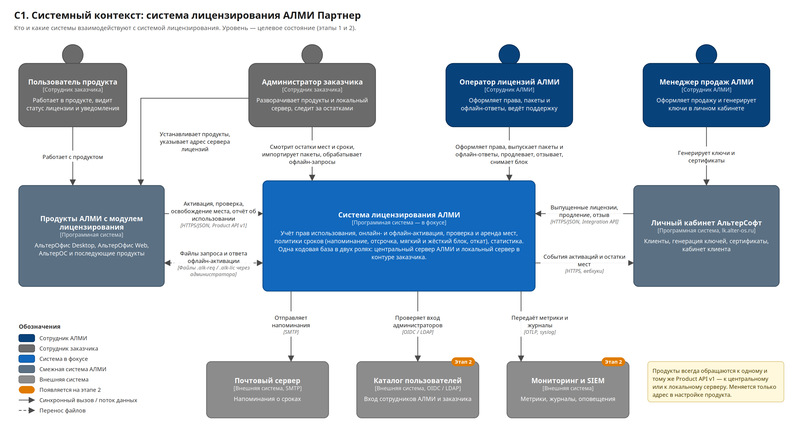
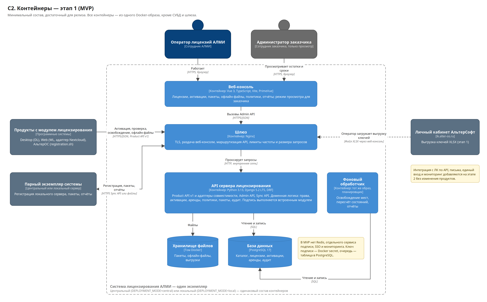
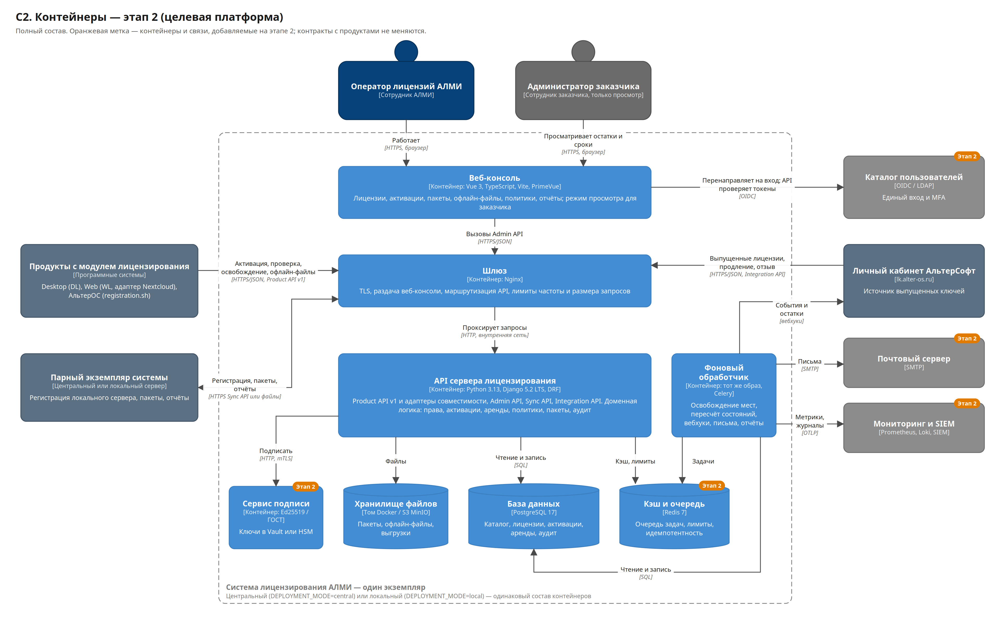
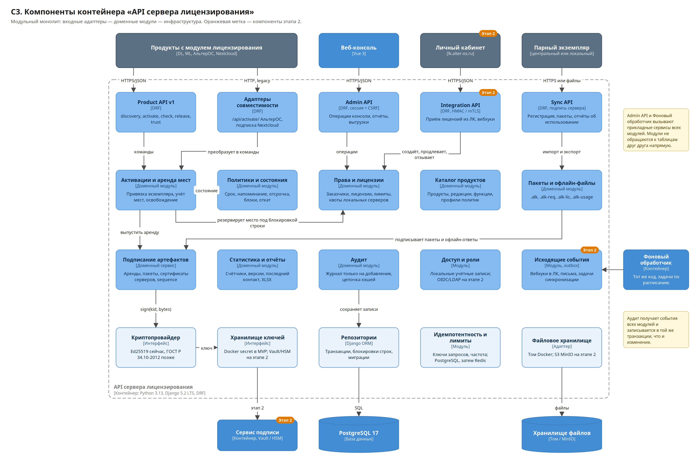
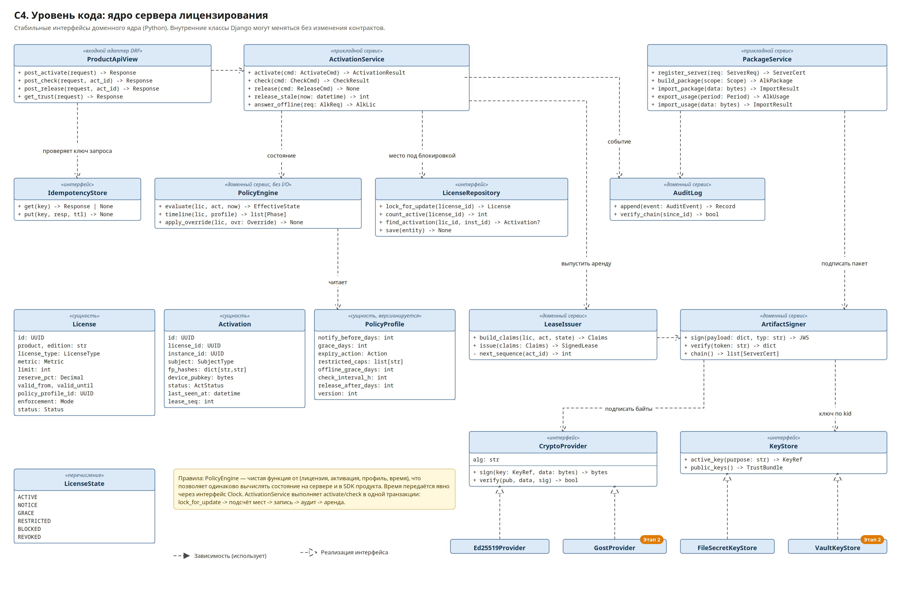
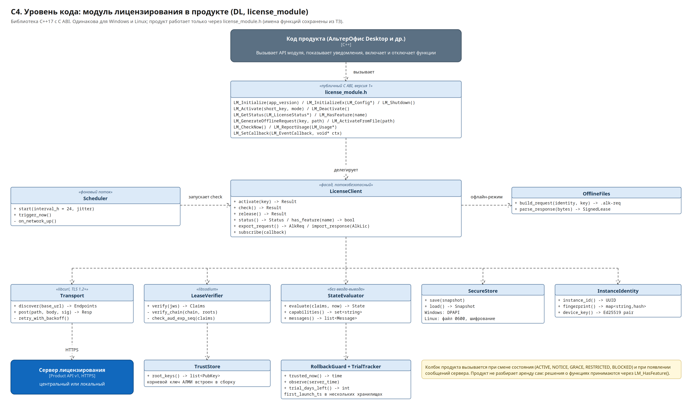
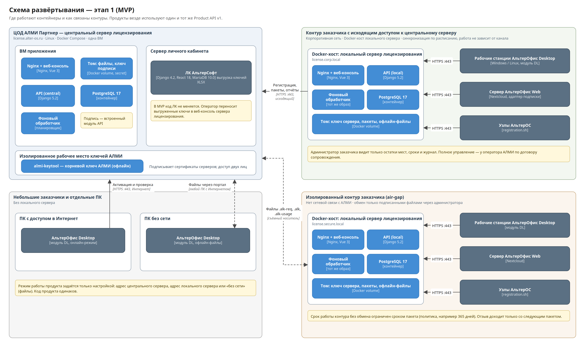
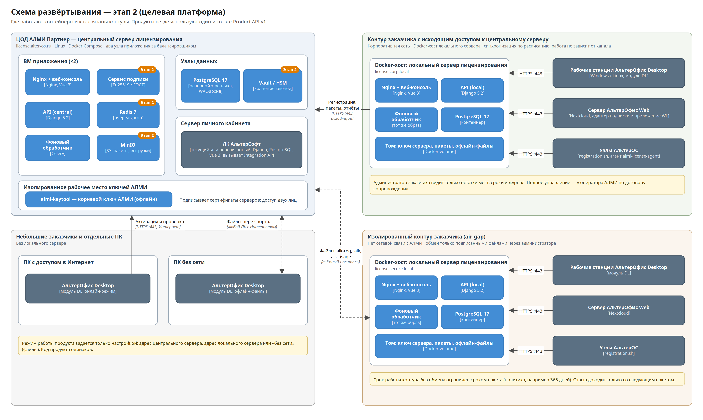
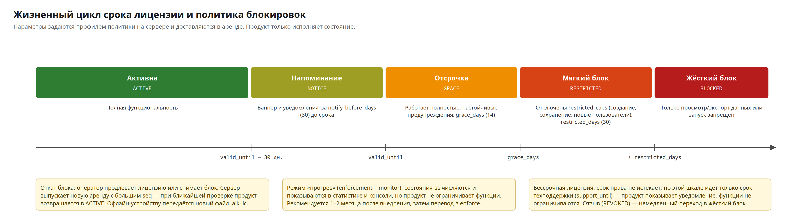

# Архитектура и план разработки системы лицензирования АЛМИ

| Параметр | Значение |
|---|---|
| Документ | Архитектура и план разработки (документ 1 из 2) |
| Версия | 1.0 |
| Дата | 14.10.2026 |
| Статус | На согласование |
| Связанный документ | «Спецификация взаимодействия сервера лицензирования с продуктами» (документ 2) и файл `contracts/openapi-product-api-v1.yaml` |

---

## 1. Резюме

Система лицензирования АЛМИ — единая платформа учёта прав на использование продуктов АЛМИ Партнер (АльтерОфис Desktop, АльтерОфис Web, АльтерОС и последующих). Она заменяет разрозненные механизмы (ключи и `registration.sh` в АльтерОС, подписка Nextcloud в веб-версии, отсутствие контроля в десктопе) одной моделью: право — активация — подписанная аренда — политика сроков.

Ключевые решения:

1. **Одна кодовая база, два режима работы.** Один Docker-образ работает как центральный сервер АЛМИ (`license.alter-os.ru`) или как локальный сервер в контуре заказчика, в том числе полностью изолированном. Режим задаётся переменной `DEPLOYMENT_MODE`.
2. **Один контракт с продуктами.** Продукт обращается к Product API v1 и не знает, с каким сервером работает: центральным или локальным. Меняется только адрес в настройке. Изолированные устройства используют те же объекты в виде подписанных файлов.
3. **Продукт исполняет, сервер решает.** Сроки, напоминания, отсрочка, мягкий и жёсткий блок, откат блока задаются профилем политики на сервере и доставляются продукту в подписанной аренде. Изменение правил не требует выпуска новой версии продукта.
4. **Цепочка доверия.** Корневой ключ АЛМИ хранится офлайн и подписывает сертификаты ключей центрального и локальных серверов. Продукт содержит только корневой открытый ключ и проверяет цепочку. Подпись — Ed25519 с возможностью замены на ГОСТ Р 34.10-2012.
5. **Модульный монолит:** Python 3.13, Django 5.2 LTS, DRF, PostgreSQL 17, Nginx; веб-консоль — Vue 3 + TypeScript.
6. **Два последовательных этапа.**
   - **Этап 1 — MVP, 6 недель.** Рабочая система с полной базовой архитектурой: онлайн- и офлайн-активация, локальный сервер для закрытого контура в Docker, политики сроков и блокировок, статистика, модуль DL для Windows и Linux, подключение АльтерОфис Web и АльтерОС без изменения их кода. Разработка в основном с ИИ-ассистентами при фиксированных контрактах. Входит в ближайший релиз.
   - **Этап 2 — целевая платформа, 16 недель.** Интеграция с личным кабинетом по API, отдельный сервис подписи с Vault/HSM, ГОСТ, единый вход, уведомления, конкурентные сессии и нативные модули для веб-продуктов, агент АльтерОС, мониторинг, отказоустойчивость, аудит безопасности. Контракт с продуктами, зафиксированный на этапе 1, не меняется.

---

## 2. Цели и проблемы бизнеса

| Проблема сейчас | Цель | Как достигается |
|---|---|---|
| Купили 10 мест — развернули 10 000; факт использования неизвестен | Видеть фактическое использование по каждому заказчику | Активация при установке, ежедневная проверка со счётчиками, статистика |
| По окончании срока ничего не происходит | Управляемое окончание срока | Политика: напоминание, отсрочка, мягкий блок, жёсткий блок, откат |
| Закрытые контуры не подключены к Интернету | Лицензирование без сетевой связи с АЛМИ | Локальный сервер в Docker и подписанные файлы |
| У каждого продукта свой механизм | Один сервис для всех продуктов | Единый Product API v1, SDK, адаптеры совместимости |
| Резкое включение контроля опасно для отношений с заказчиками | Мягкий запуск | Режим «прогрев» (`monitor`): состояние считается и видно, но функции не ограничиваются |
| Изменение правил требует выпуска продукта | Изменения только на сервере | Политики и тексты сообщений доставляются в аренде |
| Сервер лицензирования может стать отдельным коммерческим продуктом | Продуктовая независимость | Чистые контракты, каталог продуктов, отсутствие жёсткой связи с ЛК |

---

## 3. Требования

### 3.1. Функциональные

| № | Требование | Этап 1 | Этап 2 |
|---|---|---|---|
| Ф1 | Офлайн-активация файлами | Устройства и локальные серверы | Активация по телефону (опционально) |
| Ф2 | Сервер для закрытого корпоративного контура | Локальный сервер в Docker: регистрация, пакеты, отчёты онлайн и файлами | Автообновление, удалённая диагностика по договору |
| Ф3 | Онлайн-активация | Product API v1 | Без изменений |
| Ф4 | Статистика: всего, активировано, свободно, версии продуктов и ОС, последний контакт | Отчёты в консоли, выгрузка XLSX | Сводная статистика по локальным серверам, панели, API для ЛК |
| Ф5 | Клиенты Windows и Linux | DL: Windows 10/11 x64, Linux x64 (Astra, РЕД ОС, АльтерОС, Ubuntu) | Усиление хранилища (Secret Service), агент АльтерОС |
| Ф6 | Сервер из Ф2 работает в Docker | Docker Compose | Профиль высокой доступности |
| Ф7 | Политики: истечение через, напоминание за, мягкий блок, жёсткий блок, откат блока | Полностью | Шаблоны политик по классам заказчиков |
| Ф8 | Режим «прогрев» | Полностью | Без изменений |
| Ф9 | Автоосвобождение мест и резерв | Полностью | Без изменений |
| Ф10 | Триал 30 дней (десктоп, без ключа) | Полностью, локально в DL | Без изменений |
| Ф11 | Веб: лимит пользователей | Через адаптер подписки Nextcloud | Нативный модуль WL, конкурентные сессии |
| Ф12 | Поступление лицензий из ЛК | Импорт XLSX | Integration API, вебхуки, миграция legacy-активаций |
| Ф13 | Администратор заказчика видит остатки | Роль «только просмотр» | Единый вход |

### 3.2. Нефункциональные

| Показатель | Значение |
|---|---|
| Объём | до 10 000 лицензий и 100 000 активаций в первый год |
| Нагрузка | не менее 100 запросов в секунду на один узел |
| Время ответа (p95) | активация не более 500 мс; проверка не более 200 мс |
| Проверка аренды в продукте | не более 50 мс, без сети |
| Доступность центрального сервера | 99 % на этапе 1; 99,5 % на этапе 2 |
| RPO / RTO | 24 ч / 4 ч на этапе 1; 15 мин / 1 ч на этапе 2 |
| Хранение данных | на территории РФ; ПДн минимизированы (152-ФЗ) |
| Транспорт | TLS 1.2+ |
| Криптография | Ed25519; замена на ГОСТ Р 34.10-2012 без изменения протокола |
| Влияние сбоев сервера на заказчика | недоступность сервера не блокирует работу продуктов в пределах политики |

---

## 4. Архитектурные принципы

1. **Контракт прежде кода.** Product API, схемы подписанных объектов и форматы файлов фиксируются до разработки и версионируются. Всё, что видит продукт, — публичный контракт.
2. **Продукт — тонкий исполнитель.** Логика сроков и ограничений вычисляется по данным аренды; тексты сообщений приходят с сервера.
3. **Совместимость вперёд.** Продукт игнорирует неизвестные поля и директивы. Сервер добавляет поля, но не меняет смысл существующих.
4. **Работа без сети — норма.** Любое состояние продукта выводится из локально сохранённой подписанной аренды.
5. **Нет общего секрета.** Сервер и продукт не делят симметричных ключей: сервер подписывает, продукт проверяет; запросы продукта подписаны ключом устройства.
6. **Одинаковость центрального и локального серверов.** Отличия — только в конфигурации и источнике прав (центральный выдаёт права, локальный получает их пакетом).
7. **Изменения через журнал.** Все изменения прав и состояний фиксируются в аудите в той же транзакции.
8. **Минимум данных о заказчике.** Собираются только данные, нужные для контроля договора.
9. **Простота MVP без долгов в контрактах.** Упрощения этапа 1 касаются только внутреннего устройства (нет Redis, подпись встроена в API), но не протокола.

---

## 5. Ключевые архитектурные решения

| № | Решение | Альтернатива | Почему так |
|---|---|---|---|
| Р1 | Модульный монолит | Микросервисы | Нагрузка невелика, команда небольшая; модули изолированы по коду и могут быть выделены позже |
| Р2 | Один образ для центрального и локального сервера | Отдельный продукт для контура | Один код, одно тестирование, одинаковое поведение |
| Р3 | Подписанная аренда (JWS, EdDSA) | Онлайн-проверка на каждый запуск | Работа офлайн, мгновенная локальная проверка |
| Р4 | Иерархия ключей: корневой офлайн + ключи серверов с сертификатами | Один ключ на всё | Компрометация локального сервера не затрагивает остальных; корневой ключ не находится в сети |
| Р5 | `instance_id` + отпечаток с допуском | Только HWID | Виртуальные машины и контейнеры меняют «железо»; допуск 3 из 4 компонентов, как в ТЗ |
| Р6 | Подпись запросов ключом устройства | Токен в заголовке | Невозможно продлить чужую активацию, перехватив идентификатор |
| Р7 | Политика как данные | Константы в продукте | Изменение правил без выпуска продукта |
| Р8 | Адаптеры совместимости | Доработка продуктов сразу | Подключение АльтерОфис Web и АльтерОС в MVP без изменения их кода |
| Р9 | PostgreSQL с блокировкой строки лицензии при подсчёте мест | Счётчики в Redis | Транзакционная корректность учёта мест без двойного списания |
| Р10 | Vue 3 для консоли | React | Доступность специалистов; консоль не зависит от ЛК, переиспользование кода ЛК не требуется |
| Р11 | Очередь и планировщик на PostgreSQL в MVP, Celery + Redis на этапе 2 | Сразу Celery | Меньше компонентов на этапе 1, особенно в закрытом контуре |

---

## 6. Архитектура в нотации C4

Нотация C4 описывает систему на четырёх уровнях детализации: контекст (кто и с чем взаимодействует), контейнеры (из каких запускаемых частей состоит система), компоненты (из чего состоит основной контейнер) и код (ключевые классы и интерфейсы). Дополнительно приводятся схемы развёртывания и последовательности.

Обозначения на всех схемах: тёмно-синий — сотрудники АЛМИ, серый — сотрудники заказчика и внешние системы, ярко-синий — система лицензирования и её части, серо-синий — смежные системы АЛМИ, оранжевая метка «Этап 2» — элементы, появляющиеся на втором этапе. Сплошная стрелка — вызов или поток данных, пунктир — перенос файлов или опосредованная связь.

### 6.1. C1 — системный контекст



Схема показывает систему лицензирования как единое целое и её окружение.

| Участник | Роль | Взаимодействие |
|---|---|---|
| Пользователь продукта | Работает в продукте | Видит состояние лицензии и уведомления; с сервером не взаимодействует |
| Администратор заказчика | Устанавливает продукты и локальный сервер | Указывает адрес сервера, переносит офлайн-файлы, просматривает остатки мест и сроки |
| Оператор лицензий АЛМИ | Сопровождает права | Оформляет лицензии, выпускает пакеты и офлайн-ответы, продлевает, отзывает, снимает блок |
| Менеджер продаж АЛМИ | Оформляет продажу | Генерирует ключи в ЛК |
| Продукты АЛМИ | Потребители прав | Активация, проверка, освобождение места, отчёт об использовании |
| Личный кабинет АльтерСофт | Источник коммерческих данных | Этап 1 — выгрузка ключей; этап 2 — Integration API и вебхуки |
| Почтовый сервер, каталог пользователей, мониторинг | Внешние сервисы | Этап 2 |

Главное на этом уровне: продукты всегда обращаются к одному и тому же Product API v1. Центральный сервер и локальный сервер в контуре заказчика — это одна система в двух ролях.

### 6.2. C2 — контейнеры, этап 1



| Контейнер | Технология | Назначение |
|---|---|---|
| Веб-консоль | Vue 3, TypeScript, Vite, PrimeVue | Интерфейс оператора АЛМИ и режим просмотра для администратора заказчика |
| Шлюз | Nginx | TLS, раздача консоли, маршрутизация, ограничение частоты и размера запросов |
| API сервера лицензирования | Python 3.13, Django 5.2, DRF | Все API и доменная логика; подпись выполняется встроенным модулем, ключ передан как Docker secret |
| Фоновый обработчик | Тот же образ, режим планировщика | Автоосвобождение мест, пересчёт состояний, формирование отчётов и пакетов |
| База данных | PostgreSQL 17 | Все данные системы, включая очередь задач |
| Хранилище файлов | Том Docker | Пакеты, офлайн-файлы, выгрузки |

На этапе 1 в системе четыре типа запускаемых контейнеров. Это важно для закрытого контура: администратору заказчика нужно обслуживать минимум компонентов.

### 6.3. C2 — контейнеры, этап 2



Добавляются: сервис подписи с хранением ключей в Vault или HSM, Redis 7 (очередь Celery, ограничение частоты, идемпотентность), Integration API для ЛК и вебхуки, вход через OIDC/LDAP, письма, экспорт метрик и журналов. Хранилище файлов может быть заменено на S3-совместимое (MinIO). Контракт с продуктами и форматы файлов не меняются.

### 6.4. C3 — компоненты API сервера лицензирования



Контейнер API разделён на три слоя.

**Входные адаптеры** принимают запросы и преобразуют их в команды доменного слоя; бизнес-логики в них нет.

| Компонент | Назначение |
|---|---|
| Product API v1 | Контракт с продуктами: discovery, активация, проверка, освобождение, доверенные ключи |
| Адаптеры совместимости | Старый `/api/activate/` для АльтерОС и протокол подписки Nextcloud для АльтерОфис Web |
| Admin API | Операции веб-консоли |
| Sync API | Обмен центрального и локальных серверов |
| Integration API (этап 2) | Приём лицензий из ЛК, выдача остатков |

**Доменные модули** содержат правила.

| Компонент | Назначение |
|---|---|
| Активации и аренда мест | Привязка экземпляра продукта к лицензии, учёт мест, освобождение |
| Политики и состояния | Вычисление состояния по сроку и профилю политики |
| Права и лицензии | Заказчики, лицензии, лимиты, квоты локальных серверов |
| Каталог продуктов | Продукты, редакции, функции, профили политик по умолчанию |
| Пакеты и офлайн-файлы | Формирование и разбор `.alk`, `.alk-req`, `.alk-lic`, `.alk-usage` |
| Подписание артефактов | Сборка и подпись аренд, пакетов, сертификатов; монотонный номер `seq` |
| Статистика и отчёты | Счётчики, версии, последний контакт, выгрузки |
| Аудит | Журнал только на добавление с цепочкой хэшей |
| Доступ и роли | Учётные записи и роли |
| Исходящие события (этап 2) | Таблица исходящих событий для вебхуков и писем |

**Инфраструктура** изолирует внешние зависимости за интерфейсами: криптопровайдер, хранилище ключей, репозитории, идемпотентность и лимиты, файловое хранилище. Благодаря этому переход на ГОСТ, Vault или MinIO не затрагивает доменные модули.

Правило модульности: модули не обращаются к таблицам друг друга напрямую, только через прикладные сервисы. Правило проверяется автоматически (import-linter) в CI.

### 6.5. C4 — уровень кода: ядро сервера



| Элемент | Ответственность | Важные свойства |
|---|---|---|
| `ActivationService` | Сценарии activate, check, release, автоосвобождение, офлайн-ответ | Одна транзакция: блокировка строки лицензии, подсчёт мест, запись, аудит, аренда |
| `PolicyEngine` | Вычисление состояния | Чистая функция без ввода-вывода; тот же алгоритм реализован в SDK и проверяется общими тестовыми векторами |
| `LicenseRepository` | Доступ к лицензиям и активациям | `lock_for_update` — `SELECT … FOR UPDATE` |
| `LeaseIssuer` | Сборка утверждений аренды | Монотонный `seq` на активацию |
| `ArtifactSigner` | Подпись и проверка JWS, цепочка сертификатов | Единая точка подписи для аренд, пакетов, сертификатов |
| `CryptoProvider` | Алгоритм подписи | `Ed25519Provider` сейчас, `GostProvider` на этапе 2 |
| `KeyStore` | Доступ к закрытому ключу | `FileSecretKeyStore` (Docker secret) сейчас, `VaultKeyStore` на этапе 2 |
| `PackageService` | Регистрация локальных серверов, пакеты, отчёты | Один код для онлайн- и файлового обмена |
| `AuditLog` | Журнал изменений | Цепочка хэшей, проверка целостности |
| `IdempotencyStore` | Повторы запросов | Ключ `Idempotency-Key`, хранение 24 ч |

### 6.6. C4 — уровень кода: модуль лицензирования в продукте



Модуль DL — библиотека C++17 с C ABI (`license_module.dll` / `liblicense_module.so`). Имена функций сохранены из ТЗ (`LM_Initialize`, `LM_Activate`, `LM_GetStatus` и др.) и дополнены функциями проверки, функций и уведомлений. Продукт работает только через заголовок `license_module.h` и не разбирает аренду сам. Подробный контракт — в документе 2.

| Компонент | Назначение |
|---|---|
| `LicenseClient` | Фасад, потокобезопасный; координирует остальные компоненты |
| `Scheduler` | Фоновая проверка при старте и раз в `check_interval_hours` с разбросом по времени |
| `Transport` | HTTPS через libcurl, discovery, повторы с экспоненциальной задержкой, системный прокси |
| `LeaseVerifier` | Проверка JWS и цепочки сертификатов до корневого ключа (libsodium) |
| `TrustStore` | Корневые открытые ключи АЛМИ, встроенные в сборку |
| `StateEvaluator` | Вычисление состояния по аренде и доверенному времени |
| `RollbackGuard + TrialTracker` | Защита от перевода часов назад, учёт триала 30 дней |
| `SecureStore` | Хранение аренды и ключа устройства: DPAPI в Windows, зашифрованный файл с правами 0600 в Linux |
| `InstanceIdentity` | `instance_id`, отпечаток из 4 компонентов, ключ устройства Ed25519 |
| `OfflineFiles` | Формирование `.alk-req` и разбор `.alk-lic` |

### 6.7. Схемы развёртывания

**Этап 1**



**Этап 2**



Поддерживаются четыре варианта размещения у заказчика:

| Вариант | Как работает | Что нужно от заказчика |
|---|---|---|
| ПК или сервер с Интернетом | Продукт обращается к центральному серверу | Доступ к `license.alter-os.ru:443` |
| Отдельный ПК без сети | Файлы `.alk-req` / `.alk-lic` через любой ПК с Интернетом и портал или через оператора | Перенос файла |
| Корпоративный контур с исходящим доступом | Локальный сервер; продукты обращаются к нему; он синхронизируется с центральным по расписанию | Docker-хост (2 vCPU, 4 ГБ ОЗУ, 40 ГБ), исходящий доступ с хоста локального сервера |
| Изолированный контур | Локальный сервер; обмен пакетами и отчётами только файлами | Docker-хост, регламент переноса файлов |

Центральный сервер этапа 1 — одна ВМ (4 vCPU, 8 ГБ ОЗУ, 100 ГБ SSD) с ежедневным резервным копированием. Этап 2 — два узла приложения за балансировщиком, PostgreSQL с репликой и архивом WAL, Vault или HSM.

### 6.8. Сценарии взаимодействия

Схемы последовательности основных сценариев (онлайн-активация, проверка и директивы, офлайн-активация, локальный сервер, поступление лицензий из ЛК, АльтерОфис Web, АльтерОС, освобождение мест) с полями запросов и ответов приведены в документе 2.

---

## 7. Доменная модель

### 7.1. Основные сущности

| Сущность | Описание | Ключевые поля |
|---|---|---|
| Заказчик (`Customer`) | Юридическое лицо | наименование, ИНН (уникален), внешний идентификатор ЛК, контакт (минимум ПДн), группа (этап 2) |
| Группа заказчиков (`CustomerGroup`) | Этап 2. Холдинг: несколько юрлиц с общими лицензиями | наименование, головное юрлицо, состав, внешний идентификатор ЛК |
| Продукт (`Product`) | Позиция каталога | код (`alteroffice-desktop`, `alteroffice-web`, `alteros`), редакции, функции (`capabilities`), профиль политики по умолчанию, метрика по умолчанию |
| Лицензия (`License`) | Право заказчика | продукт, редакция, тип, метрика, лимит, резерв, даты, профиль политики, режим контроля, статус |
| Ключ (`LicenseKey`) | Код для активации | значение (хранится хэш и маска), формат legacy или новый, связь с лицензией, номер заказа и артикул ЛК |
| Активация (`Activation`) | Привязка экземпляра к лицензии | `instance_id`, тип субъекта, хэши компонентов отпечатка, открытый ключ устройства, статус, последний контакт, `lease_seq`, версия продукта, ОС |
| Аренда (`Lease`) | Подписанное подтверждение права | номер `seq`, срок, утверждения; хранится последняя выданная |
| Профиль политики (`PolicyProfile`) | Правила сроков и блокировок | параметры раздела 8, версия |
| Локальный сервер (`LocalServer`) | Зарегистрированный экземпляр в контуре заказчика | `server_id`, сертификат, квоты, последний пакет, последний отчёт |
| Квота (`Allocation`) | Часть лицензии, переданная локальному серверу | лицензия, сервер, количество мест |
| Пакет (`Package`) | Выпущенный для локального сервера набор прав | `seq`, срок действия, хэш |
| Отчёт об использовании (`UsageReport`) | Данные от локального сервера | период, агрегаты, квитанция |
| Событие аудита (`AuditEvent`) | Запись журнала | кто, что, когда, откуда, предыдущий хэш |

### 7.2. Типы лицензий

| Тип | Описание |
|---|---|
| `subscription` | На срок (1, 3, 6, 12, 24, 36 месяцев — поле `FF` артикула) |
| `perpetual` | Бессрочное право; ограничен только срок техподдержки (`support_until`, `FF = 99`) |
| `trial` | Пробный период. Для десктопа — 30 дней без ключа, учитывается локально в DL; серверный триал — лицензия с коротким сроком |
| `nfr` | Для партнёров и внутреннего использования, без коммерческой ценности |
| `free` | Бесплатная версия с ограничениями (лимиты задаются в лицензии) |

### 7.3. Метрики учёта

| Метрика | Что считается | Где применяется | Этап |
|---|---|---|---|
| `device` | Активированные устройства | АльтерОфис Desktop | 1 |
| `server_instance` | Экземпляры серверного продукта | АльтерОфис Web, будущие серверные продукты | 1 |
| `os_node` | Узлы ОС | АльтерОС | 1 |
| `named_user` | Зарегистрированные пользователи экземпляра | АльтерОфис Web | 1 (по отчёту продукта) |
| `active_user` | Активные пользователи за окно | АльтерОфис Web | 1 (по отчёту продукта) |
| `concurrent_session` | Одновременные сессии | Веб-продукты | 2 |
| `feature` | Включение функции | Все продукты | 1 |

### 7.4. Правила учёта мест

1. Место занимает активация в статусе `active`. Повторная активация того же `instance_id` место не занимает.
2. Допустимо превышение лимита на величину резерва: `ceil(limit × reserve_pct / 100)`, по умолчанию `reserve_pct = 3`. Активации в резерве отмечаются, оператор видит превышение.
3. Активация без проверки дольше `release_after_days` (по умолчанию 30) освобождается автоматически (`released_auto`). При следующем выходе продукта на связь он активируется повторно, если есть место.
4. Подсчёт и запись выполняются в одной транзакции с блокировкой строки лицензии.
5. Для веб-продуктов место — экземпляр сервера; число пользователей — лимит внутри экземпляра, который продукт применяет сам по подписанным данным и сообщает фактические значения в проверке.

### 7.5. Заказчики и юридические лица

Дистрибутив продукта один для всех и не содержит данных о заказчике. Заказчик определяется ключом лицензии: ключ → лицензия → заказчик. Продукт передаёт при активации только ключ и данные экземпляра; заказчика в аренду (`lic.customer`) добавляет сервер.

| Правило | Содержание |
|---|---|
| Одно юрлицо — один заказчик | Заказчик уникален по ИНН; каждое юрлицо холдинга с отдельным ИНН заводится отдельно |
| Ключ принадлежит одному заказчику | Ключ, уже связанный с заказчиком, нельзя импортировать или выпустить для другого; импорт такой строки — ошибка |
| Доставка ключа | Ручной ввод; массовая установка — свойство установщика `LICENSE_KEY` или `config.json`; офлайн — файлы; локальный сервер — сертификат на конкретного заказчика и его продукты (раздел 4.1 документа 2) |
| Холдинги, этап 1 | Общие места на группу — лицензия на головное юрлицо; доступ дочерних юрлиц к остаткам — пользователи `customer_viewer` головного заказчика |
| Холдинги, этап 2 | Группа заказчиков (`CustomerGroup`): лицензия группы с общим пулом мест, отчёт об использовании по юрлицам группы, поле `customer.group_external_id` в Integration API |
| Смена юрлица, реорганизация | Перевод лицензии на другого заказчика: ключи, активации и сроки сохраняются; новое наименование попадает в аренду при следующей проверке; основание и прежний заказчик фиксируются в аудите. Перевод запрещён, пока места лицензии выделены локальному серверу прежнего заказчика: сначала квота возвращается |

---

## 8. Состояния и политики



### 8.1. Состояния лицензии на стороне продукта

| Состояние | Когда наступает | Поведение продукта |
|---|---|---|
| `TRIAL` | Ключ не введён, идёт пробный период | Полная функциональность, баннер «осталось N дней» |
| `UNLICENSED` | Триал завершён, ключа нет | По ТЗ: модальный диалог при запуске, работа продолжается |
| `ACTIVE` | Срок не наступил | Полная функциональность |
| `NOTICE` | До окончания осталось не более `notify_before_days` | Уведомления, текст с сервера |
| `GRACE` | Срок наступил, идёт отсрочка `grace_days` | Полная функциональность, настойчивые уведомления |
| `RESTRICTED` | Отсрочка завершена, `expiry_action = restrict` или переход по `restricted_days` | Отключены функции из `restricted_caps` (мягкий блок) |
| `BLOCKED` | `expiry_action = block` и отсрочка завершена, либо истёк `restricted_days` | Жёсткий блок: только просмотр и экспорт данных либо запрет запуска (по профилю) |
| `REVOKED` | Лицензия отозвана | Как `BLOCKED` |

### 8.2. Параметры профиля политики

| Параметр | Смысл | Desktop | Web | АльтерОС |
|---|---|---|---|---|
| `enforcement` | `enforce` — ограничивать; `monitor` — только считать и показывать | `monitor` на время прогрева | `monitor` на время прогрева | `monitor` |
| `notify_before_days` | Напоминание за N дней | 30 | 30 | 30 |
| `grace_days` | Отсрочка после срока | 14 | 14 | 30 |
| `expiry_action` | `none`, `restrict`, `block` | `restrict` | `restrict` | `none` |
| `restricted_caps` | Функции, отключаемые при мягком блоке | `updates`, `macros`, `collaboration` | `new_users` (этап 2: + `share_external`, `updates`) | — |
| `restricted_days` | Сколько длится мягкий блок до жёсткого; `null` — не переходить | `null` | `null` | `null` |
| `hard_block_mode` | `read_only` или `no_start` | `read_only` | `read_only` | — |
| `offline_grace_days` | Сколько работать без связи; `null` — бессрочно | `null` (по ТЗ) | 3 (72 ч, по ТЗ) | `null` |
| `check_interval_hours` | Период проверки | 24 | 6 | 24 |
| `release_after_days` | Автоосвобождение места | 30 | 30 | 30 |
| `reserve_pct` | Резерв мест | 3 | 3 | 3 |

Значения — исходные для каталога (полный каталог и профили по классам заказчиков — документ 4); оператор меняет их для продукта, класса заказчиков или конкретной лицензии. Профиль версионируется: продукт получает новую версию с ближайшей арендой.

### 8.3. Откат блока

Откат — штатная операция: оператор продлевает лицензию, снимает блок или временно переводит лицензию в `monitor`. Сервер выпускает новую аренду с большим `seq`; продукт применяет её при ближайшей проверке и возвращается в `ACTIVE`. Для офлайн-устройства оператор формирует новый `.alk-lic`, для изолированного контура — новый пакет `.alk`. Продукт не принимает аренду с `seq` меньше или равным уже применённому, поэтому вернуть старое состояние подменой файла нельзя.

### 8.4. Режим «прогрев»

Первые 1–2 месяца после выпуска все лицензии работают в `monitor`: продукт вычисляет состояние, показывает уведомления о сроке, сервер собирает статистику, но функции не ограничиваются. Оператор анализирует превышения и согласует их с заказчиками, после чего переводит продукты или отдельных заказчиков в `enforce` — без выпуска новых версий продуктов.

---

## 9. Доверие и криптография

### 9.1. Иерархия ключей

| Ключ | Где хранится | Что подписывает | Срок |
|---|---|---|---|
| Корневой ключ АЛМИ | Офлайн-рабочее место, утилита `almi-keytool`, доступ двух лиц, резервные копии в сейфе | Сертификаты ключей выпуска центрального сервера и ключей локальных серверов | 10 лет |
| Ключ выпуска центрального сервера | Этап 1 — Docker secret; этап 2 — Vault или HSM | Аренды, пакеты, офлайн-ответы, квитанции | 2 года, ротация с перекрытием |
| Ключ локального сервера | Генерируется на хосте локального сервера и не покидает его | Аренды устройствам контура | Срок сертификата = срок договора, не более 3 лет |
| Ключ устройства | `SecureStore` продукта | Запросы продукта к серверу (доказательство владения активацией) | Время жизни активации |

Продукт содержит в сборке только корневые открытые ключи (действующий и резервный). Каждая аренда несёт цепочку сертификатов до корня. Сертификат локального сервера ограничен: заказчик, перечень продуктов, суммарные квоты, срок. Локальный сервер не может выдать больше, чем указано в его сертификате и пакете.

### 9.2. Формат подписанных объектов

Все подписанные объекты — компактный JWS (`header.payload.signature`): заголовок содержит `alg` (`EdDSA`, позже `GOST3410-2012-256`), `kid`, `typ` (`alm-lease+jws`, `alm-package+jws`, `alm-cert+jws`, `alm-receipt+jws`) и `x5c`-подобную цепочку `chain`. Состав утверждений аренды описан в документе 2.

### 9.3. Ротация и компрометация

- Ротация ключа выпуска: новый ключ сертифицируется корнем, публикуется в `/api/v1/trust`; старый остаётся действительным для проверки до истечения выданных им аренд.
- Компрометация ключа локального сервера: сертификат отзывается в следующем пакете центрального сервера и списке отзыва `/api/v1/trust`; локальному серверу выдаётся новый сертификат.
- Компрометация корневого ключа: в продуктах заранее встроен резервный корневой ключ; переход выполняется выпуском обновления продукта. Процедура описывается в регламенте церемонии ключей.

---

## 10. Локальный сервер для закрытого контура

| Аспект | Решение |
|---|---|
| Поставка | Docker-образ и `docker-compose.yml`; установочный архив для изолированных контуров (`docker load`) |
| Первый запуск | Мастер в консоли: код регистрации из договора, генерация ключа сервера, формирование запроса регистрации |
| Получение прав | Пакет `.alk` — по HTTPS (Sync API) или файлом |
| Срок автономной работы | Задаётся сроком пакета (по умолчанию 365 дней); за 30 дней — предупреждения в консоли и продуктах |
| Выдача устройствам | Аренды подписываются ключом локального сервера; продукты проверяют цепочку до корня АЛМИ |
| Отчётность | Отчёт `.alk-usage` — по расписанию онлайн или файлом при каждом обновлении пакета |
| Управление | Полное управление — у оператора АЛМИ по договору сопровождения (удалённый доступ или выезд); администратор заказчика — просмотр остатков, сроков, журнала и обмен файлами |
| Обновление | Новая версия образа; миграции БД выполняются при старте; совместимость пакетов: N−1 версия формата |
| Резервное копирование | Скрипт ежедневного дампа PostgreSQL и тома; ключ сервера копируется отдельно в зашифрованном виде |

---

## 11. Статистика

| Показатель | Источник | Этап |
|---|---|---|
| Выпущено лицензий и мест по продукту, редакции, типу, заказчику | Права | 1 |
| Активировано, свободно, в резерве, превышение | Активации | 1 |
| Активации, освобождения, отказы с причинами | Аудит | 1 |
| Версии продуктов и ОС | Проверки | 1 |
| Последний контакт, давность проверки | Проверки | 1 |
| Пользователи веб-экземпляров (всего, активные) | Проверки, адаптер Nextcloud | 1 |
| Состояния по срокам (ACTIVE, NOTICE, GRACE, RESTRICTED, BLOCKED) | PolicyEngine | 1 |
| Использование по локальным серверам | Отчёты `.alk-usage` | 1 — по каждому серверу, 2 — сводно |
| Панели, тренды, выгрузка в ЛК | Агрегаты | 2 |

Профиль телеметрии продукта: `minimal` (идентификаторы, версия, ОС) по умолчанию; `basic` (счётчики пользователей и документов) — по договору. Сырые события хранятся 180 дней, агрегаты — 5 лет. В журналах не сохраняются полные ключи, аренды и исходные значения компонентов отпечатка.

---

## 12. Безопасность

| Угроза | Мера |
|---|---|
| Подделка лицензии | Подпись Ed25519, цепочка до офлайн-корня, ключи вне БД и образов |
| Повтор и перехват запросов | TLS, подпись запроса ключом устройства, `nonce` и время в запросе (окно 5 минут), `Idempotency-Key` |
| Клонирование активации на другое устройство | Проверка отпечатка с допуском 3 из 4, ключ устройства в защищённом хранилище, обнаружение дублей `instance_id` с разными отпечатками |
| Откат времени | `RollbackGuard`: монотонно растущее доверенное время, время сервера из ответов |
| Откат состояния подменой файла | Монотонный `seq` аренды и пакета |
| Перебор ключей | Ограничение частоты: 10 активаций в минуту с IP, 100 проверок в минуту с IP; блокировка входа в консоль после 5 ошибок на 15 минут |
| Злоупотребление локальным сервером | Ограниченный сертификат, квоты в пакете, сверка отчётов с квотами |
| Внутренний нарушитель | Роли, аудит с цепочкой хэшей, двойной контроль операций с корневым ключом |
| Уязвимости зависимостей | SBOM, сканирование образов, обновления; этап 2 — подпись образов и внешнее тестирование на проникновение |

Роли консоли: `superadmin`, `operator`, `support` (чтение и офлайн-ответы), `auditor` (чтение журнала), `customer_viewer` (остатки своего заказчика), `local_admin` (локальный сервер, обмен файлами).

---

## 13. Технологический стек

| Слой | Этап 1 | Этап 2 | Почему |
|---|---|---|---|
| Язык и фреймворк сервера | Python 3.13, Django 5.2 LTS, DRF | Без изменений | LTS-поддержка, преемственность с ЛК, транзакции и миграции |
| Описание API | drf-spectacular, OpenAPI 3.1 | Без изменений | Контракт генерируется и сверяется с эталоном в CI |
| БД | PostgreSQL 17 | Реплика, pgBackRest, архив WAL | Блокировки строк, JSONB, надёжность |
| Очередь и планировщик | Таблица задач в PostgreSQL (django-q2 или собственный планировщик) | Celery 5 + Redis 7 | Минимум компонентов в MVP |
| Шлюз | Nginx | Nginx + балансировщик | Простота, ограничение частоты |
| Криптография сервера | `cryptography` (Ed25519) | + ГОСТ-провайдер (КриптоПро CSP или OpenSSL gost-engine), Vault Transit или HSM | Абстракция `CryptoProvider` |
| Консоль | Vue 3, TypeScript, Vite, PrimeVue, Pinia, Vue Router, vue-i18n | Без изменений | Специалисты в команде; готовые таблицы и формы |
| Модуль DL | C++17, CMake, libsodium, libcurl, nlohmann/json, GoogleTest | Secret Service (libsecret) в Linux | Совместимость с ТЗ |
| Веб-продукты | Адаптер подписки Nextcloud на сервере | PHP 8.1+ SDK (Composer), приложение Nextcloud `alter_license` | Нулевые изменения в MVP |
| АльтерОС | Адаптер `/api/activate/` | Агент `almi-license-agent` (Go или C++) | Совместимость со старым скриптом |
| Тестирование | pytest, hypothesis, Playwright, k6 | + тесты соответствия для SDK, тесты отказов | |
| Поставка | Docker, Docker Compose, GitLab CI или GitHub Actions | + подпись образов (cosign), SBOM (Syft), сканирование (Trivy) | |
| Наблюдаемость | Структурные журналы JSON, `/health`, `/ready`, метрики Prometheus | OpenTelemetry, Prometheus, Grafana, Loki, передача в SIEM | |

Почему Vue 3, а не React: консоль — отдельное приложение, не связанное кодом с ЛК, поэтому выбор определяется командой. Vue 3 с PrimeVue закрывает потребности консоли (таблицы с фильтрами, формы, мастера) и хорошо генерируется ИИ-ассистентами. Переиспользование компонентов текущего ЛК не планируется. ЛК АльтерСофт при необходимости переписывается на тот же стек (Django 5.2, PostgreSQL 17, Vue 3) с отказом от MariaDB; сервер лицензирования от этого не зависит: ЛК в любой версии работает с ним только через выгрузку XLSX (этап 1) и Integration API с вебхуками (этап 2).

---

## 14. Структура репозитория

```
almi-license/
├── AGENTS.md                      # правила для ИИ-ассистентов и разработчиков
├── contracts/                     # источник истины, меняется только через ревью архитектора
│   ├── openapi-product-api-v1.yaml
│   ├── schemas/                   # JSON Schema: lease, package, alk-req, alk-lic, alk-usage, error
│   └── vectors/                   # эталонные векторы: ключи, JWS, состояния политики
├── server/
│   ├── almi_license/              # Django-проект: settings, urls
│   ├── apps/
│   │   ├── catalog/  licensing/  activation/  policy/  packages/
│   │   ├── signing/  stats/  audit/  iam/  outbox/
│   │   ├── api_product/  api_admin/  api_sync/  api_integration/
│   │   └── compat/                # legacy /api/activate/, подписка Nextcloud
│   ├── infra/                     # crypto, keystore, storage, idempotency, clock
│   └── tests/
├── console/                       # Vue 3 + TypeScript
├── sdk/
│   ├── cpp/                       # license_module (DL)
│   └── php/                       # WL, этап 2
├── tools/
│   ├── almi-keytool/              # корневой ключ, сертификаты
│   └── conformance/               # тесты соответствия продукта контракту
├── deploy/
│   ├── central/  local/           # docker-compose, nginx, скрипты резервного копирования
│   └── airgap-bundle/
└── docs/                          # ADR, регламенты, руководства
```

---

## 15. Этап 1 — MVP

### 15.1. Цель

За 6 недель выпустить работающую систему лицензирования для ближайшего релиза продуктов: десктоп активируется и проверяется, веб-версия и АльтерОС подключены без изменения кода, закрытые контуры обслуживаются локальным сервером и файлами, политики сроков работают, первые месяцы — в режиме «прогрев».

### 15.2. Состав

| Входит | Не входит (этап 2) |
|---|---|
| Product API v1 полностью: discovery, activate, check, release, trust | Конкурентные сессии веб-продуктов |
| Офлайн-активация файлами `.alk-req` / `.alk-lic` | Активация по телефону |
| Локальный сервер: регистрация, пакеты, отчёты — онлайн и файлами | Автоматическое обновление локальных серверов |
| Политики: напоминание, отсрочка, мягкий и жёсткий блок, откат, «прогрев» | Шаблоны политик по классам заказчиков |
| Автоосвобождение мест, резерв | |
| Модуль DL C++ для Windows и Linux, интеграция в АльтерОфис Desktop, триал 30 дней | Хранилище Secret Service в Linux |
| Адаптер подписки Nextcloud (АльтерОфис Web) | Нативный PHP-модуль WL, приложение `alter_license` |
| Адаптер `/api/activate/` (АльтерОС) | Агент АльтерОС |
| Веб-консоль Vue 3: все операции оператора, просмотр для заказчика | Единый вход OIDC/LDAP |
| Импорт ключей из ЛК (XLSX) | Integration API, вебхуки, миграция legacy-активаций |
| Статистика в консоли, выгрузка XLSX | Панели, сводная статистика, API для ЛК |
| Аудит с цепочкой хэшей | Передача в SIEM |
| Встроенная подпись, ключ в Docker secret, `almi-keytool` | Отдельный сервис подписи, Vault/HSM, ГОСТ |
| Docker Compose, резервное копирование, журналы, проверки состояния | Отказоустойчивость, OpenTelemetry, мониторинг |

### 15.3. Команда

| Роль | Загрузка | Зона ответственности |
|---|---|---|
| Технический лидер / архитектор | 100 % | Контракты, ревью криптографии и транзакций, правила для ИИ-ассистентов, readiness gate |
| Full-stack разработчик Python/Vue (2) | 100 % | Сервер, консоль; основная генерация кода ИИ-ассистентами |
| Full-stack разработчик Python/Vue (третий) | 50 %, недели 2–5 | Экраны консоли и статистики по эталонному экрану; по расчёту загрузки документа 3 |
| Разработчик C++ | 100 % | Модуль DL, интеграция в АльтерОфис Desktop |
| Инженер по тестированию | 100 % с недели 2 | Автотесты API и консоли, сценарии E2E, нагрузка |
| DevOps-инженер | 50 % | CI, образы, стенды, установка локального сервера, резервное копирование |
| Владелец продукта (со стороны АЛМИ) | по запросу | Решения по политикам и каталогу, приёмка |

### 15.4. План по неделям

**Неделя 1. Контракты и каркас**

| Задача | Результат |
|---|---|
| Утвердить этот документ и документ 2 | Подписанный комплект |
| Зафиксировать `contracts/openapi-product-api-v1.yaml`, JSON Schema аренды, пакета, файлов, ошибок | Контракт v1 заморожен в конце недели |
| Подготовить эталонные векторы: ключи, JWS, 30+ сценариев PolicyEngine | `contracts/vectors` |
| Каркас репозитория, `AGENTS.md`, CI (линтеры, тесты, проверка контракта, import-linter) | Зелёный конвейер |
| Django-проект, модели и миграции: каталог, заказчики, лицензии, ключи, активации, профили, аудит | Схема БД |
| `almi-keytool`: генерация корневого ключа, сертификат ключа выпуска | Тестовые ключи для стендов |
| DL: каркас CMake, проверка эталонных JWS на Windows и Linux | Сборка в CI для двух ОС |

**Неделя 2. Ядро сервера**

| Задача | Результат |
|---|---|
| `ActivationService`: activate, check, release, идемпотентность, учёт мест с блокировкой | Product API работает на стенде |
| `PolicyEngine` с property-тестами на эталонных векторах | Все векторы проходят |
| `LeaseIssuer`, `ArtifactSigner`, `/api/v1/trust`, discovery | Подписанные аренды |
| Подпись запросов ключом устройства, ограничение частоты | Защищённый протокол |
| Admin API: заказчики, лицензии, ключи, профили, отзыв, продление, снятие блока | CRUD |
| Импорт XLSX из ЛК с предпросмотром и сопоставлением артикулов | Загрузка реальной выгрузки |
| DL: `Transport`, `InstanceIdentity`, `SecureStore`, `LeaseVerifier` | Онлайн-активация из тестового приложения |

**Неделя 3. Консоль, офлайн и локальный сервер**

| Задача | Результат |
|---|---|
| Консоль Vue 3: вход, заказчики, лицензии, карточка лицензии с активациями, ключи, профили политик, импорт | Оператор работает без API-клиента |
| Офлайн-файлы на сервере: приём `.alk-req`, выдача `.alk-lic`, страница для администратора заказчика | Офлайн-активация на стенде |
| Режим `local`: мастер регистрации, сертификат сервера, импорт и экспорт пакетов, отчёт `.alk-usage` | Локальный сервер в тестовом изолированном контуре |
| Статистика: сводка по лицензии и заказчику, версии, последний контакт, выгрузка | Экран статистики |
| DL: `OfflineFiles`, `StateEvaluator`, `TrialTracker`, `RollbackGuard`, колбэки | Полный набор функций `LM_*` |

**Неделя 4. Совместимость и продукты**

| Задача | Результат |
|---|---|
| Адаптер подписки Nextcloud: ответ в формате приложения support | АльтерОфис Web показывает срок и лимит пользователей с нового сервера |
| Адаптер `/api/activate/`: совместимость со старым `registration.sh` | Узел АльтерОС регистрируется без изменений |
| Фоновый обработчик: автоосвобождение, пересчёт состояний, срок пакетов | Ежечасные задачи |
| Роль `customer_viewer`, журнал аудита в консоли | Просмотр для заказчика |
| Скрипты резервного копирования и восстановления, установочный архив для изолированного контура | Проверенное восстановление |
| DL: сборки для Windows и Linux, начало интеграции в АльтерОфис Desktop (диалог активации, баннеры, ограничение функций по `LM_HasFeature`) | Тестовая сборка продукта |

**Неделя 5. Интеграция и проверка**

| Задача | Результат |
|---|---|
| Интеграция DL в АльтерОфис Desktop завершена | Релизная ветка продукта с модулем |
| Сквозные сценарии: онлайн, офлайн, локальный сервер (подключённый и изолированный), автоосвобождение, откат блока, «прогрев» | Протокол E2E |
| Нагрузка 100 запросов в секунду на check, 20 на activate, конкурентные активации одного ключа | Отчёт k6, отсутствие двойного списания |
| Ревью безопасности: криптография, транзакции, хранение ключей, журналы без секретов | Закрытые замечания |
| Стенды: центральный staging и тестовый закрытый контур | Готовность к релизу |

**Неделя 6. Стабилизация и выпуск**

| Задача | Результат |
|---|---|
| Исправление дефектов, повторные E2E | Нет блокирующих дефектов |
| Документация: руководство оператора, руководство по установке локального сервера, регламент эксплуатации, регламент церемонии ключей, руководство по подключению продукта | Комплект документации |
| Церемония ключей: продуктивный корневой ключ, сертификат ключа выпуска, встраивание открытого ключа в сборки продуктов | Протокол церемонии |
| Развёртывание центрального сервера в продуктиве, импорт действующих ключей из ЛК, профили в режиме `monitor` | Сервер в эксплуатации |
| Readiness gate | Решение о выпуске |

### 15.5. Результаты этапа

1. Центральный сервер лицензирования в продуктиве, профили в режиме «прогрев».
2. Образ и установочный комплект локального сервера, проверенный в изолированном контуре.
3. Модуль DL для Windows и Linux, интегрированный в релиз АльтерОфис Desktop.
4. Подключённые без изменения кода АльтерОфис Web и АльтерОС.
5. Замороженный контракт Product API v1, схемы, эталонные векторы.
6. Исходный код, автотесты, протоколы E2E и нагрузочного тестирования.
7. Эксплуатационная документация и протокол церемонии ключей.

### 15.6. Критерии приёмки

| № | Критерий | Проверка |
|---|---|---|
| 1 | Онлайн-активация десктопа на Windows и Linux, ответ не более 500 мс (p95) | E2E, нагрузка |
| 2 | Повтор активации тем же `instance_id` не занимает место; параллельные активации последнего места не превышают лимит с резервом | Интеграционный тест 50 параллельных запросов |
| 3 | Офлайн-активация файлами на ПК без сети | E2E |
| 4 | Локальный сервер в изолированном контуре: регистрация, пакет, выдача мест устройствам, отчёт — только файлами | E2E на стенде |
| 5 | Продукт работает без связи с сервером в пределах `offline_grace_days` (бессрочно для профиля Desktop) | Ручной тест |
| 6 | Политика: напоминание, отсрочка, мягкий блок, жёсткий блок, откат — по всем векторам; смена параметров без выпуска продукта | Векторы, E2E |
| 7 | Режим `monitor` не ограничивает функции, но показывает уведомления и статистику | E2E |
| 8 | Автоосвобождение через `release_after_days`, повторная активация после возврата | Тест с подменой времени сервера |
| 9 | Триал 30 дней не сбрасывается переустановкой и переводом часов | Ручной тест |
| 10 | АльтерОфис Web получает срок и лимит пользователей; АльтерОС регистрируется старым скриптом | E2E |
| 11 | Статистика: всего, активировано, свободно, версии, последний контакт | Ручной тест |
| 12 | Подмена аренды, понижение `seq`, перевод часов, чужая подпись — отклоняются | Негативные тесты |
| 13 | Восстановление из резервной копии не более 4 ч | Учение |
| 14 | В журналах нет полных ключей, аренд, исходных компонентов отпечатка | Проверка журналов |
| 15 | Покрытие тестами модулей activation, policy, signing не ниже 85 %, DL (verifier, evaluator, trial) не ниже 90 % | Отчёт CI |

### 15.7. Readiness gate этапа 1

Выпуск разрешается, если выполнены все условия:

- все критерии 15.6 подтверждены протоколами;
- контракт Product API v1 и схемы совпадают с реализацией (автоматическая сверка в CI);
- код криптографии, учёта мест и `PolicyEngine` прошёл ревью технического лидера;
- проведена церемония ключей, корневой ключ хранится офлайн у двух ответственных;
- резервное копирование настроено и проверено восстановлением;
- все профили продуктов в продуктиве — в режиме `monitor`;
- подготовлен план отката: продукт с модулем в режиме `monitor` работает и без сервера.

### 15.8. Риски этапа 1

| Риск | Вероятность | Влияние | Мера |
|---|---|---|---|
| Интеграция DL в АльтерОфис Desktop займёт больше недели | Средняя | Высокое | Начать с недели 2 на тестовом приложении; интерфейс модуля минимален; ответственный разработчик продукта назначен с недели 1 |
| Ошибки ИИ-генерации в криптографии и транзакциях | Средняя | Высокое | Эталонные векторы, тесты до кода, обязательное ручное ревью этих модулей |
| Неполные или противоречивые данные в выгрузке ЛК | Высокая | Среднее | Предпросмотр импорта, отчёт об ошибках, ручное сопоставление артикулов |
| Ложные блокировки у заказчиков | Средняя | Высокое | Режим `monitor` на старте, перевод в `enforce` поэтапно |
| Форматы Nextcloud и `registration.sh` отличаются от описания | Средняя | Среднее | Снять реальные запросы со стенда на неделе 1 и зафиксировать в тестах |
| Нехватка времени на документацию | Средняя | Среднее | Документация пишется вместе с кодом; на неделе 6 — только доработка |

---

## 16. Этап 2 — целевая платформа

### 16.1. Цель

Довести систему до промышленной платформы: интеграция с ЛК без ручных операций, защищённое хранение ключей и ГОСТ, полноценное лицензирование веб-продуктов и АльтерОС, мониторинг, отказоустойчивость, подтверждённая безопасность. Всё — без изменений в продуктах, выпущенных на этапе 1.

### 16.2. Условия начала

Этап 1 выпущен, прошёл не менее 4 недель эксплуатации, собрана статистика «прогрева», утверждён приоритет инкрементов.

### 16.3. Команда

Состав этапа 1 плюс PHP-разработчик (инкремент 2), специалист по информационной безопасности (50 %, инкремент 3), DevOps-инженер — 100 % в инкрементах 3–4.

### 16.4. Инкременты

**Инкремент 1 (недели 7–10). Интеграция и уведомления**

| Задача | Результат |
|---|---|
| Redis 7 и Celery; перенос задач из PostgreSQL | Масштабируемая очередь |
| Integration API: приём лицензий, продление, отзыв; таблица исходящих событий; вебхуки в ЛК с повторами | Ключи из ЛК появляются автоматически |
| Миграция legacy-активаций из MariaDB ЛК: таблица соответствия, сверка, отчёт расхождений | Единые данные об активациях |
| Письма: напоминания о сроке администратору заказчика и менеджеру, шаблоны | Напоминания без участия оператора |
| Группы заказчиков (холдинги): лицензия группы с общим пулом мест, отчёт по юрлицам группы, перевод лицензии через Integration API | Учёт холдингов без обходных решений |
| Единый вход OIDC/LDAP для сотрудников АЛМИ и заказчиков, MFA для операторов | Централизованный доступ |
| Доработка ЛК (на стороне команды ЛК; при переписывании — в ЛК 3.0 по документу 8): отправка заказов, приём вебхуков, остатки в карточке клиента | Согласованная интеграция |

**Инкремент 2 (недели 11–14). Веб-продукты и АльтерОС**

| Задача | Результат |
|---|---|
| PHP SDK (Composer): проверка аренды, кэш, лимиты пользователей, конкурентные сессии | Пакет для веб-продуктов |
| Приложение Nextcloud `alter_license` на PHP SDK для АльтерОфис Web; адаптер подписки остаётся для старых версий | Подписанная аренда в веб-версии |
| Конкурентные сессии: пул мест на сервере (`/seats/acquire`, `renew`, `release`) | Метрика `concurrent_session` |
| Агент `almi-license-agent` для АльтерОС (пакеты deb/rpm), замена `registration.sh` | Полноценная активация узлов |
| Модуль DL: Secret Service в Linux, улучшенная диагностика | Усиленное хранилище |
| Активация по телефону (при подтверждённой потребности) | Коды активации и ответа |

**Инкремент 3 (недели 15–18). Безопасность и наблюдаемость**

| Задача | Результат |
|---|---|
| Отдельный сервис подписи; ключи в Vault Transit или HSM; mTLS между сервисами | Ключ недоступен процессу API |
| ГОСТ-провайдер (ГОСТ Р 34.10-2012, 34.11-2012) на сервере и в DL; двойная подпись на переходный период | Готовность к требованиям ФСТЭК/ФСБ |
| Модель угроз STRIDE, внешнее тестирование на проникновение, устранение замечаний | Отчёт о защищённости |
| Подпись образов, SBOM, сканирование уязвимостей в CI | Защищённая цепочка поставки |
| OpenTelemetry, Prometheus, Grafana, Loki; передача аудита в SIEM | Мониторинг и оповещения |
| Документы по 152-ФЗ: перечень данных, сроки хранения, удаление по запросу | Соответствие |

**Инкремент 4 (недели 19–22). Отказоустойчивость и масштабирование**

| Задача | Результат |
|---|---|
| Два узла приложения за балансировщиком, PostgreSQL с репликой, pgBackRest и архив WAL | Доступность 99,5 %, RPO 15 мин, RTO 1 ч |
| MinIO для файлов | Общее хранилище для узлов |
| Сводная статистика по всем серверам, панели, API статистики для ЛК | Аналитика для руководства и продаж |
| Тесты соответствия для продуктов (`tools/conformance`), шаблон подключения нового продукта | Подключение продукта за 1–2 недели |
| Обновление локальных серверов: проверка совместимости, откат версии | Управляемые обновления в контурах |
| Перевод продуктов и заказчиков из `monitor` в `enforce` по согласованному графику | Действующий контроль |
| Учения по восстановлению и компрометации ключа | Протоколы |

### 16.5. Результаты этапа

Отказоустойчивый центральный сервер, интеграция с ЛК, сервис подписи с Vault/HSM и ГОСТ, PHP SDK и приложение Nextcloud, агент АльтерОС, конкурентные сессии, мониторинг, отчёт о тестировании на проникновение, тесты соответствия и шаблон подключения продуктов, полный комплект эксплуатационной документации.

### 16.6. Критерии приёмки

| № | Критерий |
|---|---|
| 1 | Лицензия, созданная в ЛК, доступна для активации не позднее 1 минуты; вебхуки доставляются с повторами, без потерь |
| 2 | Закрытый ключ выпуска недоступен процессу API; подпись выполняется только сервисом подписи |
| 3 | Аренда с подписью ГОСТ проверяется модулем DL; продукты этапа 1 продолжают работать с Ed25519 |
| 4 | Конкурентные сессии: превышение лимита ставит пользователя в очередь, зависшие сессии освобождаются через 15 минут |
| 5 | Агент АльтерОС активирует узел, повторная установка не занимает новое место |
| 6 | Отключение одного узла приложения не прерывает обслуживание; восстановление на момент не старше 15 минут |
| 7 | Отчёт тестирования на проникновение без критических и высоких незакрытых уязвимостей |
| 8 | Продукты, выпущенные на этапе 1, проходят тесты соответствия без изменений |

### 16.7. Readiness gate этапа 2

Критерии 16.6 подтверждены; учения по восстановлению и компрометации ключа проведены; мониторинг и оповещения работают; документы по 152-ФЗ утверждены; регламент поддержки локальных серверов согласован с договорной службой.

### 16.8. Риски этапа 2

| Риск | Мера |
|---|---|
| Доработка ЛК зависит от другой команды | Integration API и вебхуки готовы раньше; до готовности ЛК — импорт XLSX |
| Сроки получения сертифицированного СКЗИ | Двойная подпись: Ed25519 остаётся до готовности ГОСТ |
| Качество данных legacy-активаций | Сверка с отчётом расхождений, ручное разрешение конфликтов |
| Сопротивление заказчиков переходу в `enforce` | Статистика «прогрева», поэтапный перевод, уведомления заранее |

### 16.9. Сводный график

| Недели | 1–6 | 7–10 | 11–14 | 15–18 | 19–22 |
|---|---|---|---|---|---|
| Этап | MVP | Интеграция | Веб и АльтерОС | Безопасность | Отказоустойчивость |
| Выпуск | Релиз продуктов с лицензированием | v1.1 | v1.2 | v1.3 | v2.0 |

---

## 17. Разработка с ИИ-ассистентами

Этап 1 рассчитан на то, что значительная часть кода сервера, консоли и тестов генерируется ИИ-ассистентами. Это ускоряет разработку только при жёстких рамках.

1. **Контракты — входные данные для генерации.** OpenAPI, JSON Schema и эталонные векторы лежат в `contracts/` и передаются ассистенту как спецификация. Ассистент не меняет контракты.
2. **`AGENTS.md` в корне репозитория.** Стек и версии, структура модулей, правила (модули не читают чужие таблицы, бизнес-логика только в доменных сервисах, время через `Clock`, без сетевых вызовов в `PolicyEngine`), команды запуска тестов, запрет на секреты в коде.
3. **Сначала тест.** Для каждой задачи сначала пишутся или генерируются тесты по контракту и векторам, затем реализация. Задача закрыта, когда проходят тесты и сверка контракта.
4. **Мелкие задачи.** Одна задача — один сценарий или один экран; объём изменения, который человек может проверить за 30 минут.
5. **Обязательное ручное ревью.** Криптография, подпись запросов, учёт мест и транзакции, `PolicyEngine`, `RollbackGuard`, `SecureStore`, разбор файлов — ревью технического лидера, без исключений.
6. **Автоматические ограничители в CI.** Линтеры (ruff, mypy, eslint, clang-tidy), import-linter, сверка OpenAPI, сканирование секретов и зависимостей, покрытие тестами.
7. **Перекрёстная проверка языков.** Сервер на Python и DL на C++ проходят одни и те же эталонные векторы — расхождения обнаруживаются автоматически.
8. **Консоль по образцу.** Сначала вручную делается один эталонный экран (таблица, фильтры, форма, ошибки), остальные генерируются по нему.

---

## 18. Комплект архитектурных документов

| № | Документ | Где | Когда |
|---|---|---|---|
| 1 | Архитектура и план разработки | Этот документ | Готов |
| 2 | Спецификация взаимодействия с продуктами | Документ 2 | Готов |
| 3 | Бэклог этапа 1 | `03-backlog.md` | Готов |
| 4 | Каталог продуктов, функций и профилей политик | `04-catalog.md` | Готов, подтверждение — неделя 1 |
| 5 | Тексты сообщений | `05-messages.md` | Готов, согласование — неделя 2 |
| 6 | Правила разработки с ИИ-ассистентами (`AGENTS.md`) | `06-ai-rules.md` | Готов |
| 7 | Стенды, CI/CD и порядок выпуска | `07-environments.md` | Готов |
| 8 | ТЗ на ЛК АльтерСофт 3.0 | `08-lk-tz.md` | Готов, решение — пункт 11 раздела 19 |
| 9 | Контракт Product API v1 (OpenAPI) | `contracts/openapi-product-api-v1.yaml` | Готов, заморозка — неделя 1 |
| 10 | Промпты для разработки этапа 1 с ИИ | `10-ai-prompts.md` | Готов |
| 11 | Журнал архитектурных решений (ADR) | `docs/adr` | Неделя 1, далее по мере решений |
| 12 | Схемы подписанных объектов и файлов (JSON Schema) | `contracts/schemas` | Неделя 1 |
| 13 | Эталонные векторы | `contracts/vectors` | Неделя 1 |
| 14 | Модель данных (ER) | `docs/data-model.md` | Неделя 1 |
| 15 | Модель угроз | `docs/threat-model.md` | Черновик — неделя 2; STRIDE — этап 2 |
| 16 | Криптографический дизайн и регламент церемонии ключей | `docs/crypto.md`, `docs/key-ceremony.md` | Неделя 5 |
| 17 | Матрица совместимости продуктов, SDK, API и форматов | `docs/compatibility.md` | Неделя 4 |
| 18 | Перечень данных и сроки хранения (152-ФЗ) | `docs/privacy.md` | Неделя 4; утверждение — этап 2 |
| 19 | Матрица трассировки требований к тестам | `docs/traceability.md` | Неделя 5 |
| 20 | Стратегия тестирования | `docs/test-strategy.md` | Неделя 2 |
| 21 | Руководство по подключению продукта | `docs/product-onboarding.md` | Неделя 5 |
| 22 | Руководство по установке центрального и локального сервера | `docs/deployment.md` | Неделя 5 |
| 23 | Регламент эксплуатации: резервное копирование, восстановление, обновление, обмен пакетами | `docs/runbook.md` | Неделя 6 |
| 24 | Руководство оператора и администратора заказчика | `docs/user-guide.md` | Неделя 6 |
| 25 | Политика выпусков и совместимости | `docs/release-policy.md` | Неделя 6 |
| 26 | План реагирования на инциденты (компрометация ключа, массовая ложная блокировка) | `docs/incident-response.md` | Этап 2, инкремент 3 |
| 27 | План восстановления после аварий | `docs/dr-plan.md` | Этап 2, инкремент 4 |
| 28 | Руководство по наблюдаемости | `docs/observability.md` | Этап 2, инкремент 3 |
| 29 | Архитектура миграции legacy ЛК | `docs/migration.md` | Этап 2, инкремент 1 |

---

## 19. Решения к согласованию

| № | Вопрос | Предлагаемое решение | Срок |
|---|---|---|---|
| 1 | Значения политик по умолчанию для каждого продукта | Таблица 8.2 | Неделя 1 |
| 2 | Длительность «прогрева» и порядок перевода в `enforce` | 2 месяца, затем по продуктам, начиная с новых заказчиков | До выпуска |
| 3 | Поведение десктопа при жёстком блоке | `read_only`: открытие, просмотр, печать, экспорт; без редактирования | Неделя 1 |
| 4 | Резерв мест и автоосвобождение | 3 % и 30 дней | Неделя 1 |
| 5 | Срок автономной работы изолированного контура | 365 дней по сроку пакета | Неделя 1 |
| 6 | Формат новых ключей | Сохранить `WWyy-XXXX-XXXX-XXXX` для совместимости с ЛК | Неделя 1 |
| 7 | Профиль телеметрии по умолчанию | `minimal`; `basic` — по договору | Неделя 2 |
| 8 | Ответственные за корневой ключ (два лица) | Назначает руководство | Неделя 5 |
| 9 | Необходимость активации по телефону | Решение по итогам «прогрева» | Этап 2 |
| 10 | СКЗИ для ГОСТ | Выбор после консультации с ИБ | Этап 2 |
| 11 | Переписывание ЛК АльтерСофт | Новый ЛК на Django 5.2, PostgreSQL 17, Vue 3 с миграцией из MariaDB; отдельный проект, интеграция только через Integration API | До начала этапа 2 |
| 12 | Учёт холдингов на этапе 1 | Лицензия на головное юрлицо; группа заказчиков — этап 2 (раздел 7.5) | Неделя 1 |

---

## 20. Организационные условия

1. В договоры поставки и сопровождения включается условие о доступе специалистов АЛМИ к локальному серверу лицензирования (удалённо или на площадке) для обслуживания и сверки.
2. В лицензионное соглашение включается описание собираемых данных (профиль телеметрии) и порядок действий при окончании срока.
3. Назначается владелец каталога продуктов и политик — изменения политик выполняются по заявке и фиксируются в аудите.
4. Для каждого продукта назначается ответственный за интеграцию модуля и тесты соответствия.
5. Поддержка первой линии получает регламент диагностики по `activation_id` и `X-Request-Id` без запроса ключей и персональных данных у заказчика.
