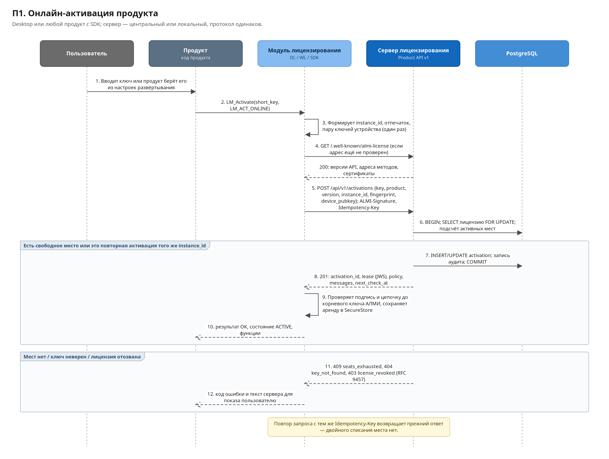
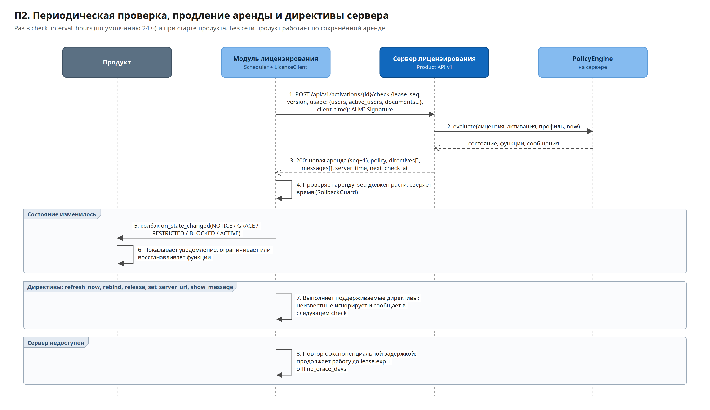
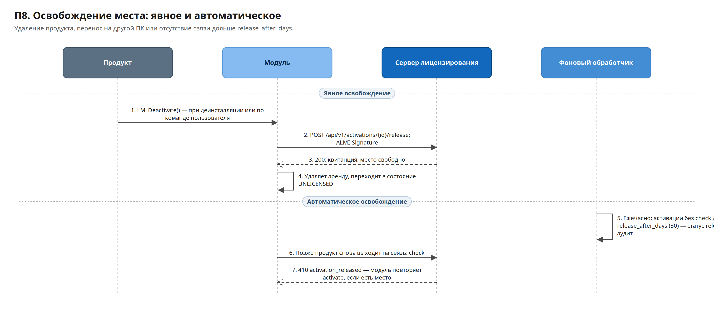
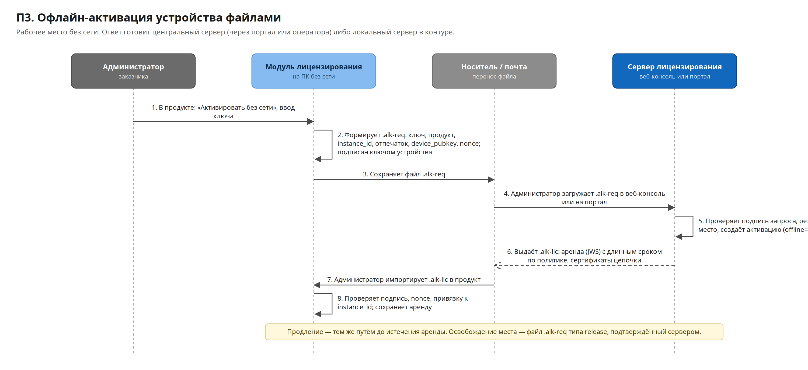
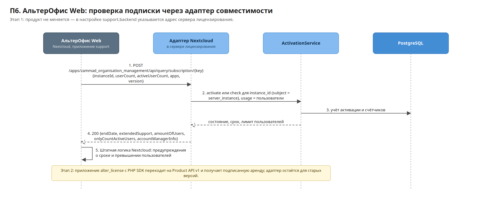
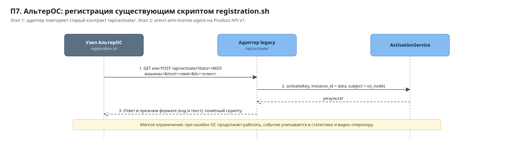
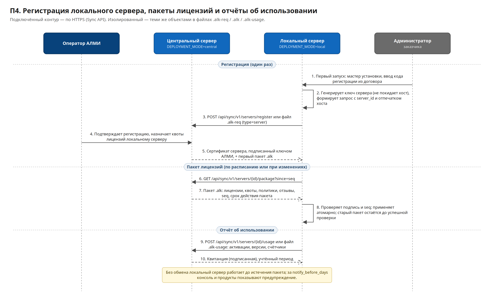
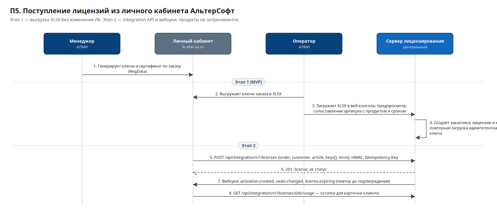

# Спецификация взаимодействия сервера лицензирования с продуктами

| Параметр | Значение |
|---|---|
| Документ | Спецификация взаимодействия (документ 2 из 2) |
| Версия | 1.0 (протокол Product API v1) |
| Дата | 14.10.2026 |
| Статус | На согласование; после утверждения — заморозка контракта v1 |
| Связанные материалы | Документ 1 «Архитектура и план разработки», `contracts/openapi-product-api-v1.yaml` |

---

## 1. Назначение и главное правило

Документ фиксирует все потоки, методы и данные между системой лицензирования и продуктами в обе стороны, а также обмен между центральным и локальными серверами и с личным кабинетом АльтерСофт.

**Главное правило:** продукт реализует этот контракт один раз. Дальнейшее развитие — новые правила сроков, тексты, тарифы, интервалы проверок, переход заказчика на локальный сервер, ротация ключей, интеграция с ЛК — выполняется только на сервере лицензирования. Перечень того, что сервер может менять без изменения продуктов, приведён в разделе 17.

Ключевые слова: **обязательно** — требование контракта; **рекомендуется** — желательное поведение; **допускается** — разрешённый вариант.

---

## 2. Участники, идентификаторы и термины

### 2.1. Участники

| Участник | Реализация контракта | Этап |
|---|---|---|
| АльтерОфис Desktop | Модуль DL `license_module` (C++, C ABI) | 1 |
| АльтерОфис Web (на базе Nextcloud) | Этап 1 — штатное приложение support через адаптер подписки; этап 2 — приложение `alter_license` на PHP SDK | 1, 2 |
| АльтерОС | Этап 1 — существующий `registration.sh` через адаптер `/api/activate/`; этап 2 — агент `almi-license-agent` | 1, 2 |
| Будущие продукты (TeamVision, WebPoint и др.) | DL, PHP SDK или прямая реализация Product API v1 | 2 |
| Центральный сервер | `DEPLOYMENT_MODE=central`, `https://license.alter-os.ru` | 1 |
| Локальный сервер | `DEPLOYMENT_MODE=local`, адрес в контуре заказчика | 1 |
| Личный кабинет АльтерСофт | `lk.alter-os.ru` | 1 (XLSX), 2 (API) |

### 2.2. Идентификаторы

| Идентификатор | Формат | Кто создаёт | Назначение |
|---|---|---|---|
| `product.code` | строка `[a-z0-9-]`: `alteroffice-desktop`, `alteroffice-web`, `alteros` | Каталог | Код продукта |
| `license_key` | `WWyy-XXXX-XXXX-XXXX` (принимается и `XXXX-XXXX-XXXX-XXXX`), регистр и пробелы не важны | ЛК | Ввод пользователем |
| `instance_id` | UUID v4 | Продукт при первом запуске | Постоянный идентификатор экземпляра; хранится в `SecureStore` или БД продукта, не меняется при обновлении |
| `activation_id` | `act_` + 26 символов ULID | Сервер | Идентификатор активации в API |
| `license_id` | UUID | Сервер | Идентификатор лицензии |
| `server_id` | `srv_` + ULID | Локальный сервер при установке | Идентификатор локального сервера |
| `kid` | строка, например `c-2026-01`, `srv_01J…-1` | Сервер | Идентификатор ключа подписи |
| `X-Request-Id` | UUID | Клиент (или шлюз) | Сквозная диагностика |

Идентификатора заказчика в запросах продукта нет: дистрибутив один для всех, сервер определяет заказчика по ключу (ключ → лицензия → заказчик) и возвращает его в аренде (`lic.customer`). Правила учёта юрлиц, холдингов и перевода лицензий — раздел 7.5 документа 1.

### 2.3. Тип субъекта активации

| `subject_type` | Что лицензируется | Продукт |
|---|---|---|
| `device` | Рабочее место (ПК, ВМ, терминальный сервер) | Desktop |
| `server_instance` | Экземпляр серверного продукта | Web |
| `os_node` | Установленная ОС | АльтерОС |

### 2.4. Отпечаток экземпляра

Схема `fp-v1`. Компоненты нормализуются (нижний регистр, без пробелов), каждый хэшируется отдельно: `SHA-256("almi-fp-v1|" + имя + "|" + значение)`, передаётся в base64url. Сырые значения не передаются и не сохраняются.

| Тип субъекта | Компоненты | Правило совпадения на сервере |
|---|---|---|
| `device` | `disk` (серийный номер системного диска), `board` (серийный номер платы или UUID SMBIOS), `cpu` (идентификатор процессора), `mac` (MAC первого физического интерфейса) | Совпадение не менее 3 из 4; недоступный компонент — значение `unknown` и не учитывается (тогда не менее 2 из 3) |
| `server_instance` | `machine_id` (`/etc/machine-id`), `hostname`, `mac`, `os`; в контейнере — `env_id` из `LICENSE_SERVER_ID` | Для контейнеров основной признак — `instance_id` и `env_id`; остальные компоненты информативны |
| `os_node` | `machine` (MD5 из `registration.sh` на этапе 1) | Точное совпадение |

При расхождении сверх допуска сервер возвращает `412 rebind_required`; продукт выполняет повторную активацию с тем же `instance_id` (раздел 6.3).

### 2.5. Ключ устройства

При первой активации продукт генерирует пару Ed25519 и хранит закрытый ключ в `SecureStore`. Открытый ключ передаётся в запросе активации. Все последующие запросы по активации подписываются этим ключом (раздел 4.4). Это защищает активацию от использования на другом устройстве даже при утечке `activation_id`.

---

## 3. Сводная таблица потоков

### 3.1. Продукт — сервер лицензирования

| № | Направление | Когда | Метод или канал | Данные | Этап |
|---|---|---|---|---|---|
| П1 | Продукт → сервер | При первом обращении к адресу | `GET /.well-known/almi-license` | — / версии API, адреса, время сервера | 1 |
| П2 | Продукт → сервер | Ввод ключа или установка с ключом | `POST /api/v1/activations` | Ключ, продукт, экземпляр, ОС, отпечаток, ключ устройства / аренда, сообщения, директивы | 1 |
| П3 | Продукт → сервер | При старте и раз в `check_interval_hours` | `POST /api/v1/activations/{id}/check` | Версия, ОС, счётчики использования, подтверждение директив / новая аренда, директивы, сообщения | 1 |
| П4 | Продукт → сервер | Деинсталляция, перенос, команда пользователя | `POST /api/v1/activations/{id}/release` | Причина / квитанция | 1 |
| П5 | Продукт → сервер | Раз в 7 дней и по директиве `update_trust` | `GET /api/v1/trust` | — / корневые ключи, сертификаты, отзывы | 1 |
| П6 | Продукт → сервер | Накопленные события (не чаще раза в час) | `POST /api/v1/events` | Отказы проверки, перевод часов, превышение лимитов | 1 (приём), продукты — по готовности |
| П7 | Сервер → продукт | В ответах П2, П3 | Поле `directives[]` | Команды: обновить, перепривязать, освободить, сменить адрес, интервал, показать сообщение | 1 |
| П8 | Сервер → продукт | В ответах П2, П3 и в аренде | Поле `messages[]` | Тексты уведомлений с параметрами | 1 |
| П9 | Продукт ⇄ сервер (файлы) | Нет сети | `.alk-req` → `.alk-lic` | Запрос активации, продления или освобождения / аренда | 1 |
| П10 | Веб-продукт → сервер | На каждый вход пользователя при конкурентной модели | `POST /api/v1/activations/{id}/seats:acquire`, `:renew`, `:release` | Хэш пользователя, сессия / токен места | 2 |
| П11 | АльтерОфис Web → сервер | По расписанию приложения support | `POST /apps/zammad_organisation_management/api/query/subscription/{key}` | Протокол Nextcloud (раздел 11) | 1 |
| П12 | АльтерОС → сервер | Регистрация узла | `GET/POST /api/activate/` | `data`, `host`, `lic` (раздел 12) | 1 |

### 3.2. Сервер лицензирования — другие системы

| № | Направление | Когда | Метод или канал | Данные | Этап |
|---|---|---|---|---|---|
| С1 | Локальный → центральный | Установка | `POST /api/sync/v1/servers/register` или `.alk-req` (type `server`) | Код регистрации, `server_id`, открытый ключ, отпечаток хоста / сертификат, первый пакет | 1 |
| С2 | Локальный → центральный | По расписанию (по умолчанию раз в 6 ч) или вручную | `GET /api/sync/v1/servers/{id}/package` или файл `.alk` | Полный снимок прав сервера | 1 |
| С3 | Локальный → центральный | По расписанию (сутки) или при обмене файлами | `POST /api/sync/v1/servers/{id}/usage` или файл `.alk-usage` | Использование / квитанция | 1 |
| Л1 | ЛК → сервер | Выпуск ключей | Этап 1: выгрузка XLSX → импорт в консоли; этап 2: `POST /api/integration/v1/licenses` | Заказ, заказчик, артикул, количество, срок, ключи | 1, 2 |
| Л2 | ЛК → сервер | Продление, отзыв | `POST /api/integration/v1/licenses/{id}/renew`, `/revoke` | Новые даты, причина | 2 |
| Л3 | ЛК → сервер | Карточка клиента | `GET /api/integration/v1/licenses/{id}/usage`, `/customers/{ext_id}/usage` | Остатки | 2 |
| Л4 | Сервер → ЛК | События | Вебхуки | Активации, остатки, сроки | 2 |

---

## 4. Общие правила протокола

### 4.1. Адрес и обнаружение

Продукт хранит один базовый адрес `server_url` (например, `https://license.alter-os.ru` или `https://license.corp.local`). Все остальные адреса продукт получает из `GET /.well-known/almi-license` и кэширует на 24 часа. Пути в этом документе — значения по умолчанию.

Источник `server_url` по приоритету: директива `set_server_url` (раздел 8) → конфигурация развёртывания → значение по умолчанию сборки (центральный сервер).

| Продукт | Где задаётся адрес |
|---|---|
| Desktop, Windows | `%ProgramData%\ALMI\license\config.json`, свойства установщика `LICENSE_SERVER_URL` и `LICENSE_KEY`, переменная `ALMI_LICENSE_SERVER_URL` |
| Desktop, Linux | `/etc/almi/license/config.json`, переменная `ALMI_LICENSE_SERVER_URL`; ключ — `ALMI_LICENSE_KEY` при установке пакета или `config.json` |
| Web (этап 1) | `occ config:system:set support.backend --value=<server_url>` |
| АльтерОС (этап 1) | Адрес в `registration.sh` или DNS-имя в контуре |

Формат `config.json`:

```json
{
  "server_url": "https://license.corp.local",
  "mode": "online",
  "license_key": "ABCD-EFGH-JKLM-NPQR",
  "proxy": "system",
  "ca_bundle": null
}
```

`mode`: `online` или `offline` (только файлы). `license_key` — для активации при массовой установке. `ca_bundle` — путь к корпоративному корневому сертификату TLS для локального сервера.

Массовая установка с ключом:

- MSI: `msiexec /i AlterOffice.msi /qn LICENSE_SERVER_URL=https://license.corp.local LICENSE_KEY=2645-7KQ9-MX2D-81ZT`; DEB/RPM: переменные `ALMI_LICENSE_SERVER_URL` и `ALMI_LICENSE_KEY` при установке. Установщик записывает значения в `config.json` с правами только для администраторов и системной службы.
- Модуль использует `license_key` из `config.json`, только если активации нет: при первом запуске выполняется активация без участия пользователя. Повторная активация того же экземпляра место не занимает, поэтому повторное применение конфигурации групповой политикой безопасно.
- Ключ из `config.json` не выводится в интерфейс и журналы; в «О программе» показывается маска.

### 4.2. Транспорт

- HTTPS, TLS 1.2 и выше; проверка сертификата обязательна, отключение проверки не допускается.
- `Content-Type: application/json; charset=utf-8`; подписанные объекты в теле передаются строкой JWS в полях JSON.
- Системный прокси используется по умолчанию.
- Тайм-ауты клиента: соединение 10 с, ответ 30 с.
- Максимальный размер тела запроса — 256 КБ.

### 4.3. Заголовки

| Заголовок | Направление | Обязательность | Назначение |
|---|---|---|---|
| `ALMI-Protocol: 1` | Запрос | Обязательно | Версия протокола |
| `ALMI-Client: <product>/<version> sdk/<sdk_version> (<os>)` | Запрос | Обязательно | Диагностика и статистика |
| `ALMI-Signature` | Запрос | Обязательно для П2–П4, П6, П10 | Подпись запроса (4.4) |
| `Idempotency-Key` | Запрос | Обязательно для П2, П4, П10 | UUID; повтор с тем же ключом возвращает прежний ответ в течение 24 ч |
| `X-Request-Id` | Запрос и ответ | Рекомендуется | Сквозной идентификатор; сервер возвращает его или свой |
| `Accept-Language` | Запрос | Рекомендуется | Язык сообщений (`ru`, `en`) |
| `Retry-After` | Ответ | При 429 и 503 | Пауза в секундах |
| `ALMI-Server-Time` | Ответ | Всегда | Время сервера, RFC 3339 |

### 4.4. Подпись запроса

```
ALMI-Signature: keyid="act_01JA…", alg="ed25519", created=1765432100,
                nonce="q2p8…", sig="MEUCIQ…"
```

- `keyid` — `activation_id`; для запроса активации — `device`, открытый ключ передаётся в теле.
- Подписываемая строка (разделитель — перевод строки `\n`):

```
ALMI-REQ-V1
<HTTP-метод в верхнем регистре>
<путь без домена, с query-строкой>
<created>
<nonce>
<base64url(SHA-256(тело запроса))>
```

- `nonce` — 16 случайных байт в base64url; сервер отклоняет повтор `nonce` в течение 10 минут.
- `created` — время клиента в секундах Unix. Допустимое отклонение от времени сервера — 300 с. При большем отклонении сервер отвечает `401 clock_skew` с полем `server_time`; модуль вычисляет поправку и повторяет запрос один раз. Поправка используется только для подписи запросов, локальное время продукта не меняется.

### 4.5. Ошибки

Ошибки возвращаются в формате RFC 9457 (`application/problem+json`):

```json
{
  "type": "https://license.alter-os.ru/problems/seats_exhausted",
  "title": "Нет свободных мест по лицензии",
  "status": 409,
  "code": "seats_exhausted",
  "detail": "Использовано 10 из 10 мест.",
  "request_id": "7c1b…",
  "user_message": {"ru": "Все места по лицензии заняты. Обратитесь к администратору.", "en": "All seats are in use."},
  "data": {"limit": 10, "used": 10, "reserve": 0}
}
```

Продукт обязан опираться на `code`; при неизвестном `code` — на класс HTTP-статуса (раздел 16). `user_message` показывается пользователю как есть.

### 4.6. Совместимость

- Продукт обязан игнорировать неизвестные поля в ответах, аренде и файлах.
- Продукт обязан игнорировать неизвестные директивы и сообщать их идентификаторы в `unsupported_directives` при следующей проверке.
- Продукт обязан принимать неизвестные значения перечислений состояний как `ACTIVE` с уведомлением `unknown_state` в событиях; неизвестные `capabilities` — игнорировать.
- Сервер не удаляет поля и не меняет их смысл в рамках v1.

### 4.7. Ограничения частоты

| Метод | Лимит по умолчанию |
|---|---|
| Активация | 10 в минуту с IP, 20 в час на ключ |
| Проверка | 100 в минуту с IP, 12 в час на активацию |
| Офлайн-портал | 10 файлов в час с IP |
| Legacy `/api/activate/` | 20 в час с IP, 10 в час на ключ |

Превышение — `429 rate_limited` с `Retry-After`. За NAT заказчика с локальным сервером лимиты на IP настраиваются на локальном сервере.

### 4.8. Время

Все даты — RFC 3339 в UTC (`2027-12-31T23:59:59Z`); даты без времени (`valid_until`) трактуются как конец суток по московскому времени и передаются уже приведёнными к UTC. Продукт вычисляет состояние по доверенному времени (раздел 7.3).

---

## 5. Методы Product API v1

### 5.1. Обнаружение сервера

`GET /.well-known/almi-license`

Ответ `200`:

```json
{
  "service": "almi-license",
  "deployment_mode": "local",
  "server_id": "srv_01JAB3…",
  "protocol_versions": [1],
  "endpoints": {
    "activations": "/api/v1/activations",
    "trust": "/api/v1/trust",
    "events": "/api/v1/events",
    "offline_portal": "/offline"
  },
  "server_time": "2026-11-02T08:15:00Z",
  "min_sdk_version": "1.0.0"
}
```

### 5.2. Активация

`POST /api/v1/activations` — заголовки `ALMI-Signature` (`keyid="device"`), `Idempotency-Key`.

Запрос:

| Поле | Тип | Обяз. | Описание |
|---|---|---|---|
| `license_key` | string | да | Ключ; для триального серверного режима — не передаётся, используется `trial: true` |
| `product.code` | string | да | Код продукта |
| `product.version` | string | да | Версия продукта, SemVer или формат продукта |
| `product.build` | string | нет | Номер сборки |
| `product.edition` | string | нет | Редакция, если выбирается при установке |
| `instance.instance_id` | uuid | да | Идентификатор экземпляра |
| `instance.subject_type` | enum | да | `device`, `server_instance`, `os_node` |
| `instance.name` | string | нет | Имя хоста (до 128 символов) |
| `instance.os` | object | да | `family` (`windows`, `linux`), `name`, `version`, `arch` |
| `fingerprint` | object | да | `scheme: "fp-v1"`, `components: {disk, board, cpu, mac}` — хэши |
| `device_pubkey` | string | да | Открытый ключ Ed25519, base64url |
| `client_time` | datetime | да | Время клиента |
| `usage` | object | нет | Счётчики (5.3) |

```json
{
  "license_key": "2645-7KQ9-MX2D-81ZT",
  "product": {"code": "alteroffice-desktop", "version": "3.2.0", "build": "3.2.0.1187"},
  "instance": {
    "instance_id": "8d6a1f9e-6c39-4e57-9a3e-0e5d0f7b2c11",
    "subject_type": "device",
    "name": "WS-0451",
    "os": {"family": "windows", "name": "Windows 11 Pro", "version": "10.0.22631", "arch": "x86_64"}
  },
  "fingerprint": {"scheme": "fp-v1", "components": {"disk": "pX0…", "board": "Zr4…", "cpu": "k1Q…", "mac": "s9V…"}},
  "device_pubkey": "c3Vw…",
  "client_time": "2026-11-02T08:14:58Z"
}
```

Ответ `201` (новая активация) или `200` (повторная активация того же экземпляра):

| Поле | Описание |
|---|---|
| `activation_id` | Идентификатор активации |
| `status` | `active` |
| `lease` | Аренда — строка JWS (раздел 6) |
| `next_check_at` | Когда выполнить следующую проверку (с разбросом, назначенным сервером) |
| `server_time` | Время сервера |
| `messages[]` | Сообщения (раздел 9) |
| `directives[]` | Директивы (раздел 8) |

```json
{
  "activation_id": "act_01JABF8Q4W2N8C1R7ZB0Y5K6M3",
  "status": "active",
  "lease": "eyJhbGciOiJFZERTQSIs…",
  "next_check_at": "2026-11-03T09:41:00Z",
  "server_time": "2026-11-02T08:15:00Z",
  "messages": [],
  "directives": []
}
```

Ошибки: `400 invalid_request`, `400 invalid_key_format`, `401 signature_invalid`, `401 clock_skew`, `403 license_revoked`, `403 license_expired`, `403 product_mismatch`, `404 key_not_found`, `409 seats_exhausted`, `409 instance_conflict`, `409 idempotency_conflict`, `422 unsupported_product_version`, `426 upgrade_required`, `429 rate_limited`.

Правила сервера:

1. Ключ ищется по нормализованному значению; продукт ключа должен совпадать с `product.code`.
2. Если активация с этим `instance_id` и ключом уже есть и отпечаток в допуске — возвращается она же (`200`) с новой арендой; ключ устройства обновляется, если изменился.
3. Если `instance_id` уже активирован с другим ключом устройства и отпечатком вне допуска — `409 instance_conflict` (признак клонирования образа). Оператор видит конфликт в консоли.
4. Подсчёт мест — с блокировкой строки лицензии; разрешено `limit + ceil(limit × reserve_pct / 100)`.
5. Лицензия, у которой истёк срок и отсрочка, новые активации не принимает (`403 license_expired`), кроме режима `monitor`.



### 5.3. Проверка

`POST /api/v1/activations/{activation_id}/check` — заголовок `ALMI-Signature` (`keyid=<activation_id>`).

Запрос:

| Поле | Тип | Обяз. | Описание |
|---|---|---|---|
| `lease_seq` | integer | да | `seq` применённой аренды |
| `product.version`, `product.build` | string | да | Текущая версия |
| `instance.os` | object | да | Текущая ОС |
| `fingerprint` | object | рекомендуется | Текущий отпечаток |
| `state` | enum | да | Текущее состояние в продукте (раздел 7) |
| `usage` | object | нет | Счётчики: `named_users`, `active_users`, `active_users_window_days`, `documents_opened`, `apps` (объект), произвольные числовые поля по каталогу продукта |
| `acked_directives` | string[] | нет | Выполненные директивы |
| `unsupported_directives` | string[] | нет | Неподдерживаемые директивы |
| `client_time` | datetime | да | Время клиента |
| `last_success_at` | datetime | нет | Время последней успешной проверки |

Ответ `200`: те же поля, что у активации (`lease` — всегда новая аренда с большим `seq`, `next_check_at`, `server_time`, `messages`, `directives`).

Ошибки: `401 signature_invalid`, `401 clock_skew`, `404 activation_not_found`, `410 activation_released`, `412 rebind_required`, `429 rate_limited`, `503 maintenance`.

Поведение модуля:

- проверка выполняется при старте продукта (в фоне, не блокируя интерфейс) и по `next_check_at`;
- при сетевой ошибке или `5xx` — повтор через 1, 5, 15, 60 минут, затем по `next_check_at`; продукт работает по сохранённой аренде;
- при `410` — повторная активация тем же ключом (раздел 6.3);
- при `412` — повторная активация с новым отпечатком.



### 5.4. Освобождение

`POST /api/v1/activations/{activation_id}/release` — заголовки `ALMI-Signature`, `Idempotency-Key`.

Запрос: `{"reason": "uninstall" | "user" | "transfer" | "directive", "client_time": "…"}`.

Ответ `200`: `{"activation_id": "…", "released_at": "…", "receipt": "<JWS alm-receipt>"}`. Повторный вызов возвращает ту же квитанцию.

После освобождения модуль удаляет аренду и переходит в `UNLICENSED`; ключ устройства и `instance_id` сохраняются.

Автоматическое освобождение: сервер освобождает активацию без проверок дольше `release_after_days`. Продукт узнаёт об этом по `410 activation_released` и повторно активируется, если есть место.



### 5.5. Доверенные ключи

`GET /api/v1/trust` — без подписи запроса.

```json
{
  "bundle": "<JWS alm-trust, подписан корневым ключом>",
  "roots": [{"kid": "root-2026", "alg": "EdDSA", "pub": "…", "status": "active"},
            {"kid": "root-2026-r", "alg": "EdDSA", "pub": "…", "status": "reserve"}],
  "issuers": ["<JWS alm-cert>", "…"],
  "revoked_kids": ["srv_01H…-1"],
  "seq": 4
}
```

Модуль принимает пакет доверия, только если `bundle` подписан встроенным корневым ключом и `seq` больше сохранённого. Корневые ключи из ответа не заменяют встроенные; они используются только для перехода на резервный ключ, уже встроенный в сборку.

### 5.6. События

`POST /api/v1/events` — заголовок `ALMI-Signature`.

```json
{"activation_id": "act_…", "events": [
  {"id": "evt_…", "type": "clock_rollback_detected", "at": "…", "data": {"delta_hours": 72}},
  {"id": "evt_…", "type": "user_limit_exceeded", "at": "…", "data": {"limit": 500, "actual": 517}}
]}
```

Типы: `clock_rollback_detected`, `lease_verification_failed`, `user_limit_exceeded`, `state_changed`, `feature_denied`, `unknown_state`, `unsupported_directive`. Не более 100 событий в запросе; ответ `202`.

### 5.7. Конкурентные сессии (этап 2)

Для лицензий с метрикой `concurrent_session` (веб-продукты) — пул мест на сервере:

| Метод | Запрос | Ответ |
|---|---|---|
| `POST /api/v1/activations/{id}/seats:acquire` | `user_ref` (HMAC-хэш логина с солью экземпляра), `session_ref` | `seat_token`, `expires_at` (15 мин) или `409 seats_exhausted` с `queue_hint` |
| `POST /api/v1/activations/{id}/seats:renew` | `seat_token` | новый `expires_at` |
| `POST /api/v1/activations/{id}/seats:release` | `seat_token` | `204` |

Очередь ожидания (60 с, затем `503` пользователю) реализует продукт. Места без продления освобождаются через 15 минут.

---

## 6. Подписанная аренда

### 6.1. Заголовок JWS

```json
{"alg": "EdDSA", "typ": "alm-lease+jws", "kid": "c-2026-01", "chain": ["<JWS alm-cert ключа выпуска>"]}
```

Для локального сервера `chain` содержит сертификат ключа локального сервера, подписанный корнем. Будущий алгоритм ГОСТ — `alg: "GOST3410-2012-256"`; на переходный период сервер может выдавать две аренды (`lease` и `lease_gost`).

### 6.2. Утверждения

| Поле | Тип | Описание |
|---|---|---|
| `ver` | integer | Версия схемы аренды, сейчас `1` |
| `iss` | string | `https://license.alter-os.ru` или `urn:almi:ls:<server_id>` |
| `sub` | string | `activation_id` |
| `aud` | string | `product.code` |
| `iat`, `nbf` | integer | Время выпуска и начала действия (Unix) |
| `exp` | integer, необяз. | Срок доверия аренде без связи: `iat + offline_grace_days`. Отсутствует — бессрочно |
| `seq` | integer | Монотонный номер аренды активации |
| `lic.id` | uuid | Лицензия |
| `lic.type` | enum | `subscription`, `perpetual`, `trial`, `nfr`, `free` |
| `lic.status` | enum | `active`, `suspended`, `revoked` |
| `lic.edition` | string | Редакция |
| `lic.valid_from`, `lic.valid_until` | datetime | Срок права; `valid_until = null` — бессрочно |
| `lic.support_until` | datetime | Срок техподдержки и обновлений |
| `lic.customer` | object | `id`, `name` (для окна «О программе») |
| `subject` | object | `type`, `instance_id`, `fp` (схема и хэши), `device_key_thumbprint` |
| `limits` | object | `named_users`, `active_users`, `only_count_active`, `concurrent_sessions`, прочие по каталогу |
| `capabilities` | string[] | Разрешённые функции при полном доступе |
| `policy` | object | Профиль политики (6.4) |
| `messages` | array | Сообщения по состояниям (раздел 9) |
| `server_time` | integer | Время сервера на момент выпуска |

Пример полезной нагрузки:

```json
{
  "ver": 1,
  "iss": "https://license.alter-os.ru",
  "sub": "act_01JABF8Q4W2N8C1R7ZB0Y5K6M3",
  "aud": "alteroffice-desktop",
  "iat": 1762071300, "nbf": 1762071300,
  "seq": 17,
  "lic": {
    "id": "6f1c…", "type": "subscription", "status": "active", "edition": "standard",
    "valid_from": "2026-11-01T00:00:00Z", "valid_until": "2027-10-31T20:59:59Z",
    "support_until": "2027-10-31T20:59:59Z",
    "customer": {"id": "c3a…", "name": "ООО «Пример»"}
  },
  "subject": {"type": "device", "instance_id": "8d6a1f9e-…", "fp": {"scheme": "fp-v1", "components": {"disk": "pX0…", "board": "Zr4…", "cpu": "k1Q…", "mac": "s9V…"}},
              "device_key_thumbprint": "Jx3…"},
  "limits": {},
  "capabilities": ["edit", "save", "export", "print", "macros", "updates"],
  "policy": {
    "version": 3, "enforcement": "enforce",
    "notify_before_days": 30, "grace_days": 14,
    "expiry_action": "restrict", "restricted_caps": ["updates"], "restricted_days": null,
    "hard_block_mode": "read_only", "read_only_caps": ["view", "print", "export"],
    "offline_grace_days": null, "check_interval_hours": 24, "release_after_days": 30
  },
  "messages": [
    {"id": "notice", "state": "NOTICE", "severity": "warning", "placement": "banner",
     "text": {"ru": "Срок лицензии истекает через {days_left} дн. Обратитесь к менеджеру АЛМИ."}}
  ],
  "server_time": 1762071300
}
```

### 6.3. Проверка аренды модулем

Аренда принимается, только если выполнены все условия:

1. Подпись верна; ключ подписи из `chain` подтверждён сертификатом, подписанным встроенным корневым ключом; сертификат действует и не отозван (`revoked_kids`).
2. Для ключа локального сервера: продукт и заказчик аренды входят в область действия сертификата.
3. `aud` совпадает с кодом продукта; `subject.instance_id` — с собственным; `device_key_thumbprint` — с собственным ключом.
4. `seq` больше сохранённого (при первой установке — любое).
5. `nbf` не позже доверенного времени + 24 ч.

Отклонённая аренда не применяется; продукт продолжает работать по прежней и отправляет событие `lease_verification_failed`.

Повторная активация (`410`, `412`, директива `rebind`): модуль вызывает активацию с сохранённым ключом лицензии, тем же `instance_id` и новым `Idempotency-Key`; до получения новой аренды продукт работает по старой.

### 6.4. Профиль политики

| Поле | Тип | Значения | Описание |
|---|---|---|---|
| `version` | integer | | Версия профиля |
| `enforcement` | enum | `enforce`, `monitor` | `monitor` — состояния и сообщения показываются, функции не ограничиваются |
| `notify_before_days` | integer | 0–365 | Напоминание за N дней |
| `grace_days` | integer | 0–365 | Отсрочка после срока |
| `expiry_action` | enum | `none`, `restrict`, `block` | Действие после отсрочки |
| `restricted_caps` | string[] | | Функции, отключаемые при мягком блоке |
| `restricted_days` | integer или null | | Длительность мягкого блока до жёсткого; `null` — без перехода |
| `hard_block_mode` | enum | `read_only`, `no_start` | Вид жёсткого блока |
| `read_only_caps` | string[] | | Функции, доступные при `read_only` |
| `offline_grace_days` | integer или null | | Срок работы без связи; `null` — бессрочно |
| `check_interval_hours` | integer | 1–168 | Период проверки |
| `release_after_days` | integer | 7–365 | Автоосвобождение (информативно для продукта) |

---

## 7. Состояние лицензии в продукте

### 7.1. Состояния и функции

| Состояние | Код `LM_LicenseMode` | Функции |
|---|---|---|
| `TRIAL` | `LM_MODE_TRIAL` (0) | Все |
| `ACTIVE` | `LM_MODE_FULL` (1) | `capabilities` |
| `UNLICENSED` | `LM_MODE_SOFT_BLOCK` (2) | По ТЗ: все, с диалогом при запуске; может быть ограничено настройкой сборки продукта |
| `RESTRICTED` | `LM_MODE_LIMITED` (3) | `capabilities` минус `restricted_caps` |
| `REVOKED` | `LM_MODE_REVOKED` (4) | Как `BLOCKED` |
| `NOTICE` | `LM_MODE_NOTICE` (5) | `capabilities` |
| `GRACE` | `LM_MODE_GRACE` (6) | `capabilities` |
| `BLOCKED` | `LM_MODE_BLOCKED` (7) | `read_only_caps` или запрет запуска |

Значения 0–4 совпадают с ТЗ; 5–7 добавлены в конец перечисления, что сохраняет двоичную совместимость.

### 7.2. Алгоритм вычисления

Алгоритм одинаков на сервере (`PolicyEngine`) и в модуле (`StateEvaluator`) и проверяется общими эталонными векторами `contracts/vectors/policy/*.json`.

```
вход: аренда L (или её отсутствие), доверенное время T, данные триала
если аренды нет:
    если триал не начат или T < first_launch + 30 дн: состояние = TRIAL
    иначе: состояние = UNLICENSED
    конец
P = L.policy; VU = L.lic.valid_until
если L.lic.status == revoked:              S = REVOKED
иначе если L.exp задан и T > L.exp:        S = после_срока(P)    # нет связи дольше offline_grace_days
иначе если VU == null:                     S = ACTIVE            # бессрочная
иначе если T < VU − P.notify_before_days:  S = ACTIVE
иначе если T < VU:                         S = NOTICE
иначе если T < VU + P.grace_days:          S = GRACE
иначе:                                     S = после_срока(P)

после_срока(P):
    если P.expiry_action == none:     вернуть GRACE
    если P.expiry_action == block:    вернуть BLOCKED
    если P.restricted_days != null и T ≥ VU + P.grace_days + P.restricted_days: вернуть BLOCKED
    вернуть RESTRICTED

функции(S):
    если P.enforcement == monitor:      вернуть capabilities        # «прогрев»
    ACTIVE, NOTICE, GRACE:              capabilities
    RESTRICTED:                         capabilities − restricted_caps
    BLOCKED, REVOKED:                   read_only_caps (или запрет запуска при no_start)
```

Для бессрочной лицензии продукт дополнительно показывает уведомление об окончании `support_until`; функции при этом не ограничиваются, кроме функции `updates`, если она указана в `restricted_caps`.

### 7.3. Доверенное время

`trusted_now = max(системное время, последнее подтверждённое время)`, где последнее подтверждённое время — максимум из `server_time` последнего ответа и сохранённых отметок запуска. Если системное время меньше подтверждённого более чем на 24 часа, модуль фиксирует `clock_rollback_detected`, использует подтверждённое время и, в режиме триала, считает триал завершённым (требование ТЗ).

### 7.4. Когда применяется новое состояние

- Переходы к более мягкому состоянию (например, после отката блока) применяются сразу.
- Переходы к более строгому состоянию во время работы применяются для новых операций; открытый документ не закрывается, несохранённые данные можно сохранить. Отзыв (`REVOKED`) применяется при следующем запуске (требование ТЗ).

---

## 8. Директивы сервера

Директива — команда сервера продукту в поле `directives[]` ответа активации или проверки.

```json
{"id": "dir_01JAC…", "type": "set_server_url", "params": {"url": "https://license.corp.local", "fallback_days": 14}}
```

| Тип | Параметры | Действие продукта | Обязательна в v1 |
|---|---|---|---|
| `refresh_now` | — | Выполнить проверку немедленно | да |
| `update_trust` | — | Запросить `/api/v1/trust` | да |
| `set_check_interval` | `hours` | Изменить период проверки | да |
| `show_message` | `message` (объект раздела 9) | Показать сообщение | да |
| `rebind` | `reason` | Повторная активация с текущим отпечатком | да |
| `release` | `reason` | Освободить активацию и перейти в `UNLICENSED` | да |
| `set_server_url` | `url`, `fallback_days` | Сохранить новый адрес; если он недоступен `fallback_days` дней, вернуться к прежнему | да |
| `collect_diagnostics` | `scope` | Отправить диагностический отчёт | нет (этап 2) |

Выполненные директивы перечисляются в `acked_directives`, неподдерживаемые — в `unsupported_directives` следующей проверки. Повторно полученная директива с тем же `id` не выполняется повторно.

Директива `set_server_url` позволяет перевести продукты заказчика с центрального сервера на развёрнутый позже локальный без переустановки продуктов.

---

## 9. Сообщения

```json
{"id": "notice", "state": "NOTICE", "severity": "warning", "placement": "banner",
 "text": {"ru": "Срок лицензии истекает через {days_left} дн.", "en": "License expires in {days_left} days."},
 "action": {"label": {"ru": "Подробнее"}, "url": "https://alter-os.ru/renew"},
 "repeat": "daily"}
```

| Поле | Значения |
|---|---|
| `state` | Состояние, в котором показывается сообщение; отсутствует — показывается сразу |
| `severity` | `info`, `warning`, `critical` |
| `placement` | `banner`, `dialog` (модальное при запуске), `about` (окно «О программе»), `tray` |
| `repeat` | `once`, `daily`, `each_start` |
| Подстановки | `{days_left}`, `{valid_until}`, `{customer}`, `{used}`, `{limit}` |

Продукт показывает текст сервера без изменений. Если подходящего сообщения нет, продукт использует встроенные тексты по умолчанию для каждого состояния (поставляются в модуле DL).

---

## 10. Офлайн-файлы

Все файлы — UTF-8 JSON-обёртка с подписанным содержимым:

```json
{"format": "alk-req", "version": 1, "payload": "<JWS>"}
```

| Файл | Кто создаёт | Подпись | Содержимое |
|---|---|---|---|
| `.alk-req` (type `activate`, `renew`, `release`) | Продукт | Ключ устройства | Ключ (для `activate`), продукт, экземпляр, ОС, отпечаток, `device_pubkey`, `nonce`, `created`, `activation_id` (для `renew`/`release`), счётчики использования |
| `.alk-req` (type `server`) | Локальный сервер | Ключ сервера | Код регистрации, `server_id`, открытый ключ, отпечаток хоста, версия |
| `.alk-lic` | Центральный или локальный сервер | Ключ выпуска | `request_nonce`, `activation_id`, аренда (раздел 6), квитанция освобождения для `release` |
| `.alk` | Центральный сервер | Ключ выпуска | Пакет прав локального сервера (раздел 13.3) |
| `.alk-usage` | Локальный сервер | Ключ сервера | Отчёт об использовании (раздел 13.4) |

Правила:

- модуль хранит `nonce` неподтверждённых запросов и принимает `.alk-lic` только с известным `request_nonce`;
- срок ответа — 30 дней с момента запроса; после — нужен новый запрос;
- для офлайн-активаций сервер ставит `exp` аренды по `offline_grace_days` профиля; для продления используется `.alk-req` типа `renew`;
- файлы можно передавать по почте: они не содержат секретов, кроме ключа лицензии в `activate`;
- точный состав полезной нагрузки файлов и подписанных объектов (`alk-req`, `alk-lic`, `package`, `alk-usage`, `cert`, `trust`, `receipt`, аренда) — JSON Schema в `contracts/schemas`; время `iat`, `nbf`, `exp`, `server_time` — Unix, остальные даты — RFC 3339.

Где обрабатываются файлы устройств: портал `/offline` центрального сервера (без входа, с ограничением частоты), консоль оператора, консоль локального сервера.



---

## 11. АльтерОфис Web

### 11.1. Этап 1: адаптер подписки Nextcloud

Продукт не меняется. Администратор задаёт адрес сервера лицензирования командой:

```
occ config:system:set support.backend --value="https://license.alter-os.ru"
```

и вводит ключ подписки в штатном разделе «Поддержка».

`POST {support.backend}/apps/zammad_organisation_management/api/query/subscription/{subscriptionKey}`

Сопоставление запроса:

| Поле Nextcloud | Поле Product API |
|---|---|
| `{subscriptionKey}` в пути | `license_key` |
| `instanceId` | `instance.instance_id` (субъект `server_instance`; строковый идентификатор Nextcloud приводится к UUID v5) |
| `userCount` | `usage.named_users` |
| `activeUserCount` | `usage.active_users` |
| `apps` | `usage.apps` (сохраняется для статистики) |
| `version` | `product.version` |

Первый запрос с новым `instanceId` создаёт активацию, последующие — выполняют проверку. Подпись запроса не требуется (протокол Nextcloud её не поддерживает); вместо неё адаптер проверяет пару «ключ — `instanceId`» и ограничивает частоту.

Сопоставление ответа:

| Поле ответа | Источник |
|---|---|
| `endDate` | `lic.valid_until` (`YYYY-MM-DD`); для бессрочной — `support_until`; в режиме `monitor` после срока — фактическая дата |
| `extendedSupport` | `support_until ≥ сегодня` |
| `amountOfUsers` | `limits.named_users` (или `active_users`) |
| `onlyCountActiveUsers` | `limits.only_count_active` |
| `accountManagerInfo` | `{name, email, phone}` менеджера заказчика из каталога |

```json
{"endDate": "2027-12-31", "extendedSupport": true, "amountOfUsers": 500, "onlyCountActiveUsers": false,
 "accountManagerInfo": {"name": "Иван Петров", "email": "ivan.petrov@alter-os.ru", "phone": "+7 495 000-00-00"}}
```

Ограничение этапа 1: предупреждения о сроке и превышении пользователей показывает штатная логика приложения support; мягкий и жёсткий блок для веб-версии на этом этапе — только в виде уведомлений.

Изолированный контур без локального сервера: консоль формирует набор команд `occ config:app:set support …` (`subscriptionKey`, `end_date`, `extended_support`, `last_response`) для офлайн-режима приложения support, а администратор выполняет их на сервере АльтерОфис Web.



### 11.2. Этап 2: приложение `alter_license` и PHP SDK

| Элемент | Назначение |
|---|---|
| PHP SDK (Composer, PHP 8.1+) | Реализация Product API v1: активация, проверка раз в 6 ч (cron), проверка аренды (sodium), кэш 5 мин, хранение в БД экземпляра |
| Интерфейс SDK | `LicenseManager::activate($key)`, `check()`, `release()`, `status(): Status`, `hasFeature($name)`, `limits(): Limits`, `reportUsage(Usage $u)`, `acquireSeat($user, $session)` |
| Middleware | Проверка состояния на каждый запрос (через кэш), лимит новых пользователей (`403 User limit reached`), очередь конкурентных сессий |
| Приложение Nextcloud `alter_license` | Страница лицензии, баннеры, ограничение входа новых пользователей, заменяет обращения приложения support |

Адаптер подписки остаётся для экземпляров, не обновлённых до `alter_license`.

---

## 12. АльтерОС

### 12.1. Этап 1: адаптер `/api/activate/`

`GET` или `POST /api/activate/?data=<MD5 32 hex>&host=<имя хоста>&lic=<ключ>[&format=json]`

| Параметр | Сопоставление |
|---|---|
| `data` | `fingerprint.components.machine`; `instance_id` = UUID v5 от `data` |
| `host` | `instance.name` |
| `lic` | `license_key` |

Ответ — в прежнем формате текущей реализации ЛК: HTML по умолчанию, JSON при `format=json` или `Accept: application/json`. Тексты и коды ответов фиксируются на неделе 1 по коду текущего ЛК и проверяются тестами совместимости.

На центральном сервере в этапе 1 существующий `/api/activate/` продолжает обслуживать ЛК; адаптер используется на локальных серверах в закрытых контурах. Перенос центрального эндпоинта в сервер лицензирования — этап 2 после миграции legacy-активаций.

Режим по умолчанию для АльтерОС — `monitor` с `expiry_action = none`: отказ регистрации не мешает работе ОС, событие учитывается в статистике.



### 12.2. Этап 2: агент `almi-license-agent`

Системная служба (deb/rpm), реализует Product API v1 с `subject_type = os_node`, хранит аренду в `/var/lib/almi-license/` (права 0600), предоставляет локальный интерфейс `almi-license status|activate|release` и D-Bus-сигнал смены состояния для графической оболочки. Существующий `registration.sh` заменяется вызовом агента.

---

## 13. Центральный и локальный серверы

### 13.1. Регистрация

`POST /api/sync/v1/servers/register` (или файл `.alk-req` type `server`)

| Поле | Описание |
|---|---|
| `registration_code` | Код из договора, выдаётся оператором |
| `server_id` | Генерируется при установке |
| `server_pubkey` | Открытый ключ Ed25519 локального сервера |
| `host_fingerprint` | Хэши `machine_id`, `hostname` |
| `version` | Версия образа |

Ответ: `202 pending` (ожидает подтверждения оператора) или `200` с `certificate` (JWS `alm-cert`) и `package` (JWS `alm-package`). Повторная регистрация с тем же `server_id` идемпотентна.

### 13.2. Аутентификация обмена

Запросы локального сервера подписываются его ключом (`ALMI-Signature`, `keyid=<server_id>`). Ответы центрального сервера — подписанные JWS.

### 13.3. Пакет `.alk`

`GET /api/sync/v1/servers/{server_id}/package?since_seq=N` → `200` (новый пакет) или `204` (изменений нет).

Пакет — полный снимок прав сервера: при импорте он заменяет предыдущий целиком.

| Поле | Описание |
|---|---|
| `typ` | `alm-package+jws` |
| `server_id`, `customer_id` | Получатель |
| `seq` | Монотонный номер; пакет с меньшим или равным `seq` отклоняется |
| `issued_at`, `valid_until` | Срок действия пакета (по умолчанию 365 дней) |
| `licenses[]` | `license_id`, продукт, редакция, тип, метрика, `allocation` (переданные места), лимиты, даты, `capabilities`, полный профиль политики, статус |
| `keys[]` | `key_hash` (SHA-256 нормализованного ключа), `key_mask` (`2645-****-****-81ZT`), `license_id` |
| `revocations[]` | Отозванные лицензии и активации |
| `trust` | Сертификаты ключей выпуска, `revoked_kids`, обновлённый сертификат локального сервера |
| `messages[]` | Сообщения для консоли локального сервера |

Применение: проверка подписи и `seq` → атомарная замена в транзакции → пересчёт состояний → запись в аудит. При ошибке остаётся прежний пакет.

За `notify_before_days` до `valid_until` пакета консоль локального сервера и продукты получают предупреждение. После `valid_until` локальный сервер продолжает выдавать аренды по профилю, но с `enforcement` и `expiry_action`, заданными в пакете для случая «пакет истёк» (по умолчанию — `GRACE` 30 дней, затем `RESTRICTED`).

### 13.4. Отчёт `.alk-usage`

`POST /api/sync/v1/servers/{server_id}/usage` → `200` с квитанцией (`alm-receipt+jws`). Отчёт подписывается ключом локального сервера, `typ: alm-usage+jws`.

| Поле | Описание |
|---|---|
| `server_id`, `seq` | Монотонный номер отчёта |
| `period` | `from`, `to` |
| `package_seq` | Применённый пакет |
| `licenses[]` | `license_id`, активно, освобождено, в резерве, по версиям продуктов, по ОС, пользователи (всего и максимум активных) |
| `activations[]` | По профилю телеметрии: `activation_id`, `instance_hash`, версия, ОС, статус, даты активации и последнего контакта |
| `denials` | Отказы по кодам |
| `audit_digest` | Хэш последней записи аудита локального сервера |

Отчёт идемпотентен по `seq`. Квитанцию локальный сервер хранит; при файловом обмене квитанция приходит в следующем пакете.



---

## 14. Личный кабинет АльтерСофт

### 14.1. Этап 1: импорт выгрузки XLSX

Оператор выгружает ключи заказа из ЛК и загружает файл в консоль. Импорт идемпотентен по коду ключа; перед записью показывается предпросмотр с ошибками.

| Колонка выгрузки ЛК | Поле сервера лицензирования |
|---|---|
| Серийный номер `YY-ARTICLE-DDD-NNNN` | `external_ref` лицензии |
| Код лицензии `WWyy-XXXX-XXXX-XXXX` | `license_key` |
| Артикул (поля `AA…II`) | Продукт, редакция, метрика (`AA` — продукт по каталогу) |
| Срок `FF` | `type` и `valid_until`: `01/03/06/12/24/36` — подписка на N месяцев от даты выдачи; `99` — бессрочная |
| Количество (`TotalLicenses`) | `limit` |
| Заказчик, ИНН | `customer` (поиск по ИНН) |
| Дата выдачи | `valid_from` |

Точный состав колонок выгрузки фиксируется на неделе 1 по реальному файлу; таблица соответствия артикулов и продуктов ведётся в каталоге консоли.

### 14.2. Этап 2: Integration API

Аутентификация: HMAC-SHA256 запроса общим секретом (`ALMI-Integration-Signature: t=<unix>, v1=<hex>`), разрешённые IP; `Idempotency-Key` обязателен для изменений.

| Метод | Назначение | Тело / ответ |
|---|---|---|
| `POST /api/integration/v1/licenses` | Создать или обновить лицензию по `external_ref` | `external_ref`, `order_no`, `customer{external_id, name, inn}`, `article`, `quantity`, `valid_from`, `valid_until`, `support_until`, `keys[]`, `policy_profile` / `license_id`, `status` |
| `POST /api/integration/v1/licenses/{id}/renew` | Продление | `valid_until`, `support_until`, `quantity` |
| `POST /api/integration/v1/licenses/{id}/revoke` | Отзыв | `reason` |
| `GET /api/integration/v1/licenses/{id}/usage` | Остатки | `total`, `used`, `free`, `reserve_used`, `last_activity_at`, `by_version` |
| `GET /api/integration/v1/customers/{external_id}/usage` | Остатки по заказчику | Список лицензий с остатками |
| `POST /api/integration/v1/licenses/{id}/transfer` | Перевод лицензии на другого заказчика (реорганизация, смена юрлица) | `customer{external_id, name, inn}`, `reason`, `document` / лицензия с новым заказчиком; `409`, если места выделены локальному серверу |

Поле `customer.group_external_id` (необязательное) относит заказчика к группе (холдингу); лицензия группы создаётся с `customer_group{external_id, name, head_inn}` вместо `customer`.

### 14.3. Вебхуки (этап 2)

`POST <webhook_url ЛК>`, подпись `ALMI-Webhook-Signature: t=<unix>, v1=<HMAC>`; доставка «не менее одного раза», повторы с увеличением интервала до 24 часов; получатель отбрасывает дубли по `id`.

```json
{"id": "whk_01JAD…", "type": "seats.threshold", "occurred_at": "2027-03-01T10:00:00Z",
 "data": {"license_id": "6f1c…", "external_ref": "26-AB01…", "used": 9, "limit": 10, "threshold": 90}}
```

| Событие | Когда |
|---|---|
| `license.created`, `license.updated` | Изменение лицензии на сервере |
| `license.transferred` | Перевод лицензии на другого заказчика |
| `activation.created`, `activation.released` | Активация и освобождение |
| `seats.threshold` | Использование 90 % и 100 % |
| `license.expiring` | За `notify_before_days` до срока |
| `license.state_changed` | Смена состояния (GRACE, RESTRICTED, BLOCKED, ACTIVE) |
| `local_server.usage_imported` | Принят отчёт локального сервера |

### 14.4. Миграция legacy-активаций (этап 2)

| Legacy (MariaDB ЛК) | Сервер лицензирования |
|---|---|
| `RegData` (серийный номер, код, `Total`) | Лицензия и ключ, `limit = Total` |
| `RegData.Used` | Проверочный показатель (не переносится, пересчитывается) |
| `Licensing` (`SystemUniqueNumber`, хост, дата) | Активация `os_node`, `instance_id` = UUID v5 от `SystemUniqueNumber` |

После миграции `/api/activate/` центрального сервера маршрутизируется в адаптер сервера лицензирования, ЛК читает остатки через Integration API.



---

## 15. Модуль DL: C ABI

### 15.1. Заголовок `license_module.h`

Функции и типы из ТЗ сохранены без изменений; добавленные элементы отмечены комментарием `v1+`.

```c
#ifndef LICENSE_MODULE_H
#define LICENSE_MODULE_H
#include <stdint.h>
#ifdef _WIN32
#  ifdef LM_BUILDING_DLL              /* v1+ задаётся только при сборке самой библиотеки */
#    define LM_API __declspec(dllexport)
#  else
#    define LM_API __declspec(dllimport)
#  endif
#else
#  define LM_API __attribute__((visibility("default")))
#endif
#ifdef __cplusplus
extern "C" {
#endif

#define LM_ABI_VERSION 1

typedef enum {
    LM_OK = 0,
    LM_ERR_INVALID_KEY = -1,          /* key_not_found, invalid_key_format, product_mismatch */
    LM_ERR_DEVICE_LIMIT = -2,         /* seats_exhausted */
    LM_ERR_NETWORK = -3,              /* нет связи, 5xx, 503 maintenance */
    LM_ERR_INVALID_SIGNATURE = -4,    /* аренда или файл не прошли проверку */
    LM_ERR_EXPIRED = -5,              /* license_expired */
    LM_ERR_REVOKED = -6,              /* license_revoked */
    LM_ERR_CLOCK_ROLLBACK = -7,
    LM_ERR_REBIND_REQUIRED = -8,      /* v1+ 412; модуль повторяет активацию сам */
    LM_ERR_RELEASED = -9,             /* v1+ 410 */
    LM_ERR_RATE_LIMITED = -10,        /* v1+ 429 */
    LM_ERR_INSTANCE_CONFLICT = -11,   /* v1+ 409 instance_conflict */
    LM_ERR_INVALID_FILE = -12,        /* v1+ файл повреждён, чужой nonce, истёк срок ответа */
    LM_ERR_UNSUPPORTED = -13,         /* v1+ функция недоступна в этой версии */
    LM_ERR_NOT_INITIALIZED = -14,     /* v1+ */
    LM_ERR_BUFFER_TOO_SMALL = -15,    /* v1+ */
    LM_ERR_UPGRADE_REQUIRED = -16,    /* v1+ 426 */
    LM_ERR_INTERNAL = -99
} LM_Result;

typedef enum {
    LM_MODE_TRIAL = 0,
    LM_MODE_FULL = 1,
    LM_MODE_SOFT_BLOCK = 2,           /* триал истёк, ключ не введён (UNLICENSED) */
    LM_MODE_LIMITED = 3,              /* мягкий блок (RESTRICTED) */
    LM_MODE_REVOKED = 4,
    LM_MODE_NOTICE = 5,               /* v1+ напоминание о сроке */
    LM_MODE_GRACE = 6,                /* v1+ отсрочка */
    LM_MODE_BLOCKED = 7               /* v1+ жёсткий блок */
} LM_LicenseMode;

typedef enum {
    LM_ACT_ONLINE = 0,
    LM_ACT_OFFLINE_FILE = 1,
    LM_ACT_OFFLINE_PHONE = 2          /* этап 2; до этого LM_ERR_UNSUPPORTED */
} LM_ActivationMode;

/* Структура из ТЗ — без изменений */
typedef struct {
    LM_LicenseMode mode;
    int trial_days_left;
    char license_type[32];
    int64_t expires_at;               /* Unix, 0 = бессрочно */
    char features[256];               /* JSON-массив функций */
} LM_LicenseStatus;

/* v1+ расширенный статус; поле struct_size заполняет вызывающий */
typedef struct {
    uint32_t struct_size;
    LM_LicenseMode mode;
    int32_t enforcement_monitor;      /* 1 = «прогрев», функции не ограничиваются */
    int32_t days_left;                /* до valid_until, отрицательное — после срока */
    int32_t trial_days_left;
    int64_t valid_until;              /* 0 = бессрочно */
    int64_t support_until;
    int64_t last_check_at;
    int64_t next_check_at;
    char license_type[32];
    char edition[64];
    char customer_name[256];
    char activation_id[40];
    char server_url[256];
    int32_t offline;                  /* 1 = активация файлами */
} LM_LicenseStatusEx;

/* v1+ */
typedef struct {
    uint32_t struct_size;
    const char* product_code;         /* "alteroffice-desktop" */
    const char* app_version;
    const char* server_url;           /* NULL = из config.json */
    const char* data_dir;             /* NULL = по умолчанию для ОС */
    const char* locale;               /* "ru" */
    uint32_t flags;                   /* LM_FLAG_NO_BACKGROUND_CHECK = 1 */
} LM_Config;

typedef struct {
    uint32_t struct_size;
    const char* id;
    const char* severity;             /* info | warning | critical */
    const char* placement;            /* banner | dialog | about | tray */
    const char* text;                 /* уже с подстановками, на языке locale */
    const char* action_label;
    const char* action_url;
} LM_Message;

typedef struct {
    uint32_t struct_size;
    int64_t documents_opened;         /* -1 = не передавать */
    const char* extra_json;           /* дополнительные счётчики по каталогу, NULL */
} LM_Usage;

typedef enum {
    LM_EVENT_STATE_CHANGED = 1,
    LM_EVENT_MESSAGE = 2,
    LM_EVENT_LEASE_UPDATED = 3,
    LM_EVENT_CHECK_FAILED = 4
} LM_EventType;

typedef void (*LM_EventCallback)(LM_EventType type, void* ctx);

/* --- функции из ТЗ --- */
LM_API int       LM_Initialize(const char* app_version);
LM_API LM_Result LM_GetStatus(LM_LicenseStatus* status);
LM_API LM_Result LM_Activate(const char* short_key, LM_ActivationMode mode);
LM_API LM_Result LM_ActivateFromFile(const char* response_file_path);
LM_API LM_Result LM_ActivateByPhone(const char* response_code);
LM_API LM_Result LM_Deactivate(void);
LM_API LM_Result LM_GenerateOfflineRequest(const char* short_key, const char* output_file_path);
LM_API LM_Result LM_GetHwid(char* buffer, int buffer_size);
LM_API void      LM_Shutdown(void);

/* --- v1+ --- */
LM_API LM_Result LM_InitializeEx(const LM_Config* config);
LM_API LM_Result LM_GetStatusEx(LM_LicenseStatusEx* status);
LM_API int       LM_HasFeature(const char* feature);            /* 1 / 0 */
LM_API LM_Result LM_CheckNow(void);                             /* синхронно, до 30 с */
LM_API LM_Result LM_SetCallback(LM_EventCallback cb, void* ctx);
LM_API int       LM_GetMessageCount(void);
LM_API LM_Result LM_GetMessage(int index, LM_Message* message); /* строки живут до следующего вызова */
LM_API LM_Result LM_MarkMessageShown(const char* message_id);
LM_API LM_Result LM_ReportUsage(const LM_Usage* usage);
LM_API LM_Result LM_GenerateRenewRequest(const char* output_file_path);
LM_API LM_Result LM_GenerateReleaseRequest(const char* output_file_path);
LM_API LM_Result LM_SetServerUrl(const char* url);
LM_API LM_Result LM_GetLastError(char* buffer, int buffer_size); /* user_message последней ошибки, UTF-8 */
LM_API int       LM_GetAbiVersion(void);
LM_API LM_Result LM_GetVersion(char* buffer, int buffer_size);  /* v1+ версия модуля SemVer, UTF-8; без инициализации */

#ifdef __cplusplus
}
#endif
#endif
```

### 15.2. Правила использования

| Правило | Описание |
|---|---|
| Инициализация | `LM_Initialize` или `LM_InitializeEx` вызывается один раз до показа основного окна; проверка аренды локальная, не более 50 мс |
| Потоки | Все функции потокобезопасны. Колбэк вызывается из фонового потока; продукт обязан передать обработку в поток интерфейса |
| Блокирующие вызовы | `LM_Activate` (онлайн) и `LM_CheckNow` выполняют сетевой запрос — вызывать не из потока интерфейса |
| Функции | Перед защищаемой операцией продукт вызывает `LM_HasFeature("edit")` и т. п. Имена функций — из каталога продукта; продукт не вычисляет состояние сам |
| Сообщения | При `LM_EVENT_MESSAGE` и при запуске продукт читает `LM_GetMessage` и показывает тексты в указанном `placement`, затем вызывает `LM_MarkMessageShown` |
| Деинсталляция | Деинсталлятор вызывает `LM_Deactivate`; при отсутствии сети место освободится автоматически через `release_after_days` |
| Строки | UTF-8; буферы — с завершающим нулём; при нехватке (в том числе `NULL` или размер ≤ 0) — `LM_ERR_BUFFER_TOO_SMALL`, буфер не меняется |
| Версии | `LM_GetAbiVersion` — версия ABI (`LM_ABI_VERSION`); `LM_GetVersion` — версия модуля (SemVer, независимо от сервера, раздел 7.2 документа 7). Обе работают без инициализации |
| Сборка | Библиотека собирается с `LM_BUILDING_DLL` (экспорт на Windows); продукт этот макрос не задаёт |
| Хранилище | Windows: `%ProgramData%\ALMI\license\` (машинная активация) с защитой DPAPI (LocalMachine); Linux: `/var/lib/almi/license/` или `~/.local/share/almi/license/`, права 0600, шифрование ключом, производным от `machine-id` |

### 15.3. Каталог функций АльтерОфис Desktop

| Функция | Назначение |
|---|---|
| `view` | Открытие и просмотр |
| `edit` | Редактирование |
| `create` | Создание новых документов |
| `save` | Сохранение изменений |
| `export` | Экспорт в PDF и другие форматы |
| `print` | Печать |
| `macros` | Макросы и расширения |
| `updates` | Получение обновлений |
| `collaboration` | Совместная работа |
| `support` | Обращение в поддержку из продукта |

Каталог расширяется на сервере; продукт поддерживает только известные ему имена. Полный каталог, редакции и матрица «состояние — функции» — в документе 4. Набор функций для каждого состояния определяет политика, а не продукт.

### 15.4. Обязанности интерфейса продукта

| Ситуация | Что показывает продукт |
|---|---|
| `TRIAL` | Баннер «Пробный период: осталось N дней», кнопка «Ввести ключ» |
| `UNLICENSED` | Модальный диалог при запуске: «Ввести ключ» / «Продолжить без ключа» (ТЗ) |
| `NOTICE`, `GRACE` | Сообщения сервера (`banner`, `dialog`) |
| `RESTRICTED` | Сообщение и неактивные элементы для отключённых функций с пояснением |
| `BLOCKED`, `REVOKED` | Модальное сообщение; режим только чтения или завершение (по `hard_block_mode`) |
| «О программе» | Состояние, тип, срок, заказчик, `activation_id`, адрес сервера, кнопки «Ввести ключ», «Активировать без сети», «Освободить лицензию» |
| Ошибки активации | `LM_GetLastError` — текст сервера |

---

## 16. Каталог ошибок и реакция продукта

| HTTP | `code` | Значение | Реакция модуля | Сообщение пользователю | Повтор |
|---|---|---|---|---|---|
| 400 | `invalid_request` | Нарушен формат запроса | Событие в журнал | «Ошибка модуля лицензирования, обратитесь в поддержку» | нет |
| 400 | `invalid_key_format` | Формат ключа | `LM_ERR_INVALID_KEY` | `user_message` | после исправления |
| 401 | `signature_invalid` | Подпись запроса неверна | Повторная активация (ключ устройства мог быть утрачен) | — | 1 раз |
| 401 | `clock_skew` | Отклонение времени | Поправка, повтор | — | 1 раз |
| 403 | `license_revoked` | Лицензия отозвана | `LM_ERR_REVOKED`, состояние по аренде из ответа | `user_message` | нет |
| 403 | `license_expired` | Новая активация после срока | `LM_ERR_EXPIRED` | `user_message` | нет |
| 403 | `product_mismatch` | Ключ другого продукта | `LM_ERR_INVALID_KEY` | `user_message` | нет |
| 404 | `key_not_found` | Ключ не найден | `LM_ERR_INVALID_KEY` | `user_message` | нет |
| 404 | `activation_not_found` | Активация удалена | Повторная активация | — | 1 раз |
| 409 | `seats_exhausted` | Нет мест | `LM_ERR_DEVICE_LIMIT` | `user_message` с `used/limit` | по действию пользователя |
| 409 | `instance_conflict` | Клон экземпляра | `LM_ERR_INSTANCE_CONFLICT`; новый `instance_id` и повтор только по действию пользователя | `user_message` | по действию пользователя |
| 409 | `idempotency_conflict` | Тот же ключ идемпотентности с другим телом | Новый ключ, повтор | — | 1 раз |
| 410 | `activation_released` | Место освобождено | Повторная активация | — | 1 раз |
| 412 | `rebind_required` | Отпечаток вне допуска | Повторная активация с новым отпечатком | — | 1 раз |
| 413 | `payload_too_large` | Слишком большое тело | Сократить `usage` | — | 1 раз |
| 422 | `unsupported_product_version` | Версия продукта не поддерживается лицензией | `LM_ERR_INVALID_KEY` | `user_message` | нет |
| 426 | `upgrade_required` | Протокол устарел | `LM_ERR_UPGRADE_REQUIRED`, работа по аренде | `user_message` | нет |
| 429 | `rate_limited` | Частота | Пауза `Retry-After` | — | да |
| 500 | `internal_error` | Ошибка сервера | Работа по аренде | — | да, с задержкой |
| 503 | `maintenance` | Обслуживание | Пауза `Retry-After`, работа по аренде | — | да |
| — | сеть | Нет соединения, TLS | `LM_ERR_NETWORK`, работа по аренде | При активации: «Сервер недоступен. Активируйте без сети или повторите позже» | да |

Неизвестный `code`: `4xx` — как `invalid_request` с показом `user_message`; `5xx` — как `internal_error`.

---

## 17. Версионирование и гарантии совместимости

### 17.1. Что меняется только на сервере

| Изменение | Как доставляется продукту |
|---|---|
| Сроки, напоминания, отсрочка, мягкий и жёсткий блок, откат | Профиль политики в аренде |
| Режимы `monitor` / `enforce` | Профиль политики |
| Тексты уведомлений, языки, ссылки | `messages[]` |
| Набор функций редакции (в пределах известных продукту имён) | `capabilities`, `restricted_caps`, `read_only_caps` |
| Интервалы проверок, автоосвобождение, резерв | Профиль политики, директивы |
| Лимиты пользователей и мест, продление, перенос между лицензиями | Аренда |
| Переход заказчика на локальный сервер и обратно | Директива `set_server_url` |
| Ротация ключей выпуска, новые локальные серверы | Цепочка сертификатов, `/api/v1/trust` |
| Интеграция с ЛК, новые отчёты, статистика | Не затрагивает продукт |
| Новые необязательные поля, директивы, события | Продукт игнорирует неизвестное |

### 17.2. Что требует изменения продукта

| Изменение | Условие |
|---|---|
| Новая функция, которую нужно ограничивать | Продукт должен знать её имя и вызывать `LM_HasFeature` |
| Переход на ГОСТ-подпись | Обновление модуля DL (заложено в этап 2); Ed25519 поддерживается параллельно |
| Смена корневого ключа сверх резервного | Обновление модуля |
| Протокол v2 | v1 поддерживается сервером не менее 3 лет после выпуска v2 |

### 17.3. Политика версий

- Протокол — целое число в `ALMI-Protocol` и пути `/api/v1`. Изменения внутри v1 — только добавляющие.
- Модуль DL — SemVer; C ABI v1 — только добавление функций и значений перечислений в конец; структуры расширяются только через `struct_size`.
- Схемы аренды и файлов — поле `ver`/`version`; сервер выпускает версию, которую понимает продукт (по `ALMI-Client`).
- Локальный сервер принимает пакеты текущей и предыдущей версии формата.
- Объявление об устаревании — не менее чем за 12 месяцев, заголовок `Deprecation` в ответах.

---

## 18. Чек-лист соответствия продукта

Продукт считается подключённым, если подтверждены все пункты (тесты `tools/conformance`):

| № | Проверка |
|---|---|
| 1 | Адрес сервера задаётся конфигурацией, без пересборки |
| 2 | `instance_id` создаётся один раз и сохраняется при обновлении продукта |
| 3 | Активация онлайн и файлами, включая повторную активацию без занятия нового места |
| 4 | Проверка при старте (в фоне) и по `next_check_at` с повторами при ошибках |
| 5 | Работа без сети по сохранённой аренде в пределах политики |
| 6 | Отклонение аренды с неверной подписью, чужим `aud`/`instance_id`, меньшим `seq` |
| 7 | Обнаружение перевода часов назад |
| 8 | Все состояния раздела 7 отображаются по разделу 15.4 |
| 9 | Ограничение функций только через `LM_HasFeature` / `hasFeature` |
| 10 | Режим `monitor` не ограничивает функции |
| 11 | Откат блока применяется при ближайшей проверке |
| 12 | Директивы `refresh_now`, `update_trust`, `set_check_interval`, `show_message`, `rebind`, `release`, `set_server_url` |
| 13 | Неизвестные поля, директивы, состояния, функции не приводят к сбою |
| 14 | Тексты сообщений сервера показываются без изменений |
| 15 | Освобождение при деинсталляции |
| 16 | Обработка всех кодов раздела 16 и неизвестных кодов |
| 17 | В журналах продукта нет ключа лицензии целиком, аренды и закрытого ключа устройства |
| 18 | Проверка при запуске занимает не более 50 мс |
| 19 | Работа через системный прокси и с корпоративным корневым сертификатом |
| 20 | Работа с центральным и локальным сервером без изменений продукта |

---

## Приложение А. Пример `.alk-req`

```json
{
  "format": "alk-req",
  "version": 1,
  "payload": "eyJhbGciOiJFZERTQSIsInR5cCI6ImFsbS1yZXErandzIiwia2lkIjoiZGV2aWNlIn0.eyJ0eXBlIjoiYWN0aXZhdGUiLCJsaWNlbnNlX2tleSI6IjI2NDUtN0tROS1NWDJELTgxWlQiLCJwcm9kdWN0Ijp7ImNvZGUiOiJhbHRlcm9mZmljZS1kZXNrdG9wIiwidmVyc2lvbiI6IjMuMi4wIn0sIm5vbmNlIjoiLi4uIn0.c2ln"
}
```

Полезная нагрузка (JWS `typ: alm-req+jws`, подпись ключом устройства):

```json
{
  "type": "activate",
  "license_key": "2645-7KQ9-MX2D-81ZT",
  "product": {"code": "alteroffice-desktop", "version": "3.2.0"},
  "instance": {"instance_id": "8d6a1f9e-…", "subject_type": "device", "name": "WS-0451",
               "os": {"family": "linux", "name": "Astra Linux", "version": "1.8", "arch": "x86_64"}},
  "fingerprint": {"scheme": "fp-v1", "components": {"disk": "…", "board": "…", "cpu": "…", "mac": "…"}},
  "device_pubkey": "c3Vw…",
  "nonce": "Jq0x8w2N…",
  "created": "2026-11-02T08:14:58Z"
}
```

## Приложение Б. Пример `.alk-lic`

```json
{
  "format": "alk-lic",
  "version": 1,
  "payload": "<JWS alm-lic+jws: {request_nonce, activation_id, lease, issued_at, respond_before}>"
}
```
