# Руководство оператора консоли лицензирования

| Параметр | Значение |
|---|---|
| История бэклога | E17-01 |
| Версия сервера | 0.6.1 (выпуск 1.0.0 — после readiness gate) |
| Для кого | Операторы и администраторы АЛМИ (центральный сервер), администраторы заказчиков (локальный сервер), сотрудники заказчика с правом просмотра |
| Связанные документы | Руководство администратора — `docs/deployment.md`; подключение продуктов — `docs/integration/product-guide.md`; прототипы продуктов — `prototypes/README.md` |

Снимки экранов сделаны на пробном сервере с тестовыми данными (`manage.py seed_minimal`). Ключи, коды регистрации и пароли, которые консоль показывает один раз, на снимках заменены образцом `XXXX`. Снимки обновляются командой `make screenshots` (раздел 15).

## Содержание

1. Назначение и основные понятия
2. Вход, роли, смена пароля
3. Заказчики
4. Лицензии: список и карточка
5. Действия с лицензией
6. Активации и команды продуктам
7. Импорт выгрузки личного кабинета
8. Каталог и профили политик
9. Офлайн-активация через портал
10. Локальные серверы (центральный сервер)
11. Консоль локального сервера
12. Статистика
13. Журнал аудита
14. Пользователи консоли
15. Типовые задачи и что делать, если…
16. Справочник состояний, сообщений и кодов
17. Расхождения со спецификациями

---

## 1. Назначение и основные понятия

Сервер лицензирования выдаёт продуктам АЛМИ подписанные **аренды**: срок, функции редакции, правила поведения после окончания срока. Консоль — рабочее место, где оператор ведёт заказчиков и лицензии, следит за активациями и отправляет продуктам команды.

| Понятие | Что это |
|---|---|
| Заказчик | Организация с ИНН; владелец лицензий |
| Лицензия | Право заказчика на продукт: тип, редакция, число мест, сроки, режим |
| Ключ | Строка вида `WWYY-XXXX-XXXX-XXXX`; по нему продукт активируется. Сервер хранит только хэш и маску |
| Место | Одна активация одного экземпляра продукта (компьютер, сервер Nextcloud, узел АльтерОС) |
| Резерв | Дополнительные места сверх лимита — 3 % по умолчанию, с округлением вверх, для замены компьютеров без остановки работы |
| Активация | Привязка экземпляра продукта к лицензии; у активации есть аренда |
| Аренда | Подписанный сервером документ; продукт проверяет подпись и работает по нему даже без связи |
| Профиль политики | Правила для класса заказчиков: уведомления, отсрочка, что отключается после срока, интервал проверки |
| Режим `monitor` («Только наблюдать») | Ограничения не применяются, продукт только показывает сообщения; отказы учитываются в статистике. На выпуске 1.0 все профили в этом режиме |
| Режим `enforce` («Ограничивать») | Продукт выполняет правила профиля: отсрочка, затем отключение функций или блок |
| Команда (директива) | Указание сервера продукту: проверить сейчас, показать сообщение, перейти на другой сервер и т. п. Выполняется при следующей проверке |

## 2. Вход, роли, смена пароля

Консоль открывается в браузере по адресу сервера, например `https://license.alter-os.ru/`.

- Введите логин и пароль и нажмите «Войти».
- После 10 неудачных попыток подряд вход блокируется на 15 минут. Администратор может снять блокировку на экране «Пользователи».
- Пользователь с временным паролем (выданным администратором) сразу попадает на экран «Смена пароля». Пока пароль не сменён, другие экраны недоступны.
- Сменить свой пароль можно в любой момент: ссылка «Сменить пароль» в верхней строке. Новый пароль — не короче 12 символов.
- Сеанс завершается кнопкой «Выйти» или через 8 часов после входа.
- Значок луны в верхней строке переключает тёмную тему.

| Роль | Что доступно |
|---|---|
| Оператор | Все экраны, кроме «Пользователи»: заказчики, лицензии, ключи, активации, команды продуктам, каталог, профили, импорт, локальные серверы, статистика, журнал |
| Администратор | То же и экран «Пользователи» |
| Просмотр заказчика | Только данные своего заказчика: «Лицензии» (карточка без действий), «Статистика», «Журнал». Ничего не меняет |

Каждое действие, меняющее права, записывается в журнал аудита: кто, когда, с какого адреса и что изменено (раздел 13).

## 3. Заказчики

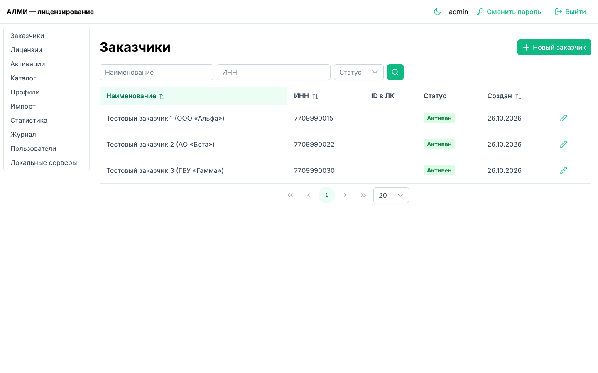

Экран «Заказчики» — список с фильтрами по наименованию, ИНН и статусу. Колонки: наименование, ИНН, идентификатор в личном кабинете (ЛК), статус, дата создания. Список сортируется щелчком по заголовку колонки.

**Создать заказчика.** Нажмите «Новый заказчик» и заполните форму:
- наименование;
- ИНН: 10 цифр для организации или 12 для ИП. Контрольная сумма проверяется, ИНН не может повторяться;
- идентификатор в ЛК — необязательно, заполняется при импорте.

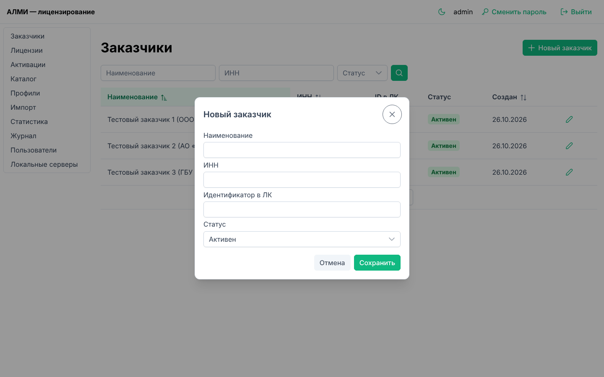

**Изменить** — кнопка «Изменить» в строке. Заказчик в статусе «В архиве» остаётся в отчётах и журнале, но новые лицензии на него не создаются.

Менеджер заказчика из ЛК показывается продукту АльтерОфис Web в поле «Менеджер» раздела «Поддержка».

## 4. Лицензии: список и карточка

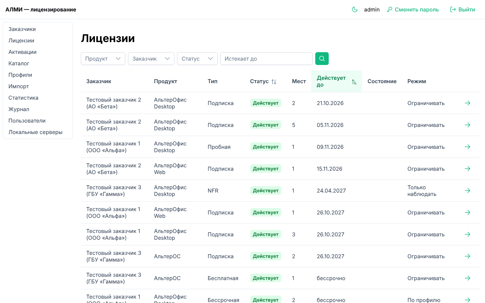

Экран «Лицензии» — список с фильтрами: продукт, заказчик, статус, «Истекает до». Колонки:
- заказчик, продукт, тип;
- статус: «Действует», «Приостановлена», «Отозвана»;
- число мест, «Действует до»;
- режим;
- **состояние** — что сейчас видит продукт. Состояние пересчитывается ежечасно.

| Состояние | Значение |
|---|---|
| Активна | Всё работает |
| Скоро истекает | NOTICE: до срока меньше, чем «Уведомлять за» в профиле (по умолчанию 30 дней) |
| Отсрочка | GRACE: срок прошёл, продукт работает без ограничений ещё «Льготный период» дней (по умолчанию 14) |
| Ограничена | RESTRICTED: отключены «Отключаемые функции» профиля, например макросы и совместная работа; документы доступны |
| Заблокирована | BLOCKED: режим блока профиля, например «только просмотр» |
| Отозвана | REVOKED |

«Открыть» в строке открывает карточку лицензии.

### Карточка лицензии

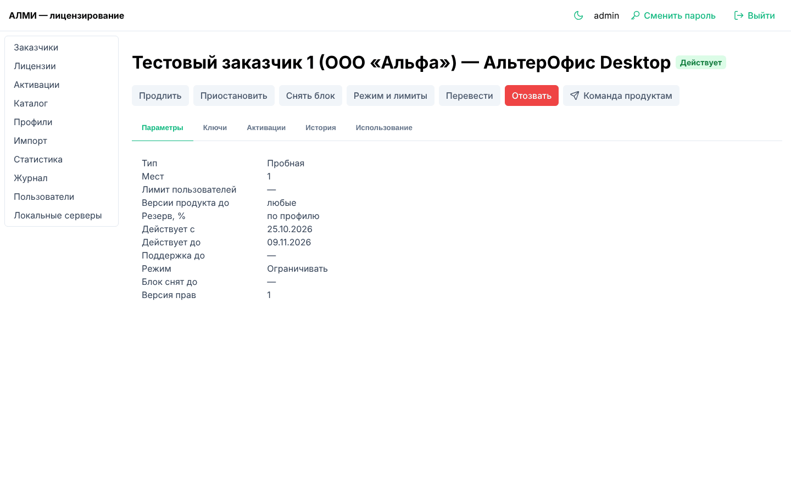

В заголовке — заказчик, продукт и статус. Под ним кнопки действий (раздел 5). Карточка состоит из пяти вкладок.

**Параметры.**
- Тип, мест, лимит пользователей (для АльтерОфис Web).
- «Версии продукта до» — старшая версия продукта по лицензии (раздел 5.6).
- Резерв, сроки действия и поддержки.
- Режим и «Блок снят до».
- Версия прав: растёт при каждом продлении и снятии блока.

**Ключи** — маски выпущенных ключей и кнопка «Выпустить ключ».

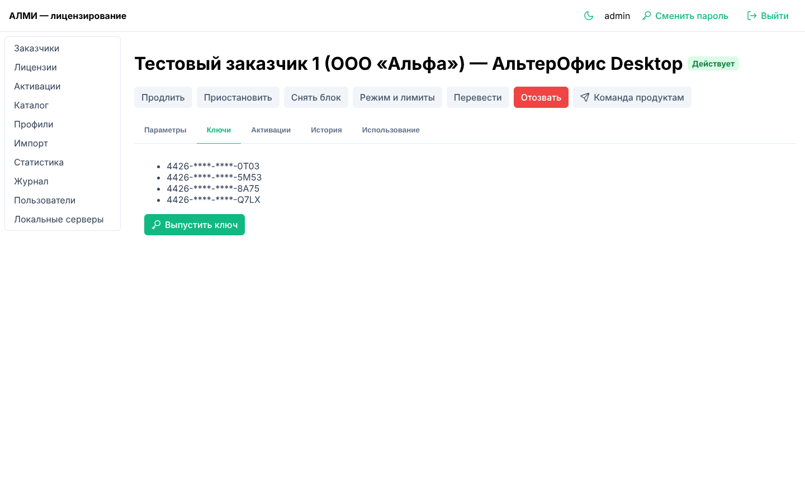

Новый ключ показывается **один раз**. Скопируйте его и передайте заказчику по защищённому каналу. Сервер хранит только хэш и маску: восстановить ключ потом нельзя, можно только выпустить новый.

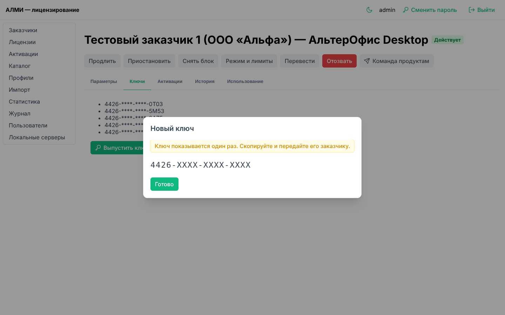

**Активации** — активации этой лицензии: компьютер, версия продукта, статус, последний контакт.

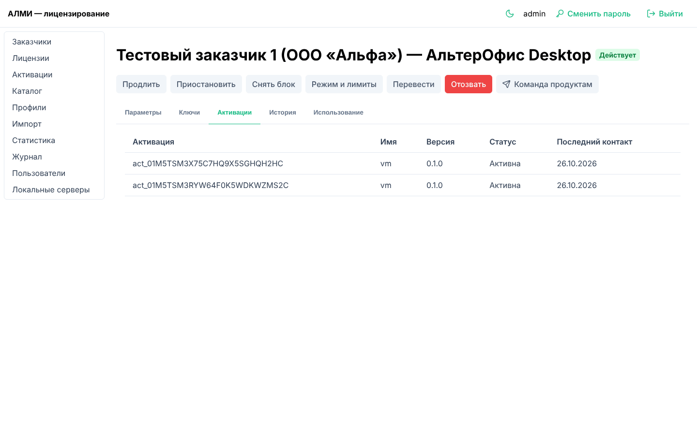

**История** — все изменения лицензии из журнала аудита: кто, когда, что.

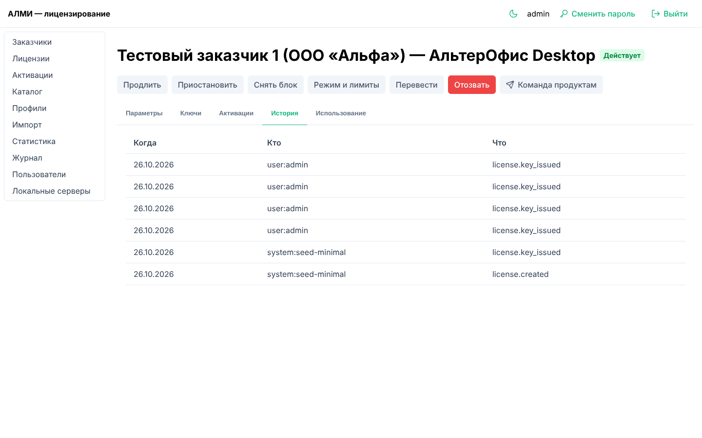

**Использование:**
- занято мест и в резерве;
- освобождено автоматически;
- конфликты;
- последний контакт;
- распределение по версиям продукта и ОС.

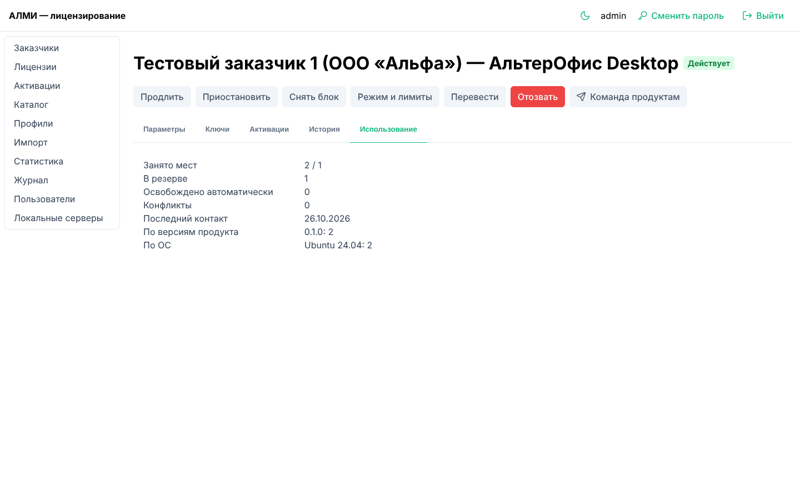

## 5. Действия с лицензией

Все действия выполняются кнопками в карточке и записываются в журнал. Продукт узнаёт об изменениях при следующей проверке — по умолчанию раз в 24 часа. Чтобы продукт узнал раньше, отправьте ему команду «Проверить немедленно» (раздел 6.2).

### 5.1. Продлить

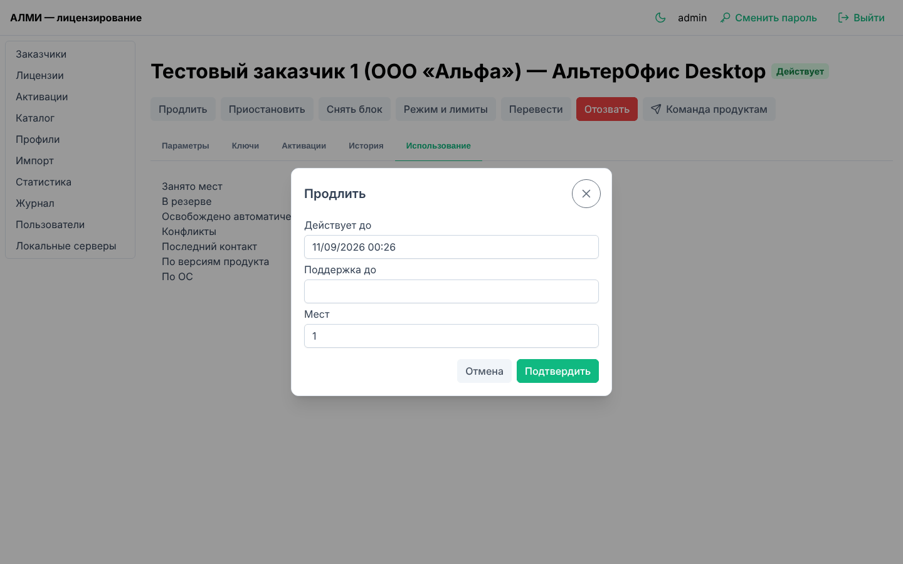

Новые «Действует до» и «Поддержка до» и, при необходимости, новое число мест. Пустое «Действует до» делает лицензию бессрочной. Продление снимает отсрочку и ограничения при следующей проверке продукта.

### 5.2. Режим и лимиты

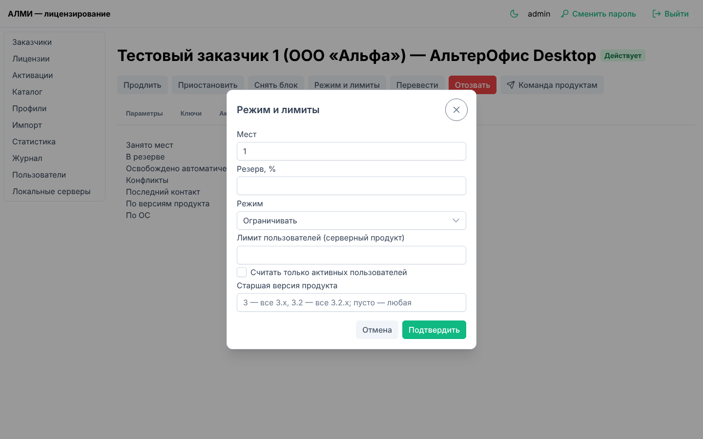

| Поле | Значение |
|---|---|
| Мест | Лимит активаций; резерв считается от него |
| Резерв, % | Пусто — по профилю (3 %) |
| Режим | «По профилю», «Ограничивать» (`enforce`) или «Только наблюдать» (`monitor`) |
| Лимит пользователей | Для АльтерОфис Web: число пользователей Nextcloud |
| Считать только активных | Для АльтерОфис Web: лимит сравнивается с числом активных пользователей, а не всех |
| Старшая версия продукта | `3` — разрешены все версии 3.x, `3.2` — все 3.2.x, пусто — любая. Активация более новой версии получает отказ «Версия продукта не поддерживается лицензией» (раздел 5.6) |

### 5.3. Снять блок

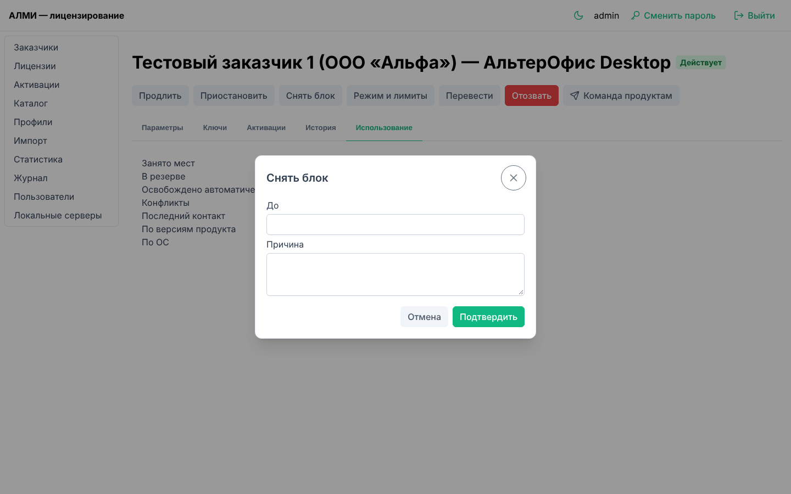

Переводит лицензию в режим наблюдения до выбранной даты. Ограничения не применяются, продукт работает полностью. Используйте, когда оплата задерживается по согласованию или когда блок поставлен по ошибке. Обязательно укажите причину.

### 5.4. Приостановить и возобновить

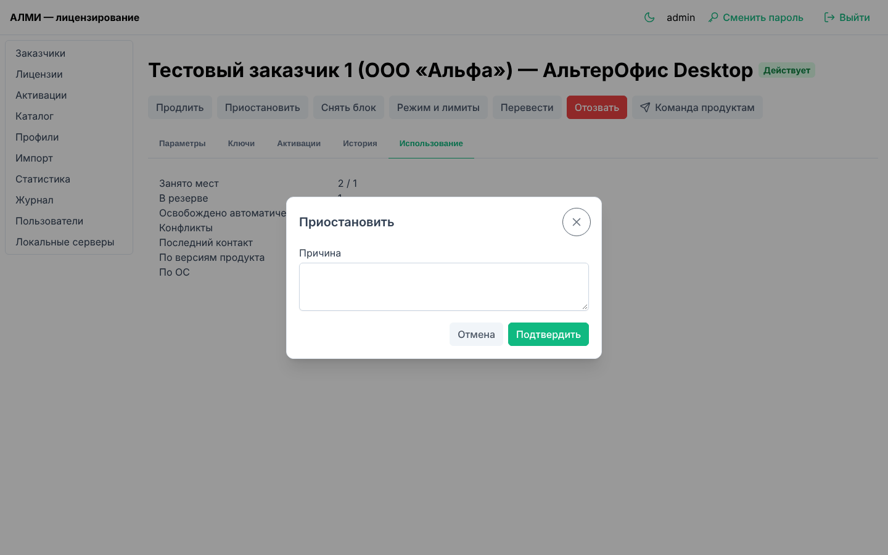

Временный запрет с причиной. «Возобновить» снимает его.

### 5.5. Перевести и отозвать

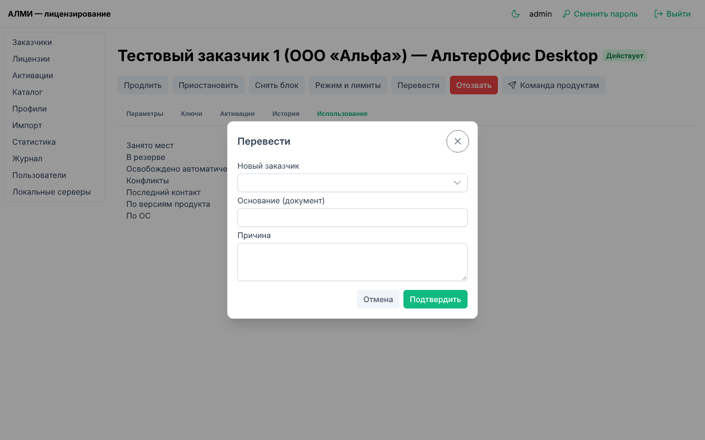

«Перевести» передаёт лицензию другому заказчику вместе с ключами, активациями и сроками. Нужны причина и основание (документ). Если часть мест передана локальному серверу, перевод не выполняется: сначала верните места.

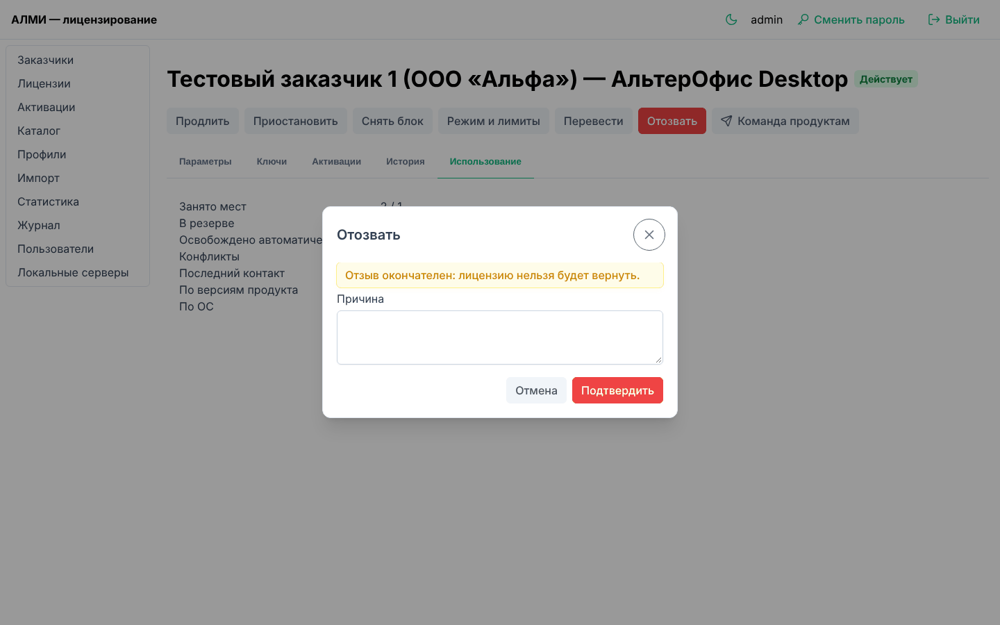

«Отозвать» действует **окончательно**: лицензию нельзя вернуть, продукт перейдёт в состояние «Лицензия отозвана». Для временных мер используйте «Приостановить».

### 5.6. Старшая версия продукта

Используйте для бессрочной лицензии, купленной на определённую версию, например «АльтерОфис 3». Задайте `3` в «Режим и лимиты». Тогда:
- компьютеры с версиями 3.x активируются как обычно;
- версия 4.0 и новее получает отказ, продукт показывает пользователю «Версия продукта не поддерживается лицензией»;
- уже активированные компьютеры продолжают работать.

Отказы учитываются в статистике. Ограничение действует на центральном сервере; на локальных серверах оно пока не применяется (раздел 17).

### 5.7. Команда всем активациям лицензии

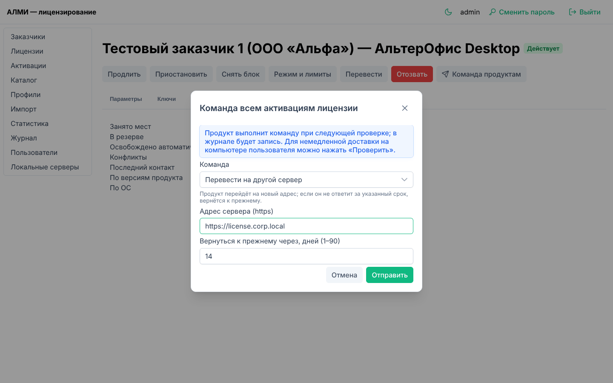

Кнопка «Команда продуктам» ставит одну команду в очередь каждой активной активации лицензии. Типичный случай — перевод заказчика на его локальный сервер: команда «Перевести на другой сервер» с адресом локального сервера. Виды команд — в разделе 6.2.

## 6. Активации и команды продуктам

### 6.1. Список активаций

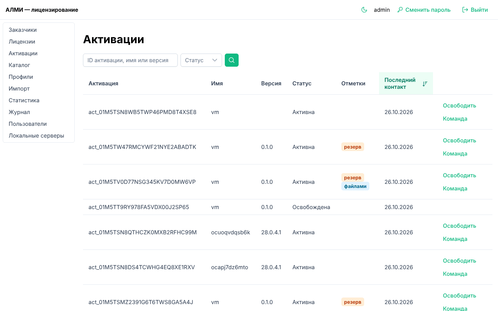

Экран «Активации»: поиск по ID активации, имени компьютера или версии продукта, фильтр по статусу. Отметки в строке:
- «резерв» — занято место из резерва;
- «файлами» — активация через офлайн-портал;
- «конфликт» — тот же экземпляр продукта появился на другом компьютере (клон). Активная запись при этом не меняется: сверьте имя и последний контакт и решите, какую оставить.

Статусы:
- «Активна»;
- «Освобождена»;
- «Освобождена автоматически» — продукт не выходил на связь дольше, чем «Освобождать место через» в профиле (по умолчанию 30 дней);
- «Отозвана»;
- «Конфликт».

**Освободить место.** Кнопка «Освободить» в строке; укажите причину. Продукт узнает об этом при следующей проверке и перейдёт в режим без лицензии. Пользователь сможет активировать продукт снова, если есть свободное место.

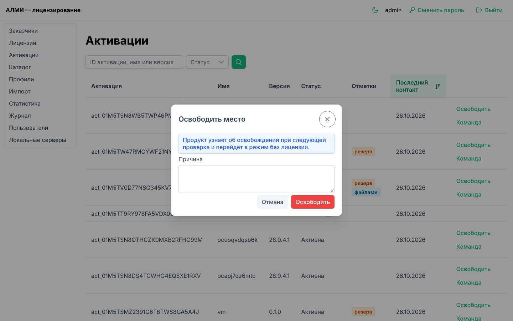

### 6.2. Команды продукту

Кнопка «Команда» в строке активации ставит команду в очередь этой активации. Продукт получает её при следующей проверке, выполняет и сообщает о выполнении. Неподдерживаемая команда записывается в журнал как `directive.unsupported`.

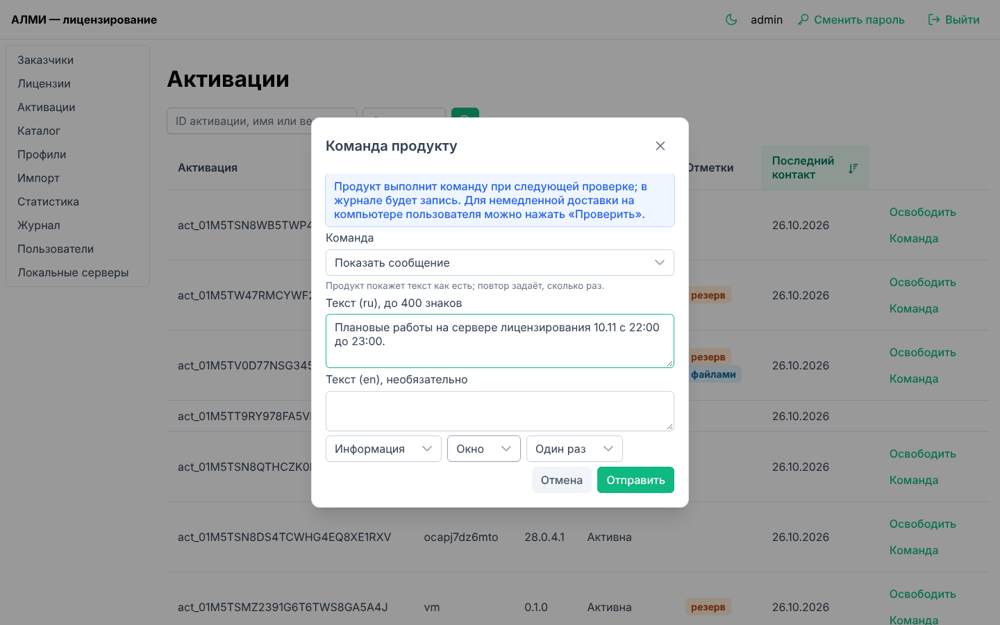

| Команда | Что сделает продукт | Параметры |
|---|---|---|
| Проверить немедленно | Сразу выполнит ещё одну проверку и получит новую аренду | — |
| Обновить доверенные ключи | Запросит пакет доверия и применит отзыв ключей | — |
| Изменить период проверки | Будет проверять лицензию с этим периодом вместо периода профиля | Часы, 1–720 |
| Показать сообщение | Покажет текст как есть | Текст ru (до 400 знаков), en, важность, место (баннер, окно, «О программе», уведомление), повтор (один раз, раз в день, при каждом запуске) |
| Перевести на другой сервер | Будет обращаться по новому адресу; если тот не ответит за указанный срок, вернётся к прежнему | Адрес `https://…`, срок возврата 1–90 дней |
| Перепривязать к компьютеру | Повторно активируется с текущим отпечатком компьютера | Причина |
| Освободить место | Сам освободит место и перейдёт в режим без лицензии | Причина |

Команда ждёт следующей проверки — по умолчанию до 24 часов. Пользователь может ускорить доставку кнопкой «Проверить» в окне лицензии продукта.

## 7. Импорт выгрузки личного кабинета

Экран «Импорт» загружает лицензии из XLSX-выгрузки ЛК в пять шагов: загрузка, предпросмотр, сопоставление, подтверждение, отчёт.

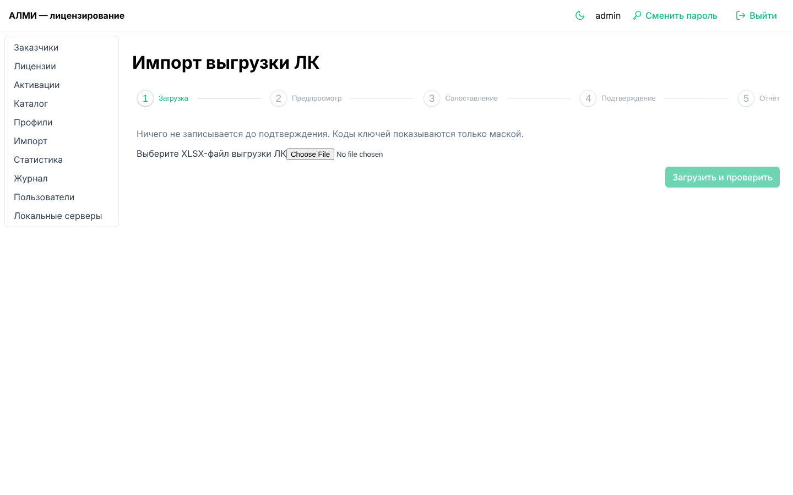

1. **Загрузка.** Выберите файл и нажмите «Загрузить и проверить». До подтверждения ничего не записывается; ключи показываются только маской.
2. **Предпросмотр.** Сводка «Новые», «Изменения», «Без изменений», «Ошибки» и таблица строк. У каждой ошибки указаны номер строки и причина. Фильтр «Показать» отбирает строки одного статуса.

   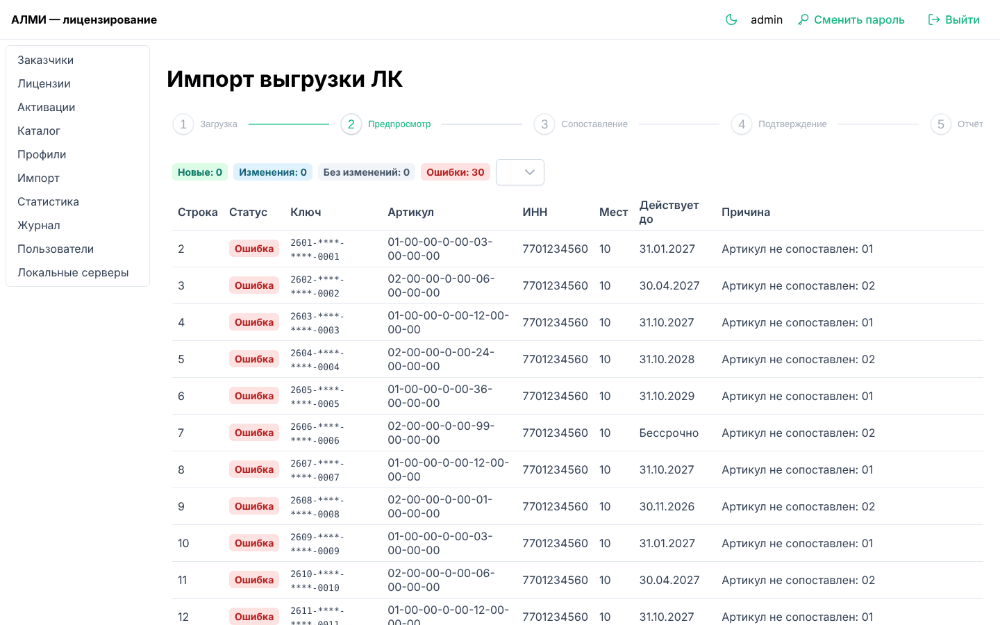

3. **Сопоставление.** Каждому значению поля AA артикула назначаются продукт, редакция и метрика. Сопоставления сохраняются и применяются к следующим выгрузкам. Строки с несопоставленными артикулами не импортируются. После сохранения нажмите «Проверить файл заново».

   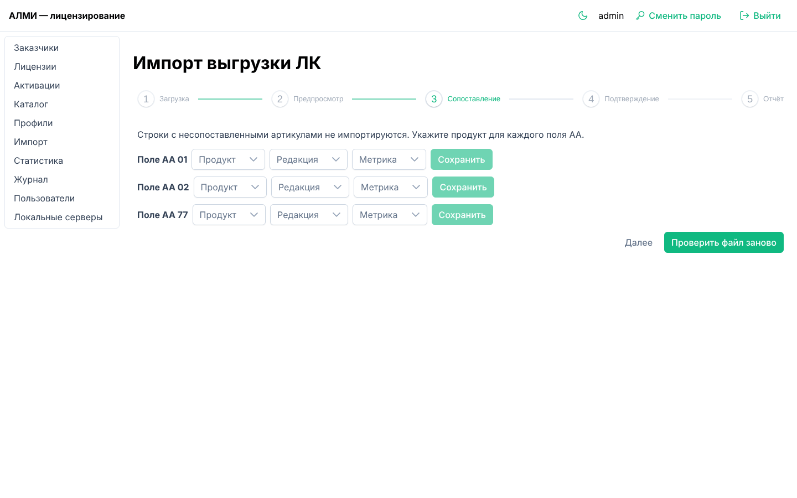

4. **Подтверждение.** Консоль показывает, сколько будет создано, изменено и пропущено. Нажмите «Подтвердить импорт».
5. **Отчёт.** Создано лицензий, изменено, пропущено, новых заказчиков, строк с ошибками.

Повторный импорт того же файла ничего не меняет. Для тестового стенда реальную выгрузку обезличивают: `uv run --script tools/anonymize-lk.py выгрузка.xlsx выгрузка-anon.xlsx`.

## 8. Каталог и профили политик

### 8.1. Каталог

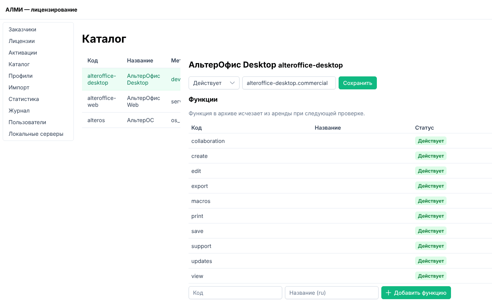

«Каталог» — продукты, редакции, функции и метрики. Начальный каталог загружается при установке:

| Продукт | Код | Редакции | Метрика |
|---|---|---|---|
| АльтерОфис Desktop | `alteroffice-desktop` | standard, professional (макросы, совместная работа) | устройство |
| АльтерОфис Web | `alteroffice-web` | enterprise | экземпляр сервера |
| АльтерОС | `alteros` | workstation | узел ОС |

Функция, переведённая в архив («В архив»), исчезает из аренды при следующей проверке. Новые функции добавляются только вместе с поддержкой в продукте (документ 4, раздел 7).

### 8.2. Профили

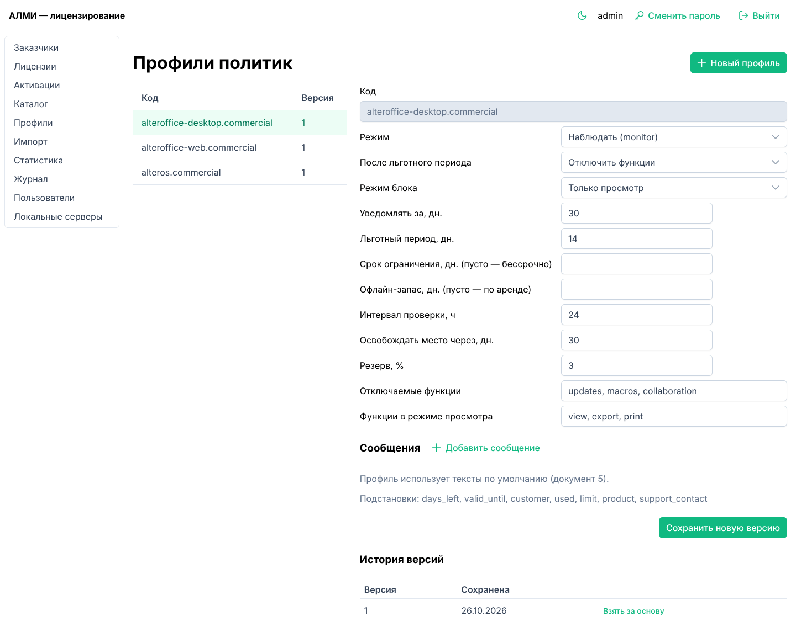

«Профили» — политики по продуктам (`<продукт>.<класс>`). Сохранение создаёт **новую версию**: аренды ссылаются на свою версию, история хранится, и любую прежнюю версию можно «Взять за основу».

| Параметр | Значение |
|---|---|
| Режим | `enforce` или `monitor` |
| Уведомлять за, дн. | Когда начинается «Скоро истекает» |
| Льготный период, дн. | Длительность отсрочки после срока |
| После льготного периода | Ничего не отключать, отключить функции или блок |
| Отключаемые функции | Коды функций через запятую, например `updates, macros, collaboration` |
| Срок ограничения, дн. | Пусто — бессрочно; иначе после него блок |
| Режим блока | «Только просмотр» или «Не запускать» |
| Функции в режиме просмотра | Что остаётся при блоке, например `view, export, print` |
| Офлайн-запас, дн. | Сколько продукт работает без связи; пусто — по аренде |
| Интервал проверки, ч | Как часто продукт обращается к серверу |
| Освобождать место через, дн. | Автоосвобождение молчащих активаций |
| Резерв, % | Резерв мест по умолчанию |

В разделе «Сообщения» задаются тексты сообщений продукту (ru и en) с предпросмотром подстановок `{days_left}`, `{valid_until}`, `{customer}` и других по документу 5. Число дней склоняется автоматически: «1 день», «3 дня», «11 дней». Неизвестная подстановка подсвечивается. Пустой раздел означает тексты по умолчанию.

На выпуске 1.0 все профили в режиме `monitor`. Перевод в `enforce` — решение владельца продукта после периода наблюдения.

## 9. Офлайн-активация через портал

Для компьютеров без доступа к серверу. Портал публичный, вход не нужен: `https://<сервер>/offline`.

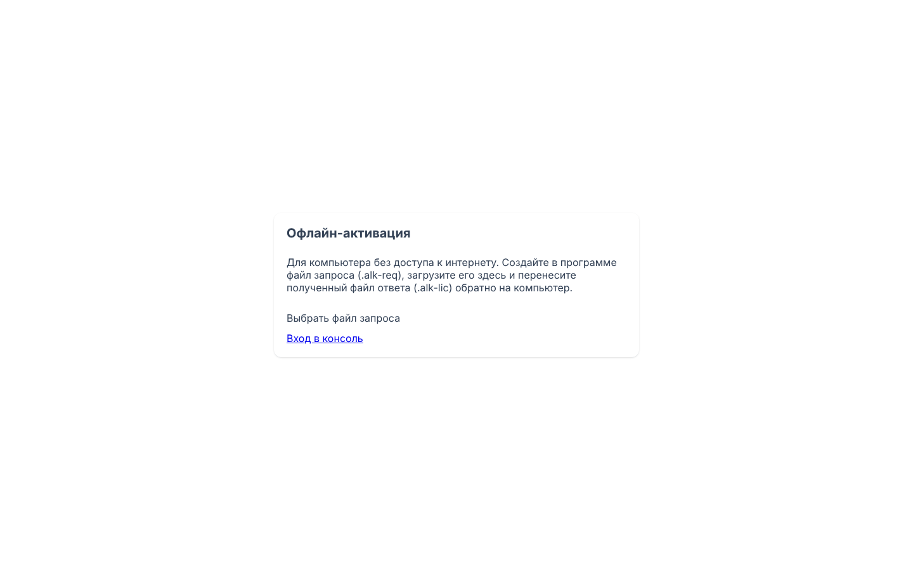

1. Пользователь создаёт в продукте файл запроса `.alk-req` — в окне лицензии продукта; в прототипе это команда `license offline-request`.
2. Переносит файл на компьютер с интернетом и загружает на портале кнопкой «Выбрать файл запроса».
3. Портал сразу скачивает файл ответа `.alk-lic`. Пользователь переносит его обратно и применяет в продукте.

   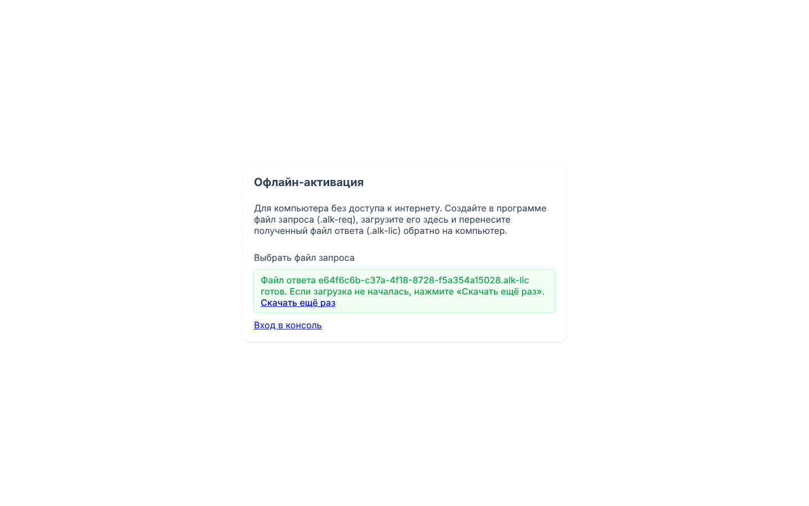

После нескольких запросов с одного адреса портал просит ввести символы с картинки (капча).

Продление и освобождение места делаются так же, файлами запросов на продление и освобождение. Офлайн-активация занимает место как обычная и отмечена в списке активаций «файлами».

## 10. Локальные серверы (центральный сервер)

Локальный сервер стоит в сети заказчика и выдаёт аренды его продуктам без обращения к центральному серверу. Подходит для закрытых контуров. Оператор АЛМИ выделяет ему места из лицензий заказчика.

### 10.1. Создать локальный сервер

1. «Новый сервер»: выберите заказчика, введите название и число мест по каждой лицензии. Эти места на центральном сервере больше не выдаются.

   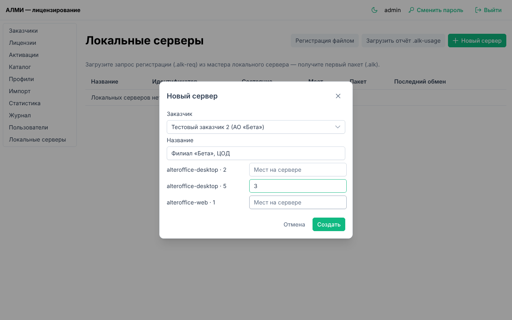

2. Консоль показывает **код регистрации** — один раз; он действует 7 дней. Передайте его администратору заказчика. Кнопка «Новый код» в строке сервера выпускает замену.

   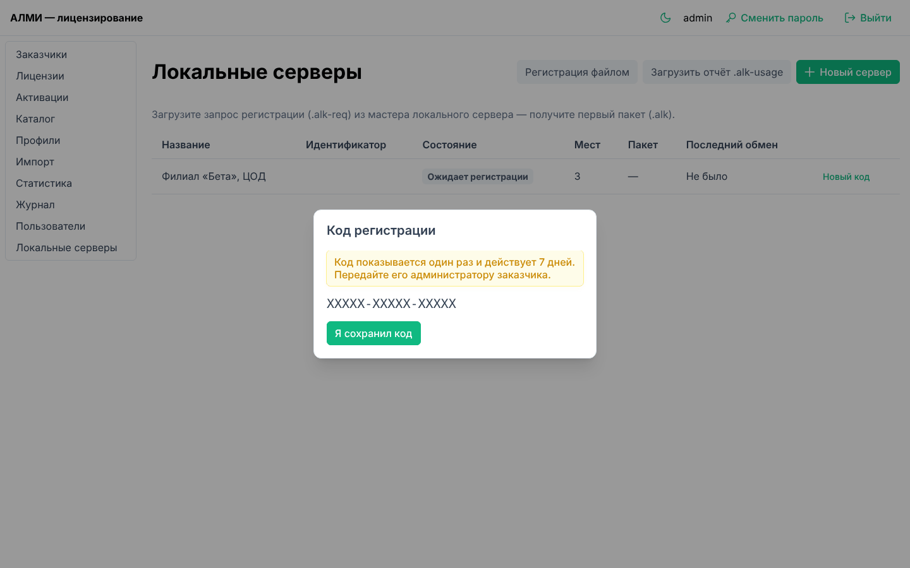

### 10.2. Регистрация и обмен

- **По сети.** Администратор заказчика вводит код в мастере локального сервера с адресом центрального. Сервер регистрируется сам и получает пакет прав `.alk`. Затем пакеты и отчёты ходят автоматически.
- **Файлами** (закрытый контур):
  1. Администратор заказчика присылает файл запроса `.alk-req` из мастера (раздел 11.1).
  2. Оператор нажимает «Регистрация файлом» и выбирает файл. Консоль скачивает первый пакет `.alk` — его нужно передать администратору.
  3. Отчёты об использовании `.alk-usage` от локального сервера загружаются кнопкой «Загрузить отчёт .alk-usage». Квитанция о приёме уходит с ближайшим пакетом.

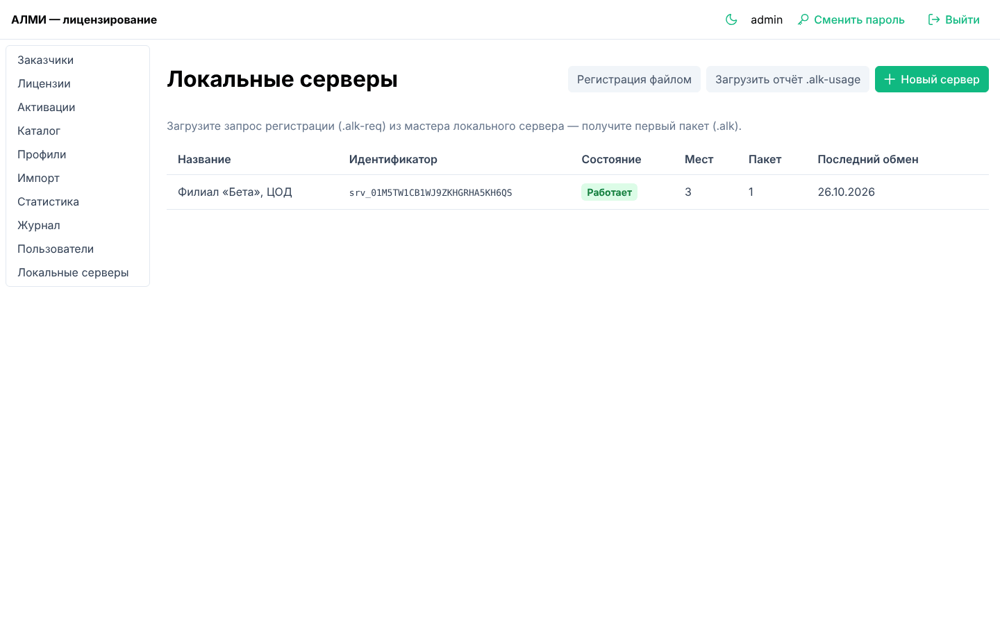

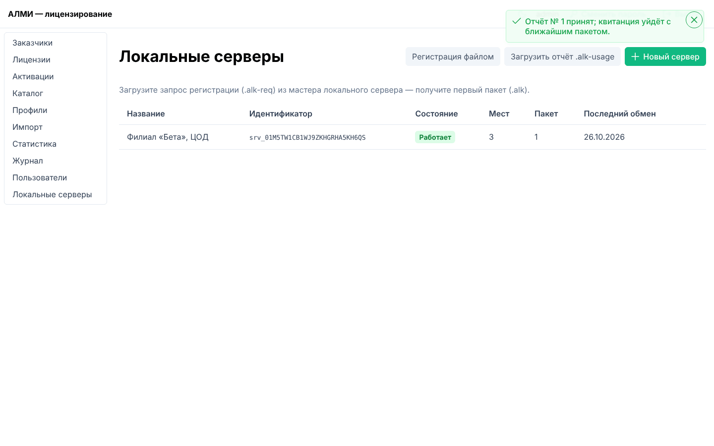

Состояния сервера:
- «Ожидает регистрации»;
- «Работает»;
- «Отключён».

Колонка «Пакет» показывает номер последнего пакета, отметка «Пакет истекает …» предупреждает о сроке пакета.

## 11. Консоль локального сервера

На локальном сервере консоль та же, но без каталога, профилей, импорта и выпуска ключей. Лицензии и сроки приходят в пакете с центрального сервера.

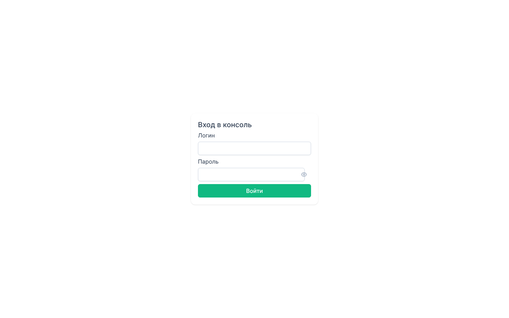

### 11.1. Мастер первого запуска

Доступен только администратору; открывается сам, пока сервер не зарегистрирован.

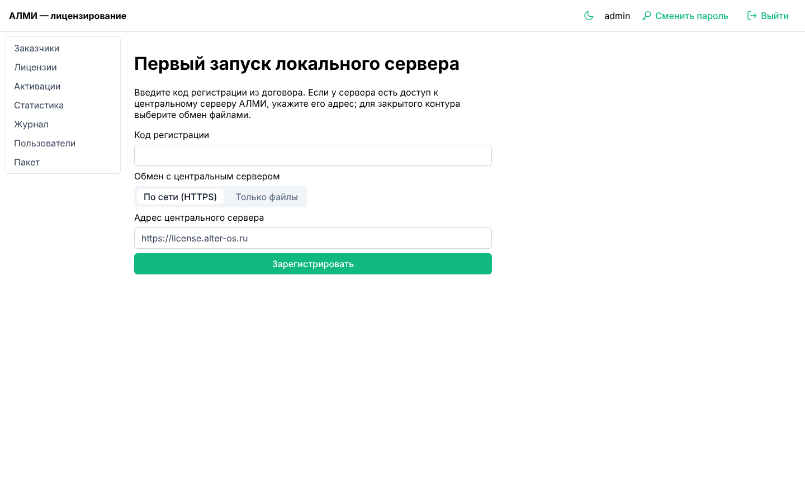

1. Введите код регистрации, полученный от оператора АЛМИ.
2. Выберите обмен:
   - **«По сети (HTTPS)»** — укажите адрес центрального сервера, например `https://license.alter-os.ru`;
   - **«Только файлы»** — для закрытого контура.

   

3. Нажмите «Зарегистрировать». При обмене файлами браузер сохранит файл запроса `.alk-req` — передайте его оператору АЛМИ и загрузите полученный пакет на экране «Пакет».

   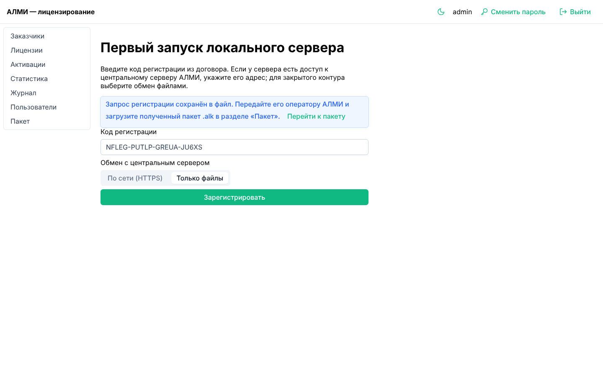

### 11.2. Пакет прав

Экран «Пакет» показывает:
- идентификатор сервера;
- способ обмена;
- номер пакета и дату выпуска;
- срок действия пакета;
- состояние отчётов об использовании: сколько отправлено и сколько подтверждено.

Действия:
- **«Загрузить пакет .alk»** — новый пакет от оператора. Пакет с тем же или меньшим номером не принимается.
- **«Проверить обновление»** (обмен по сети) — запросить новый пакет сразу.
- **«Сформировать отчёт»** — сохранить отчёт `.alk-usage` для оператора АЛМИ. По сети отчёт уходит сам раз в сутки.

За 30 дней до окончания пакета консоль предупреждает. После окончания лицензии работают по правилам пакета: отсрочка 30 дней, затем ограничение.

Продукты заказчика указывают адрес локального сервера и активируются на нём так же, как на центральном. Аренды подписывает ключ локального сервера. Перевести уже активированные продукты на локальный сервер можно командой «Перевести на другой сервер» (раздел 5.7).

## 12. Статистика

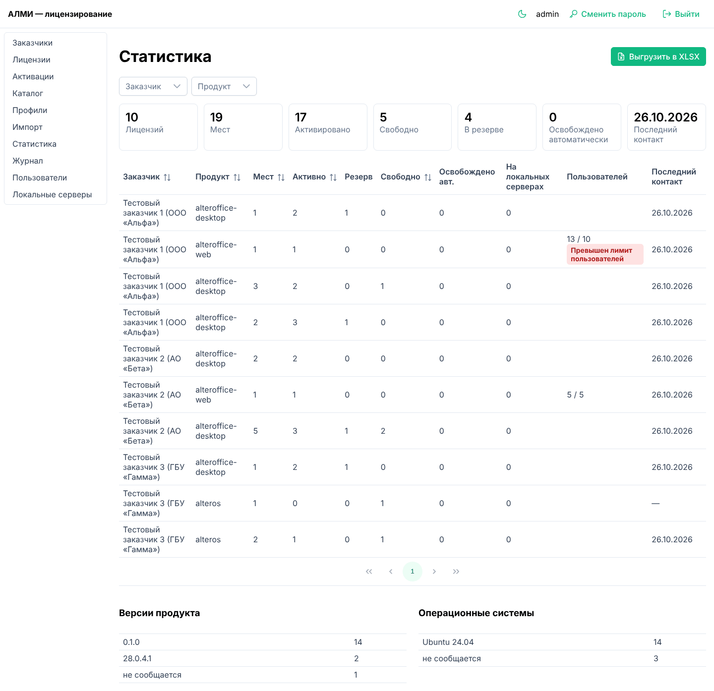

Фильтры — заказчик и продукт. Плитки:
- лицензий;
- мест;
- активировано;
- свободно;
- в резерве;
- освобождено автоматически;
- последний контакт.

В таблице — те же данные по каждой лицензии и места на локальных серверах. Для АльтерОфис Web добавлены пользователи и отметка «Превышен лимит пользователей». Ниже — распределение по версиям продукта и ОС. Продукты, которые версию или ОС не сообщают, учитываются как «не сообщается».

«Выгрузить в XLSX» создаёт файл с листами «Сводка» и «Активации» (до 100 000 строк). Время в файле указано в UTC.

## 13. Журнал аудита

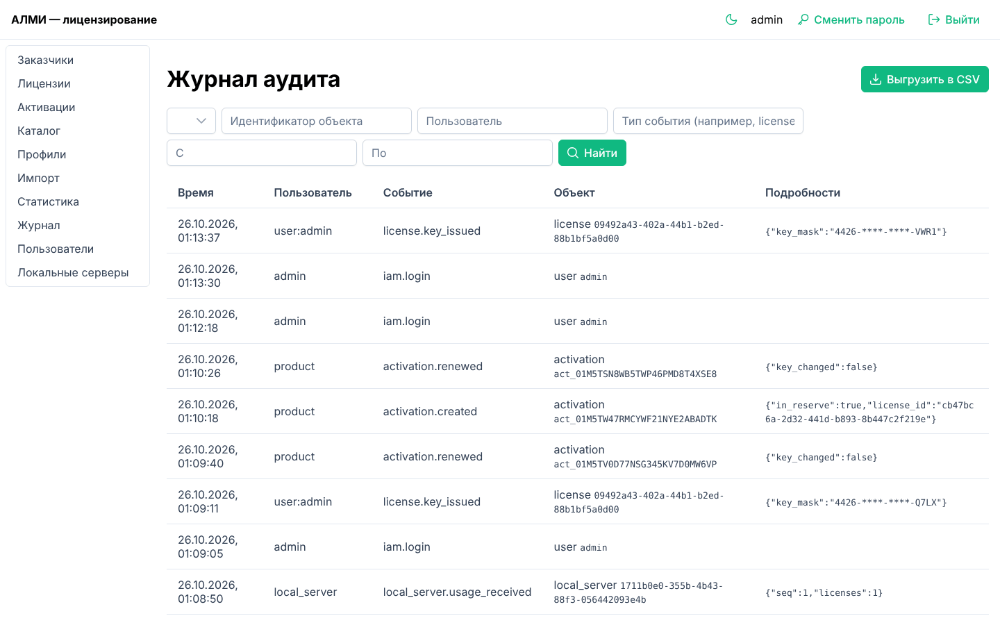

Фильтры:
- объект: лицензия, активация, заказчик, пользователь, локальный сервер, продукт, профиль, импорт, артикул;
- идентификатор объекта;
- пользователь;
- тип события — начало имени, например `license.` или `directive.`;
- период.

«Выгрузить в CSV» сохраняет найденное.

Записи журнала нельзя изменить или удалить. Их целостность проверяет цепочка хэшей (`manage.py verify_audit`, `docs/deployment.md`, раздел 6). Примеры событий: `license.created`, `license.renewed`, `license.key_issued`, `activation.created`, `activation.released`, `directive.queued`, `directive.unsupported`, `iam.account_created`.

## 14. Пользователи консоли

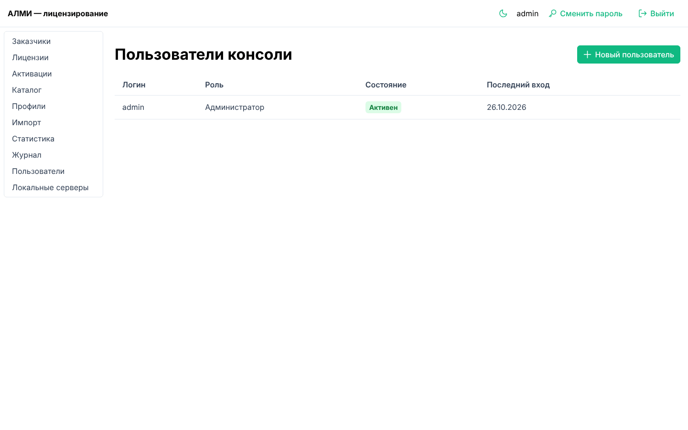

Экран доступен администратору.
- **«Новый пользователь»:** логин и роль, для роли «Просмотр заказчика» — также заказчик. Консоль показывает временный пароль **один раз**; передайте его по защищённому каналу. При первом входе пользователь задаст свой пароль.

  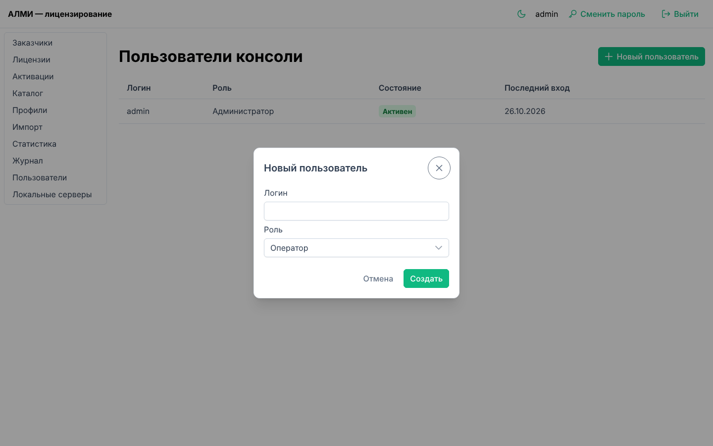

- **«Заблокировать» / «Разблокировать»** — вход запрещён, сеанс завершится при следующем запросе.
- **«Сбросить пароль»** — новый временный пароль; текущие сеансы пользователя завершаются, блокировка входа снимается.

Первая учётная запись администратора создаётся при установке сервера (`docs/deployment.md`, шаг 6).

## 15. Типовые задачи и что делать, если…

| Задача или ситуация | Действие |
|---|---|
| Новый заказчик купил АльтерОфис | 1. «Заказчики» → «Новый заказчик». 2. Создать лицензию или импортировать выгрузку ЛК. 3. «Ключи» → «Выпустить ключ», передать заказчику |
| Заказчик сменил компьютер, места нет | «Активации» → «Освободить» на старом компьютере; новый активируется. Или подождите автоосвобождения (30 дней) |
| Заказчик потерял ключ | «Выпустить ключ» и передать новый. Старый ключ продолжает действовать: отдельно ключ не отзывается (раздел 17) |
| Конфликт активации (клон) | Сверьте имя и последний контакт; освободите лишнюю запись |
| Продление оплачено, продукт ещё показывает срок | «Продлить»; для немедленного эффекта — команда «Проверить немедленно» всем активациям |
| Продукт ограничен по ошибке | «Снять блок» до нужной даты, затем исправьте условия |
| Нужно предупредить пользователей о работах | Команда «Показать сообщение» всем активациям лицензии (раздел 5.7) |
| Заказчик переходит на свой локальный сервер | Раздел 10, затем команда «Перевести на другой сервер» с адресом локального сервера |
| Заканчивается пакет локального сервера | Продлите лицензии; при обмене файлами передайте администратору новый пакет |
| Пользователь не может войти | «Пользователи» → «Разблокировать» или «Сбросить пароль» |
| Обновить снимки этого руководства | `make screenshots` на пробном сервере (`docs/deployment.md`, раздел 5) |

## 16. Справочник состояний, сообщений и кодов

**Что видит пользователь продукта** (тексты по умолчанию, документ 5):

| Состояние продукта | Пример сообщения |
|---|---|
| Пробный период | «Пробный период: осталось 30 дней.» |
| Скоро истекает | «Лицензия действует до 05.11.2026. Осталось 10 дней.» |
| Отсрочка | «Срок лицензии истёк 20.10.2026. Продукт работает без ограничений ещё 9 дней.» |
| Ограничена | Функции профиля недоступны, документы открываются |
| Отозвана | «Лицензия отозвана. Обратитесь к администратору.» |

**Отказы при активации**:

| Код | Сообщение пользователю | Что проверить в консоли |
|---|---|---|
| `key_not_found` | «Ключ не найден…» | Ключ выпускался для этой лицензии? |
| `invalid_key_format` | «Ключ введён неверно…» | Опечатка в ключе |
| `product_mismatch` | «Этот ключ предназначен для другого продукта или редакции» | Продукт и редакция лицензии |
| `license_expired` | «Срок действия этой лицензии истёк…» | «Продлить» |
| `license_revoked` | «Лицензия отозвана…» | Статус лицензии |
| `seats_exhausted` | «Все лицензии по этому ключу уже используются (3 из 3)…» | «Активации»: освободить место или увеличить «Мест» |
| `unsupported_product_version` | «Версия продукта не поддерживается лицензией» | «Режим и лимиты» → «Старшая версия продукта» |
| `instance_conflict` | «Этот компьютер похож на копию уже активированного…» | Отметка «конфликт» в «Активациях» |

## 17. Расхождения со спецификациями

1. Документ 2, раздел 10: активация по телефону отнесена к этапу 2; модуль отвечает `LM_ERR_UNSUPPORTED`.
2. Документ 2, раздел 11.1: для АльтерОфис Web на этапе 1 превышение пользователей и окончание срока — только уведомления приложения `support`. Сервер ограничений не накладывает, консоль показывает «Превышен лимит пользователей».
3. Конкурентные места (`seats:*`) и Integration API для ЛК — этап 2 по контракту, не реализованы.
4. Отдельный ключ лицензии нельзя отозвать — только всю лицензию. Утечку ключа сдерживают лимит мест и журнал активаций.
5. Старшая версия продукта (422 `unsupported_product_version`) — поле лицензии введено в версии 0.6.1. В спецификации источник ограничения не определён, на локальных серверах ограничение пока не применяется (пакет его не несёт).
6. Экспорт журнала — CSV, статистики — XLSX: формат журнала в спецификации не задан.
